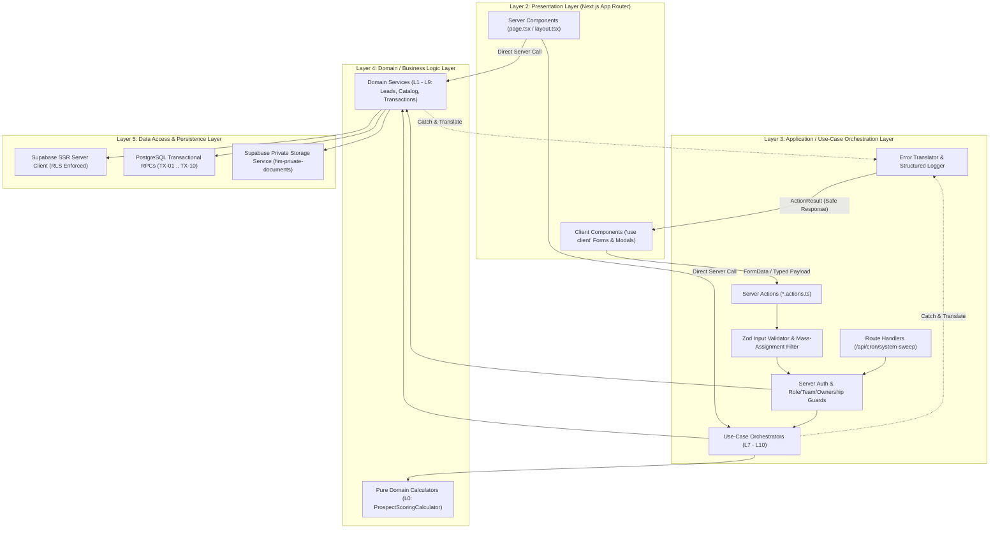

# FIM-Property Backend Application Layer Implementation

* **Nama File:** `FIM-PROPERTY_IMPLEMENTATION_06_APPLICATION_BACKEND_v1.1.md`
* **Versi Dokumen:** `1.1`
* **Tujuan Dokumen:** Menjadi pedoman implementasi teknis lengkap dan siap pakai (*runnable TypeScript source code*) untuk membangun seluruh **Backend Application Layer** (**Layer 3: Application/Use-Case Orchestration & Server Actions**, **Layer 4: Pure Domain Logic & Calculators**, dan **Layer 5: Data Access Repositories, RPC Invocations & Storage Integration**) pada proyek **FIM-Property CRM** di atas **Next.js App Router**.
* **Ruang Lingkup:**
  1. Arsitektur interaksi antar-layer (Server Components, Client Components, Server Actions, Service Layer, Domain Calculators, Transactional RPCs, dan Private Storage).
  2. Standarisasi penanganan error (`AppError`, `ActionResult<T>`, dan penerjemah kode error PostgreSQL/RPC/Storage yang aman).
  3. Sistem *Production Logging* terstruktur dengan `correlationId` dan penyensoran data sensitif (*PII/Secret Redaction*).
  4. Skema validasi input sisi server menggunakan **Zod** untuk seluruh domain (Identity, Catalog, CRM, Booking, Payment, KPR, Deal, dan Storage).
  5. Implementasi **Pure Prospect Scoring Calculator ($L_0$)** dan **Prospect Scoring Use-Case ($L_7$)** sesuai matriks 4 indikator `OQ-04`.
  6. Implementasi **Service Layer** dan **Server Actions** untuk seluruh modul operasional dengan mematuhi *Strict Topological DAG* ($L_0 \dots L_{11}$).
  7. Integrasi pemanggilan **10 Transactional RPC (`TX-01` s/d `TX-10`)**, integrasi **Supabase Private Storage** beserta *compensating cleanup* & pra-cek validasi, *Hybrid Reminder & Outbox Sweep Engine*, serta layanan agregasi **Kamus Metrik Standar**.
* **Referensi Dokumen:**
  1. `FIM-PROPERTY_MASTER_BUSINESS_DISCOVERY_v1.2_FINAL.md`
  2. `FIM-PROPERTY_PHASE_1A_SYSTEM_ARCHITECTURE_v1.2.md`
  3. `FIM-PROPERTY_PHASE_1B_DATABASE_ARCHITECTURE_v1.1.md`
  4. `FIM-PROPERTY_IMPLEMENTATION_01_PROJECT_SETUP_v1.1.md`
  5. `FIM-PROPERTY_IMPLEMENTATION_02_DATABASE_MIGRATION_v1.4.md`
  6. `FIM-PROPERTY_IMPLEMENTATION_03_AUTH_SECURITY_RLS_v1.1.md`
  7. `FIM-PROPERTY_IMPLEMENTATION_04_TRANSACTIONAL_RPC_v1.3.md`
  8. `FIM-PROPERTY_IMPLEMENTATION_05_STORAGE_DOCUMENTS_v1.1.md`
* **Dependency terhadap File Lain:**
  * **Bergantung pada (Upstream):** File 01 `v1.1` (Setup, Env `KPR_SOLD_POLICY_MODE = 'TC-01A'`, `proxy.ts`), File 02 `v1.4` (**34 ENUM** termasuk `kpr_application_status_enum` & `follow_up_tasks.related_kpr_application_id`, dan **32 Tabel**), File 03 `v1.1` (Auth, Grants, **12 fungsi `app_security`**, **6 Trigger Guard**, & **80 Kebijakan RLS**), File 04 `v1.3` (**10 Transactional RPC `TX-01` s/d `TX-10`** beserta *Global Canonical Row-Locking DAG*), dan File 05 `v1.1` (Bucket `fim-private-documents`, Validator Storage, & `isValidStorageObjectPath()`).
  * **Menjadi Prasyarat bagi (Downstream):** Implementasi antarmuka pengguna (*Frontend UI Components & Pages*) serta pengujian integrasi *end-to-end*.
* **Status Eksekusi:** Seluruh kode TypeScript dalam dokumen ini telah disusun secara lengkap tanpa pseudocode dan selaras penuh secara statis dengan File 01 `v1.1`, File 02 `v1.4`, File 03 `v1.1`, File 04 `v1.3`, serta File 05 `v1.1`, namun **belum dieksekusi di runtime Next.js / PostgreSQL lokal Anda**.

---

## 1. Tujuan dan Ruang Lingkup

Dokumen ini menjembatani fondasi database PostgreSQL/Supabase yang telah dibangun pada File 02–05 dengan antarmuka pengguna Next.js.

Dalam arsitektur **Modular Monolith FIM-Property** (satu perusahaan internal dengan 3 role: `ADMIN`, `SUPERVISOR`, `SALES`, tanpa multi-tenant dan tanpa Machine Learning), komponen tampilan (*Frontend UI*) **dilarang keras** menyusun query database mentah, menghitung skor prospek sendiri, atau mengubah status transaksi secara langsung. Seluruh operasi bisnis wajib melewati **Backend Application Layer** yang menegakkan:
1. **Validasi Input Sisi Server (*Zero Client Trust*):** Setiap payload yang dikirim dari browser divalidasi ulang menggunakan skema **Zod** dan daftar putih field (*field whitelisting* untuk mencegah *Mass Assignment*).
2. **Otorisasi Kontekstual Berlapis:** Memverifikasi sesi pengguna melalui `requireActionAuth()`, memeriksa cakupan tim (`assertTeamScopeAccess`), dan memeriksa kepemilikan baris data (`assertResourceOwnership`) sebelum memanggil layanan domain atau RPC.
3. **Kepatuhan Mutlak pada Transactional RPC:** Operasi multi-tabel (`TX-01` s/d `TX-10`) wajib dieksekusi melalui panggilan `.rpc()` tunggal, tidak pernah dipecah menjadi beberapa query `.from(...).update(...)` terpisah.
4. **Kepatuhan pada *Strict Topological DAG* ($L_0 \dots L_{11}$):** Tidak ada dua modul yang saling mengimpor secara melingkar (*zero circular dependency*).

---

## 2. Referensi

Implementasi kode pada dokumen ini diturunkan secara presisi dari:
* **`FIM-PROPERTY_MASTER_BUSINESS_DISCOVERY_v1.2_FINAL.md`:** Aturan bisnis `BR-01` s/d `BR-12`, rumus 4 indikator *Lead Scoring* (`OQ-04`), aturan *Price Freeze* (`BR-07`), *Anti-Double Counting Booking Fee* (`BR-06`), *Kebijakan C2 Cash Bertahap* (`PD-03`), eskalasi SLA verifikasi 24/48 jam (`PD-01`), pemantauan KPR hingga pencairan bank (tanpa pelacakan cicilan bulanan konsumen ke bank), serta **Kamus Metrik Standar** (Bagian 3.1).
* **`FIM-PROPERTY_PHASE_1A_SYSTEM_ARCHITECTURE_v1.2.md`:** Pembagian 5 Layer (Bagian 3) dan *Code Dependency Graph* 12 Level Topologis $L_0 \dots L_{11}$ (Bagian 5 & 6).
* **`FIM-PROPERTY_IMPLEMENTATION_01` (`v1.1`) s/d `05` (`v1.1`):** Nama tabel, kolom, **34 ENUM**, **12 fungsi `app_security`**, **6 trigger guard**, **80 kebijakan RLS**, **10 RPC (`TX-01` s/d `TX-10`)**, dan path bucket privat `fim-private-documents`.

### Ketetapan Kebijakan Bisnis Final: `TC-01A`
* **`TC-01A` (Titik Perubahan Status Unit `'SOLD'` pada KPR dengan Pencairan Bertahap):**
  Kebijakan telah **ditetapkan secara final (`TC-01A`)**: Unit hanya berubah menjadi `'SOLD'` ketika pencairan KPR mencapai **100% (`FULLY_DISBURSED`)**. Selama status pencairan masih `NOT_DISBURSED` atau `PARTIALLY_DISBURSED`, Unit tetap berstatus `'BOOKED'`. Pada layer backend dan konfigurasi server (`getServerEnv().KPR_SOLD_POLICY_MODE`), nilai yang berlaku dan harus dijaga konsistensinya dengan database (`app_security.get_kpr_sold_policy_mode()`) adalah `'TC-01A'`.

---

## 3. Application Architecture

### 3.1 Diagram Alur Arsitektur Aplikasi Backend
Diagram Mermaid berikut menggambarkan bagaimana permintaan baca (*Query*) dan tulis (*Mutation*) mengalir melewati lapisan-lapisan backend Next.js:



### 3.2 Batasan Tanggung Jawab Setiap Layer
1. **Server Components (`page.tsx`):** Berjalan di server, memanggil `requirePageAuth()` dan mengambil data melalui *Domain Services* / *Analytics Services*, serta memicu *Throttled On-Access Reminder Check* secara non-blocking.
2. **Client Components (`'use client'`):** Hanya bertugas menampilkan UI interaktif dan memanggil **Server Actions**. Dilarang mengimpor *Service Layer* atau *Server Client* secara langsung.
3. **Server Actions (`*.actions.ts`):** Pintu masuk mutasi data. Wajib menjalankan urutan baku: (a) Buat `correlationId`, (b) Validasi sesi `requireActionAuth()`, (c) Validasi input dengan **Zod**, (d) Panggil *Service Layer* / *Use-Case*, (e) Lakukan `revalidatePath()`, dan (f) Kembalikan objek standar `ActionResult<T>` melalui blok `try/catch` terpusat.
4. **Service Layer & Use-Case Orchestrators (`*.service.ts`, `*.usecase.ts`):** Mengeksekusi logika bisnis domain, mengoordinasikan pemanggilan kalkulator murni (**Layer 4**), melakukan pra-cek DB sebelum mengunggah file ke *Private Storage*, dan memanggil **Transactional RPC (`TX-01` s/d `TX-10`)**.

---

## 4. Directory Structure

Seluruh file backend yang kita bangun dalam dokumen ini ditempatkan secara presisi mengikuti struktur direktori dari **File 01**:

```text
src/
├── lib/
│   ├── errors/
│   │   └── app-error.ts                                  # [L0] AppError, ActionResult<T>, & Error Translator
│   └── logger/
│       └── server-logger.ts                              # [L0] Structured Logger + PII/Secret Redaction
├── modules/
│   ├── shared/
│   │   ├── audit/
│   │   │   └── audit.sink.ts                             # [L0] Pencatat Audit Log level aplikasi
│   │   ├── notifications/
│   │   │   └── notification.sink.ts                      # [L0] Pengirim Event ke notifications (CST-12)
│   │   ├── scoring-calculator/
│   │   │   └── prospect-scoring.calculator.ts            # [L0] Kalkulator Murni 4 Indikator (0 DB Imports)
│   │   └── storage/
│   │       ├── storage.validator.ts                      # [L0] Validator File & Magic Bytes (dari File 05 v1.1)
│   │       ├── storage.paths.ts                          # [L0] Pembangun & Validator Path Objek (dari File 05 v1.1)
│   │       └── storage.service.ts                        # [L0] Layanan Upload, Signed URL & Cleanup Storage
│   ├── identity/
│   │   ├── auth/                                         # [L0-L1] Auth Schemas, Actions & Guards (dari File 03 v1.1)
│   │   ├── profiles/
│   │   │   ├── profiles.schemas.ts                       # [L1] Validasi Zod Manajemen User
│   │   │   ├── profiles.service.ts                       # [L1] Layanan User Management & Auth Ban Sync (Modul B)
│   │   │   └── profiles.actions.ts                       # [L1] Server Actions User Management
│   │   └── teams/
│   │       ├── teams.schemas.ts                          # [L2] Validasi Zod Manajemen Tim
│   │       ├── teams.service.ts                          # [L2] Layanan Team & Memberships (Modul C)
│   │       └── teams.actions.ts                          # [L2] Server Actions Team Management
│   ├── catalog/
│   │   ├── catalog.schemas.ts                            # [L1-L4] Validasi Zod Developer, Proyek, Tipe, Unit, Promo
│   │   ├── catalog.service.ts                            # [L1-L4] Layanan Katalog Properti & Promo (Modul D,E,F,G)
│   │   ├── pricing-promotions/
│   │   │   └── pricing.orchestrator.ts                   # [L10] Orkestrator Update Harga -> Scoring & Notifikasi
│   │   └── catalog.actions.ts                            # [L10] Server Actions Katalog, Harga & Promo
│   ├── crm/
│   │   ├── crm.schemas.ts                                # [L4-L6] Validasi Zod Lead, Pipeline, Activity, Site Visit (+ KPR Link)
│   │   ├── scoring-usecase/
│   │   │   └── scoring.usecase.ts                        # [L7] Use-Case Pengambil Data & Penyimpan Skor (Modul I)
│   │   ├── leads/
│   │   │   └── leads.service.ts                          # [L4/L7] Layanan Lead Management (Modul H)
│   │   ├── pipeline/
│   │   │   └── pipeline.service.ts                       # [L5] Layanan Sales Pipeline (Modul K)
│   │   ├── activities-followup/
│   │   │   └── activities.service.ts                     # [L5/L7] Layanan Aktivitas & Follow-up (Modul L)
│   │   ├── site-visits/
│   │   │   └── site-visits.service.ts                    # [L6/L7] Layanan Site Visit Management (Modul M)
│   │   ├── assignment-usecase/
│   │   │   └── assignment.usecase.ts                     # [L10] Orkestrator Reassignment via TX-07 (Modul J)
│   │   └── crm.actions.ts                                # [L10] Server Actions CRM & Pre-Sales
│   ├── transactions/
│   │   ├── transactions.schemas.ts                       # [L6-L9] Validasi Zod Booking, Payment, Refund, KPR (TX-04/08/09/10), Deal
│   │   ├── transactions.service.ts                       # [L6-L9] Layanan Booking, Payment, KPR & Deal (Modul N,O,P,R)
│   │   └── transactions.actions.ts                       # [L9] Server Actions Transaksi, Keuangan & KPR
│   ├── notifications-engine/
│   │   ├── reminder-sweep.orchestrator.ts                # [L10] Hybrid Reminder Engine, SLA Escalation & Outbox Dispatcher
│   │   └── notifications.actions.ts                      # [L10] Server Actions Notifikasi & Manual Sync
│   └── analytics/
│       └── metrics.service.ts                            # [L11] Layanan Dashboard (Mod S), Reporting (Mod T) & Audit (Mod U)
└── app/
    └── api/
        └── cron/
            └── system-sweep/
                └── route.ts                              # [Layer 3] Endpoint Cron Harian berpelindung CRON_SECRET
```

---

## 5. Supabase Server Client

Seluruh layanan pada dokumen ini menggunakan klien Supabase yang telah dikonfigurasi pada **File 01 (`src/lib/supabase/server.ts` dan `src/lib/supabase/admin.ts`)**:
1. **`createSupabaseServerClient()`:** Digunakan untuk **99% operasi pembacaan dan pemanggilan RPC**. Klien ini meneruskan cookie JWT pengguna yang sedang login sehingga setiap query `SELECT`, `INSERT`, `UPDATE`, dan panggilan `.rpc()` otomatis membawa konteks `auth.uid()` dan tunduk pada kebijakan **Row Level Security (RLS)**.
2. **`createSupabaseAdminClient()`:** Hanya digunakan di dalam:
   * `ProfilesService.createStaffUser()` & `ProfilesService.updateStaffStatusOrRole()` (ketika Admin mendaftarkan akun staf baru ke `auth.users` atau menyinkronkan status ban Supabase Auth `ban_duration` saat staf dinonaktifkan/diaktifkan kembali agar sesi lama segera tertolak oleh `proxy.ts`).
   * `PrivateStorageService.rollbackOrphanedUploadSafe()` (khusus penghapusan kompensasi file yatim setelah path lolos `isValidStorageObjectPath()`).
   * `AuditSink` / `NotificationSink` / `ReminderSweepOrchestrator` ketika menjalankan tugas sistem latar belakang (seperti penyapuan Cron harian via `service_role` pada `TX-03` atau pencatatan `audit_logs` atas aksi sistem setelah otorisasi pemanggil diverifikasi secara ketat).

---

## 6. Error Handling & Logging Foundation (Level $L_0$)

Sebelum menulis skema validasi dan layanan bisnis, kita membangun fondasi penanganan error dan pencatatan log terstruktur di Level $L_0$.

Buat direktori `src/lib/errors` dan `src/lib/logger`:
```bash
mkdir -p src/lib/errors src/lib/logger
```

### 6.1 Implementasi Structured Server Logger (`src/lib/logger/server-logger.ts`)
Menyediakan *logger* sisi server yang menyertakan `correlationId`, membedakan format log *development* vs *production*, dan secara otomatis menyensor (*redact*) field rahasia (`password`, `token`, `secret`, `authorization`, `service_role`).

```typescript
// Lokasi: src/lib/logger/server-logger.ts
// Level Topologis: L0 (Core Infrastructure — Production-Safe Structured Logger)

import 'server-only';
import { randomUUID } from 'crypto';

export type LogLevel = 'INFO' | 'WARN' | 'ERROR';

export interface LogContext {
  correlationId?: string;
  actorUserId?: string;
  actorRole?: string;
  module?: string;
  action?: string;
  entityId?: string;
  metadata?: Record<string, unknown>;
}

const SENSITIVE_KEYS = new Set([
  'password',
  'newpassword',
  'confirm_password',
  'token',
  'accesstoken',
  'refreshtoken',
  'authorization',
  'cron_secret',
  'service_role_key',
  'supabase_service_role_key',
]);

/**
 * Menyensor field rahasia secara rekursif agar tidak pernah tertulis ke dalam log server.
 */
function redactSensitiveData(input: unknown): unknown {
  if (input === null || input === undefined) {
    return input;
  }

  if (Array.isArray(input)) {
    return input.map(redactSensitiveData);
  }

  if (typeof input === 'object') {
    const sanitized: Record<string, unknown> = {};
    for (const [key, value] of Object.entries(input as Record<string, unknown>)) {
      if (SENSITIVE_KEYS.has(key.toLowerCase())) {
        sanitized[key] = '[REDACTED_SECRET]';
      } else {
        sanitized[key] = redactSensitiveData(value);
      }
    }
    return sanitized;
  }

  return input;
}

export function generateCorrelationId(): string {
  return `req_${randomUUID().replace(/-/g, '').slice(0, 16)}`;
}

export const serverLogger = {
  info(message: string, context?: LogContext): void {
    const payload = {
      timestamp: new Date().toISOString(),
      level: 'INFO' as LogLevel,
      correlationId: context?.correlationId ?? generateCorrelationId(),
      message,
      ...context,
      metadata: context?.metadata ? redactSensitiveData(context.metadata) : undefined,
    };
    console.info(JSON.stringify(payload));
  },

  warn(message: string, context?: LogContext): void {
    const payload = {
      timestamp: new Date().toISOString(),
      level: 'WARN' as LogLevel,
      correlationId: context?.correlationId ?? generateCorrelationId(),
      message,
      ...context,
      metadata: context?.metadata ? redactSensitiveData(context.metadata) : undefined,
    };
    console.warn(JSON.stringify(payload));
  },

  error(message: string, error: unknown, context?: LogContext): void {
    const errObj =
      error instanceof Error
        ? {
            name: error.name,
            message: error.message,
            // Stack trace hanya dicatat di log internal server pada mode development
            stack: process.env.NODE_ENV === 'development' ? error.stack : undefined,
          }
        : redactSensitiveData(error);

    const payload = {
      timestamp: new Date().toISOString(),
      level: 'ERROR' as LogLevel,
      correlationId: context?.correlationId ?? generateCorrelationId(),
      message,
      error: errObj,
      ...context,
      metadata: context?.metadata ? redactSensitiveData(context.metadata) : undefined,
    };
    console.error(JSON.stringify(payload));
  },
};
```

---

### 6.2 Implementasi Standar Error & Penerjemah Error RPC/Database (`src/lib/errors/app-error.ts`)
Membedakan 9 kategori error (*Validation*, *Authentication*, *Authorization*, *Not Found*, *Conflict*, *Business Rule / RPC*, *Database*, *Storage*, dan *Unexpected Error*) serta menerjemahkan seluruh prefix error dari PostgreSQL/RPC **`TX-01` s/d `TX-10`** dan **6 Trigger Guard File 03** ke dalam tipe respons `ActionResult<T>` yang aman untuk ditampilkan di UI tanpa membocorkan detail tabel internal.

```typescript
// Lokasi: src/lib/errors/app-error.ts
// Level Topologis: L0 (Core Infrastructure — Unified Error Handling & Translator)

import { ZodError } from 'zod';
import { AuthorizationError } from '@/modules/identity/auth/auth.guards';
import { generateCorrelationId, serverLogger } from '@/lib/logger/server-logger';

export type AppErrorCategory =
  | 'VALIDATION_ERROR'
  | 'AUTHENTICATION_ERROR'
  | 'AUTHORIZATION_ERROR'
  | 'NOT_FOUND_ERROR'
  | 'CONFLICT_ERROR'
  | 'BUSINESS_RULE_ERROR'
  | 'STORAGE_ERROR'
  | 'DATABASE_ERROR'
  | 'UNEXPECTED_ERROR';

export interface ActionResult<T = undefined> {
  success: boolean;
  message: string;
  code: string;
  category?: AppErrorCategory;
  correlationId: string;
  data?: T;
  fieldErrors?: Record<string, string[]>;
}

export class AppError extends Error {
  public readonly category: AppErrorCategory;
  public readonly code: string;
  public readonly statusCode: number;
  public readonly fieldErrors?: Record<string, string[]>;

  constructor(params: {
    message: string;
    category: AppErrorCategory;
    code: string;
    statusCode?: number;
    fieldErrors?: Record<string, string[]>;
  }) {
    super(params.message);
    this.name = 'AppError';
    this.category = params.category;
    this.code = params.code;
    this.statusCode = params.statusCode ?? 400;
    this.fieldErrors = params.fieldErrors;
  }
}

/**
 * Menerjemahkan pesan error terstruktur dari fungsi PostgreSQL RPC (TX-01 s/d TX-10),
 * 6 trigger guard File 03, atau constraint PostgreSQL menjadi AppError yang aman bagi pengguna.
 */
export function translateDatabaseOrRpcError(
  rawError: { code?: string; message?: string; details?: string } | unknown
): AppError {
  if (rawError instanceof AppError) {
    return rawError;
  }

  const pgCode = (rawError as { code?: string })?.code ?? '';
  const rawMessage = (rawError as { message?: string })?.message ?? '';

  // 1. Tangkap pola "<KODE_ERROR>: <Pesan Bisnis>" dari RPC TX-01 s/d TX-10 & Trigger Keamanan
  const prefixMatch = rawMessage.match(/^([A-Z0-9_]+):\s*(.+)$/);
  if (prefixMatch) {
    const [, errorCode = 'RPC_ERROR', cleanMessage = 'Operasi ditolak oleh aturan bisnis.'] =
      prefixMatch;

    if (errorCode === 'UNAUTHORIZED') {
      return new AppError({
        message: cleanMessage,
        category: 'AUTHENTICATION_ERROR',
        code: errorCode,
        statusCode: 401,
      });
    }

    if (
      errorCode === 'FORBIDDEN' ||
      errorCode === 'PRIVILEGE_ESCALATION_BLOCKED' ||
      errorCode === 'CROSS_TEAM_TRANSFER_DENIED' ||
      errorCode === 'INTEGRITY_VIOLATION'
    ) {
      return new AppError({
        message: cleanMessage,
        category: 'AUTHORIZATION_ERROR',
        code: errorCode,
        statusCode: 403,
      });
    }

    if (errorCode === 'NOT_FOUND') {
      return new AppError({
        message: cleanMessage,
        category: 'NOT_FOUND_ERROR',
        code: errorCode,
        statusCode: 404,
      });
    }

    if (
      errorCode === 'UNIT_NOT_AVAILABLE' ||
      errorCode === 'ALREADY_PROCESSED' ||
      errorCode === 'ALREADY_CANCELLED' ||
      errorCode === 'ALREADY_SETTLED' ||
      errorCode === 'DUPLICATE_DISBURSEMENT_REF' ||
      errorCode === 'INSTALLMENTS_ALREADY_GENERATED' ||
      errorCode === 'SAME_STAGE'
    ) {
      return new AppError({
        message: cleanMessage,
        category: 'CONFLICT_ERROR',
        code: errorCode,
        statusCode: 409,
      });
    }

    return new AppError({
      message: cleanMessage,
      category: 'BUSINESS_RULE_ERROR',
      code: errorCode,
      statusCode: 422,
    });
  }

  // 2. Tangkap SQLSTATE standar PostgreSQL
  if (pgCode === '23505') {
    if (rawMessage.includes('uq_leads_phone')) {
      return new AppError({
        message: 'Nomor telepon calon pembeli ini sudah terdaftar di dalam database Lead.',
        category: 'CONFLICT_ERROR',
        code: 'DUPLICATE_LEAD_PHONE',
        statusCode: 409,
      });
    }
    if (rawMessage.includes('uq_one_active_booking_per_unit')) {
      return new AppError({
        message: 'Unit properti ini sudah memiliki reservasi Booking yang sedang aktif.',
        category: 'CONFLICT_ERROR',
        code: 'DOUBLE_BOOKING_PREVENTED',
        statusCode: 409,
      });
    }
    if (rawMessage.includes('uq_one_active_supervisor_per_team')) {
      return new AppError({
        message: 'Tim penjualan ini sudah memiliki satu Supervisor aktif.',
        category: 'CONFLICT_ERROR',
        code: 'DUPLICATE_TEAM_SUPERVISOR',
        statusCode: 409,
      });
    }
    if (rawMessage.includes('uq_kpr_disbursements_ref')) {
      return new AppError({
        message: 'Nomor referensi pencairan KPR ini sudah pernah dicatat sebelumnya.',
        category: 'CONFLICT_ERROR',
        code: 'DUPLICATE_DISBURSEMENT_REF',
        statusCode: 409,
      });
    }
    return new AppError({
      message: 'Data dengan kode atau identitas unik tersebut sudah terdaftar di sistem.',
      category: 'CONFLICT_ERROR',
      code: 'UNIQUE_CONSTRAINT_VIOLATION',
      statusCode: 409,
    });
  }

  if (pgCode === '23514') {
    return new AppError({
      message: 'Nilai data yang dikirimkan melanggar aturan validasi bisnis pada database.',
      category: 'BUSINESS_RULE_ERROR',
      code: 'CHECK_CONSTRAINT_VIOLATION',
      statusCode: 422,
    });
  }

  if (pgCode === '23503') {
    return new AppError({
      message: 'Data referensi induk tidak ditemukan atau sedang terikat dengan transaksi aktif.',
      category: 'BUSINESS_RULE_ERROR',
      code: 'FOREIGN_KEY_VIOLATION',
      statusCode: 422,
    });
  }

  if (pgCode === '22P02') {
    return new AppError({
      message: 'Format parameter atau identitas UUID tidak valid.',
      category: 'VALIDATION_ERROR',
      code: 'INVALID_INPUT_SYNTAX',
      statusCode: 400,
    });
  }

  if (pgCode === '40P01') {
    return new AppError({
      message: 'Terjadi konflik pembaruan serentak pada data yang sama. Silakan ulangi operasi.',
      category: 'CONFLICT_ERROR',
      code: 'CONCURRENT_LOCK_CONFLICT',
      statusCode: 409,
    });
  }

  if (pgCode === '42501') {
    return new AppError({
      message: 'Anda tidak memiliki izin akses untuk menjalankan operasi ini.',
      category: 'AUTHORIZATION_ERROR',
      code: 'RLS_POLICY_DENIED',
      statusCode: 403,
    });
  }

  if (pgCode === 'PGRST116' || pgCode === 'P0002') {
    return new AppError({
      message: 'Data yang diminta tidak ditemukan atau berada di luar cakupan akses Anda.',
      category: 'NOT_FOUND_ERROR',
      code: 'RESOURCE_NOT_FOUND',
      statusCode: 404,
    });
  }

  return new AppError({
    message: 'Terjadi kendala saat memproses data di server. Silakan coba beberapa saat lagi.',
    category: 'DATABASE_ERROR',
    code: 'DATABASE_OPERATION_FAILED',
    statusCode: 500,
  });
}

/**
 * Pembungkus (Wrapper) eksekusi Server Action agar seluruh Server Action memiliki
 * format respons, pencatatan log, dan penanganan error yang 100% seragam.
 */
export async function executeSafeServerAction<T>(
  context: { module: string; action: string },
  fn: (correlationId: string) => Promise<{ message: string; data?: T }>
): Promise<ActionResult<T>> {
  const correlationId = generateCorrelationId();

  try {
    const result = await fn(correlationId);
    return {
      success: true,
      message: result.message,
      code: 'OK',
      correlationId,
      data: result.data,
    };
  } catch (error) {
    // 1. Jika error validasi Zod
    if (error instanceof ZodError) {
      const fieldErrors = error.flatten().fieldErrors as Record<string, string[]>;
      const firstIssue = error.issues[0]?.message ?? 'Data input tidak valid.';
      return {
        success: false,
        message: firstIssue,
        code: 'VALIDATION_FAILED',
        category: 'VALIDATION_ERROR',
        correlationId,
        fieldErrors,
      };
    }

    // 2. Jika error otorisasi dari auth.guards.ts
    if (error instanceof AuthorizationError) {
      serverLogger.warn('Authorization denied on Server Action', {
        correlationId,
        module: context.module,
        action: context.action,
        metadata: { code: error.code, message: error.message },
      });
      return {
        success: false,
        message: error.message.replace(/^(UNAUTHORIZED|FORBIDDEN):\s*/i, ''),
        code: error.code,
        category:
          error.statusCode === 401 ? 'AUTHENTICATION_ERROR' : 'AUTHORIZATION_ERROR',
        correlationId,
      };
    }

    // 3. Jika sudah berupa AppError terstruktur
    if (error instanceof AppError) {
      if (error.category === 'DATABASE_ERROR' || error.category === 'UNEXPECTED_ERROR') {
        serverLogger.error('Application error in Server Action', error, {
          correlationId,
          module: context.module,
          action: context.action,
        });
      }
      return {
        success: false,
        message: error.message,
        code: error.code,
        category: error.category,
        correlationId,
        fieldErrors: error.fieldErrors,
      };
    }

    // 4. Error tidak terduga lainnya (Jangan bocorkan stack trace ke browser!)
    serverLogger.error('Unhandled exception in Server Action', error, {
      correlationId,
      module: context.module,
      action: context.action,
    });

    return {
      success: false,
      message: 'Terjadi kesalahan internal pada sistem. Kode referensi: ' + correlationId,
      code: 'INTERNAL_SERVER_ERROR',
      category: 'UNEXPECTED_ERROR',
      correlationId,
    };
  }
}
```

---

## 7. Shared Infrastructure Sinks, Storage Service & Pure Scoring Calculator (Level $L_0$)

### 7.1 Implementasi `AuditSink` (`src/modules/shared/audit/audit.sink.ts`)
Digunakan oleh operasi modul di luar RPC `TX-01..TX-10` (seperti pembuatan/pembaruan Developer, Proyek, Tipe, Harga, Promo, Profil Staf, Verifikasi Dokumen KPR, dan Tim) untuk mencatat jejak audit ke tabel `public.audit_logs`.

```typescript
// Lokasi: src/modules/shared/audit/audit.sink.ts
// Level Topologis: L0 (Core Infrastructure — Application Audit Sink)

import 'server-only';
import { createSupabaseAdminClient } from '@/lib/supabase/admin';
import { AppError } from '@/lib/errors/app-error';
import type { SystemRole } from '@/types/database.types';

export interface AuditRecordPayload {
  actorUserId: string | null;
  actorRole: SystemRole | 'SYSTEM_AUTOMATION';
  actionType: string;
  entityTable: string;
  entityId: string;
  oldValues?: Record<string, unknown> | null;
  newValues?: Record<string, unknown> | null;
  reason?: string | null;
}

export const AuditSink = {
  /**
   * Menyisipkan baris audit_logs. Sesuai arsitektur Phase 1A Bagian 10,
   * kegagalan menulis Audit Log akan melempar AppError agar operasi dinilai gagal.
   */
  async record(payload: AuditRecordPayload): Promise<void> {
    const supabaseAdmin = createSupabaseAdminClient();

    const { error } = await supabaseAdmin.from('audit_logs').insert({
      actor_user_id: payload.actorUserId,
      actor_role: payload.actorRole,
      action_type: payload.actionType,
      entity_table: payload.entityTable,
      entity_id: payload.entityId,
      old_values: payload.oldValues ?? null,
      new_values: payload.newValues ?? null,
      reason: payload.reason ?? null,
    });

    if (error) {
      throw new AppError({
        message: 'Gagal mencatat rekam jejak audit keamanan transaksi.',
        category: 'DATABASE_ERROR',
        code: 'AUDIT_LOG_WRITE_FAILED',
        statusCode: 500,
      });
    }
  },
};
```

---

### 7.2 Implementasi `NotificationSink` (`src/modules/shared/notifications/notification.sink.ts`)
Sesuai **Phase 1A Bagian 10**, pengiriman notifikasi bersifat *fault-tolerant / non-blocking*: kegagalan memasukkan notifikasi tidak boleh membatalkan transaksi bisnis utama yang sudah sah.

```typescript
// Lokasi: src/modules/shared/notifications/notification.sink.ts
// Level Topologis: L0 (Core Infrastructure — Non-Blocking Notification Sink)

import 'server-only';
import { createSupabaseAdminClient } from '@/lib/supabase/admin';
import { serverLogger } from '@/lib/logger/server-logger';
import type { NotificationType } from '@/types/database.types';

export interface DirectNotificationPayload {
  recipientUserId: string;
  notificationType: NotificationType;
  title: string;
  description: string;
  referenceType:
    | 'LEAD'
    | 'UNIT'
    | 'BOOKING'
    | 'PAYMENT'
    | 'KPR'
    | 'PROMO'
    | 'DEAL'
    | 'FOLLOW_UP'
    | 'SITE_VISIT';
  referenceId: string;
  deduplicationKey: string;
}

export const NotificationSink = {
  /**
   * Menerbitkan notifikasi langsung ke tabel notifications secara idempoten (CST-12).
   * Bersifat non-blocking: jika terjadi error, dicatat ke serverLogger tanpa melempar exception.
   */
  async publishDirectSafe(
    items: DirectNotificationPayload | DirectNotificationPayload[]
  ): Promise<void> {
    const list = Array.isArray(items) ? items : [items];
    if (list.length === 0) {
      return;
    }

    try {
      const supabaseAdmin = createSupabaseAdminClient();
      const rows = list.map((item) => ({
        recipient_user_id: item.recipientUserId,
        notification_type: item.notificationType,
        title: item.title,
        description: item.description,
        reference_type: item.referenceType,
        reference_id: item.referenceId,
        deduplication_key: item.deduplicationKey,
      }));

      const { error } = await supabaseAdmin.from('notifications').upsert(rows, {
        onConflict: 'recipient_user_id,deduplication_key',
        ignoreDuplicates: true,
      });

      if (error) {
        serverLogger.warn('Failed to insert direct notifications (non-blocking)', {
          module: 'NotificationSink',
          action: 'publishDirectSafe',
          metadata: { error: error.message, count: rows.length },
        });
      }
    } catch (err) {
      serverLogger.warn('Unexpected error in NotificationSink.publishDirectSafe', {
        module: 'NotificationSink',
        action: 'publishDirectSafe',
        metadata: { error: err instanceof Error ? err.message : String(err) },
      });
    }
  },
};
```

---

### 7.3 Implementasi Layanan Private Storage (`src/modules/shared/storage/storage.service.ts`)
Mengintegrasikan validator *Magic Bytes* (`storage.validator.ts`) dan validator path (`isValidStorageObjectPath()` dari `storage.paths.ts`) sesuai **File 05 `v1.1`** dengan Supabase Storage, menggunakan `AppError` + `serverLogger`, sanitasi `downloadFileName` pada `Content-Disposition`, pengembalian `{ signedUrl, expiresAt, expiresInSeconds }`, serta fitur **Compensating Delete** yang memvalidasi path sebelum memanggil `supabaseAdmin`.

```typescript
// Lokasi: src/modules/shared/storage/storage.service.ts
// Level Topologis: L0 (Core Infrastructure — Private Storage Integration Service)

import 'server-only';
import { createSupabaseServerClient } from '@/lib/supabase/server';
import { createSupabaseAdminClient } from '@/lib/supabase/admin';
import { AppError } from '@/lib/errors/app-error';
import { serverLogger } from '@/lib/logger/server-logger';
import { isValidStorageObjectPath } from './storage.paths';
import {
  STORAGE_BUCKET_NAME,
  SIGNED_URL_EXPIRES_IN_SECONDS,
  sanitizeFileName,
  validateUploadedFileServer,
  type ValidatedFileMetadata,
} from './storage.validator';

export interface UploadedStorageObject {
  filePath: string;
  originalFileName: string;
  sanitizedFileName: string;
  mimeType: string;
  sizeBytes: number;
}

export const PrivateStorageService = {
  /**
   * Memvalidasi struktur path, ukuran, ekstensi, MIME, dan Magic Bytes lalu mengunggah file
   * ke bucket privat 'fim-private-documents' menggunakan konteks sesi pengguna (RLS Storage aktif).
   */
  async validateAndUpload(params: {
    file: File | null | undefined;
    targetPath: string;
    pdfOnly?: boolean;
  }): Promise<UploadedStorageObject> {
    if (!isValidStorageObjectPath(params.targetPath)) {
      throw new AppError({
        message: 'Format path tujuan dokumen tidak valid.',
        category: 'VALIDATION_ERROR',
        code: 'INVALID_STORAGE_PATH',
        statusCode: 400,
      });
    }

    let validated: ValidatedFileMetadata;
    try {
      validated = await validateUploadedFileServer(params.file, {
        pdfOnly: params.pdfOnly,
      });
    } catch (validationErr) {
      const rawMsg =
        validationErr instanceof Error ? validationErr.message : 'File dokumen tidak valid.';
      const match = rawMsg.match(/^([A-Z0-9_]+):\s*(.+)$/);
      throw new AppError({
        message: match?.[2] ?? rawMsg,
        category: 'VALIDATION_ERROR',
        code: match?.[1] ?? 'INVALID_UPLOAD_FILE',
        statusCode: 400,
      });
    }

    const supabase = await createSupabaseServerClient();

    const { error } = await supabase.storage
      .from(STORAGE_BUCKET_NAME)
      .upload(params.targetPath, validated.buffer, {
        contentType: validated.mimeType,
        upsert: false, // Dilarang menimpa file yang sudah ada (BR-10)
      });

    if (error) {
      throw new AppError({
        message: `Gagal mengunggah dokumen ke penyimpanan privat: ${error.message}`,
        category: 'STORAGE_ERROR',
        code: 'STORAGE_UPLOAD_FAILED',
        statusCode: 400,
      });
    }

    return {
      filePath: params.targetPath,
      originalFileName: validated.originalFileName,
      sanitizedFileName: validated.sanitizedFileName,
      mimeType: validated.mimeType,
      sizeBytes: validated.sizeBytes,
    };
  },

  /**
   * Membangkitkan Signed URL berbatas waktu (300 detik / 5 menit) untuk pratinjau atau unduh.
   * Menggunakan Server Client pengguna sehingga otomatis melewati pemeriksaan RLS storage.objects!
   * Pesan penolakan diseragamkan untuk mencegah existence oracle.
   */
  async createAuthorizedSignedUrl(
    filePath: string,
    options?: { downloadFileName?: string }
  ): Promise<{ signedUrl: string; expiresAt: string; expiresInSeconds: number }> {
    if (!isValidStorageObjectPath(filePath)) {
      throw new AppError({
        message: 'Format path dokumen tidak valid.',
        category: 'VALIDATION_ERROR',
        code: 'INVALID_STORAGE_PATH',
        statusCode: 400,
      });
    }

    const safeDownloadName = options?.downloadFileName?.trim()
      ? sanitizeFileName(options.downloadFileName)
      : undefined;

    const supabase = await createSupabaseServerClient();

    const { data, error } = await supabase.storage
      .from(STORAGE_BUCKET_NAME)
      .createSignedUrl(
        filePath,
        SIGNED_URL_EXPIRES_IN_SECONDS,
        safeDownloadName ? { download: safeDownloadName } : undefined
      );

    if (error || !data?.signedUrl) {
      throw new AppError({
        message: 'Dokumen tidak ditemukan atau Anda tidak berwenang mengakses dokumen transaksi ini.',
        category: 'AUTHORIZATION_ERROR',
        code: 'SIGNED_URL_ACCESS_DENIED',
        statusCode: 403,
      });
    }

    const expiresAt = new Date(
      Date.now() + SIGNED_URL_EXPIRES_IN_SECONDS * 1000
    ).toISOString();

    return {
      signedUrl: data.signedUrl,
      expiresAt,
      expiresInSeconds: SIGNED_URL_EXPIRES_IN_SECONDS,
    };
  },

  /**
   * Compensating Cleanup:
   * Karena Supabase Storage dan PostgreSQL tidak berada dalam satu transaksi 2PC yang sama,
   * fungsi ini dipanggil di blok catch apabila unggah file ke Storage berhasil tetapi
   * penyimpanan metadata ke tabel PostgreSQL gagal, sehingga tidak meninggalkan file yatim.
   */
  async rollbackOrphanedUploadSafe(filePath: string): Promise<void> {
    if (!isValidStorageObjectPath(filePath)) {
      serverLogger.warn('Skipped compensating storage cleanup due to invalid path', {
        module: 'PrivateStorageService',
        action: 'rollbackOrphanedUploadSafe',
        metadata: { filePath },
      });
      return;
    }

    try {
      const supabaseAdmin = createSupabaseAdminClient();
      const { error } = await supabaseAdmin.storage
        .from(STORAGE_BUCKET_NAME)
        .remove([filePath]);

      if (error) {
        serverLogger.warn('Supabase rejected orphaned storage object removal', {
          module: 'PrivateStorageService',
          action: 'rollbackOrphanedUploadSafe',
          metadata: { filePath, error: error.message },
        });
      }
    } catch (err) {
      serverLogger.warn('Failed to remove orphaned storage object during rollback', {
        module: 'PrivateStorageService',
        action: 'rollbackOrphanedUploadSafe',
        metadata: { filePath, error: err instanceof Error ? err.message : String(err) },
      });
    }
  },
};
```

---

### 7.4 Implementasi Kalkulator Murni `ProspectScoringCalculator` (`src/modules/shared/scoring-calculator/prospect-scoring.calculator.ts`)
Sesuai **Phase 1A (`v1.2 Bagian 7.1`)** dan keputusan **`OQ-04`**, kalkulator ini berada di Level $L_0$ (**Layer 4 — Pure Domain Logic**), tidak memiliki akses database sama sekali, dan menghitung keempat komponen skor secara transparan (tanpa Machine Learning).

```typescript
// Lokasi: src/modules/shared/scoring-calculator/prospect-scoring.calculator.ts
// Level Topologis: L0 (Layer 4 — Pure Stateless Prospect Scoring Calculator, 0 DB Imports)

import type {
  InteractionResponse,
  LeadTemperature,
  PaymentReadiness,
  PurchaseTimeline,
  SiteVisitOutcome,
  SiteVisitStatus,
} from '@/types/database.types';

export interface ProspectScoringInput {
  budgetAmount: number;
  referenceMinUnitPrice: number | null;
  purchaseTimeline: PurchaseTimeline;
  paymentReadiness: PaymentReadiness;
  latestInteractionResponse: InteractionResponse | null;
  latestSiteVisit: {
    status: SiteVisitStatus;
    outcome: SiteVisitOutcome | null;
  } | null;
}

export interface ScoreBreakdown {
  budgetCompatibility: {
    score: number;
    maxScore: 30;
    ratioPercentage: number | null;
    reason: string;
  };
  purchaseTimeline: {
    score: number;
    maxScore: 25;
    timeline: PurchaseTimeline;
    reason: string;
  };
  paymentReadiness: {
    score: number;
    maxScore: 20;
    readiness: PaymentReadiness;
    reason: string;
  };
  interactionAndSiteVisit: {
    score: number;
    maxScore: 25;
    reason: string;
  };
}

export interface ProspectScoringOutput {
  totalScore: number;
  temperature: LeadTemperature;
  breakdown: ScoreBreakdown;
}

/**
 * Menghitung skor prospek (0-100) dan menetapkan Lead Temperature (COLD, WARM, HOT)
 * berdasarkan 4 indikator deterministik OQ-04 (Tanpa Machine Learning).
 */
export function calculateProspectScore(
  input: ProspectScoringInput
): ProspectScoringOutput {
  // 1. Indikator 1: Budget Compatibility (Maksimal 30 Poin)
  let budgetScore = 0;
  let budgetRatio: number | null = null;
  let budgetReason = 'Budget belum diisi atau di bawah 70% dari harga unit acuan.';

  if (
    input.budgetAmount > 0 &&
    input.referenceMinUnitPrice !== null &&
    input.referenceMinUnitPrice > 0
  ) {
    budgetRatio = Number(
      ((input.budgetAmount / input.referenceMinUnitPrice) * 100).toFixed(2)
    );

    if (budgetRatio >= 100) {
      budgetScore = 30;
      budgetReason = `Budget mencukupi >= 100% dari harga unit acuan (${budgetRatio}%).`;
    } else if (budgetRatio >= 85) {
      budgetScore = 20;
      budgetReason = `Budget berada pada rentang negosiasi 85% - 99.9% dari harga acuan (${budgetRatio}%).`;
    } else if (budgetRatio >= 70) {
      budgetScore = 10;
      budgetReason = `Budget berada pada rentang 70% - 84.9% dari harga acuan (${budgetRatio}%).`;
    }
  }

  // 2. Indikator 2: Purchase Timeline (Maksimal 25 Poin)
  let timelineScore = 0;
  let timelineReason = 'Target waktu pembelian belum ditentukan.';

  switch (input.purchaseTimeline) {
    case 'IMMEDIATE_LT_1M':
      timelineScore = 25;
      timelineReason = 'Rencana pembelian segera (< 1 bulan).';
      break;
    case 'SHORT_1_3M':
      timelineScore = 18;
      timelineReason = 'Rencana pembelian jangka pendek (1 - 3 bulan).';
      break;
    case 'MEDIUM_3_6M':
      timelineScore = 10;
      timelineReason = 'Rencana pembelian jangka menengah (3 - 6 bulan).';
      break;
    case 'LONG_GT_6M':
      timelineScore = 5;
      timelineReason = 'Rencana pembelian jangka panjang (> 6 bulan / baru survei).';
      break;
    case 'UNSPECIFIED':
    default:
      timelineScore = 0;
      break;
  }

  // 3. Indikator 3: Payment Readiness (Maksimal 20 Poin)
  let readinessScore = 0;
  let readinessReason = 'Kesiapan metode pembayaran belum jelas.';

  switch (input.paymentReadiness) {
    case 'READY_FULL_OR_DP_DOCS':
      readinessScore = 20;
      readinessReason = 'Dana Cash Keras siap, atau DP & dokumen KPR telah siap.';
      break;
    case 'DP_READY_COLLECTING_DOCS':
      readinessScore = 15;
      readinessReason = 'Dana DP siap, dokumen KPR sedang dikumpulkan.';
      break;
    case 'SAVING_FOR_DP':
      readinessScore = 8;
      readinessReason = 'Masih mempersiapkan dana DP / simulasi cicilan.';
      break;
    case 'UNDECIDED':
    default:
      readinessScore = 0;
      break;
  }

  // 4. Indikator 4: Interaction & Site Visit (Maksimal 25 Poin — Diambil capaian tertinggi)
  let interactionScore = 0;
  let interactionReason = 'Belum ada interaksi komunikasi dua arah atau kunjungan lokasi.';

  if (
    input.latestSiteVisit?.status === 'COMPLETED' &&
    input.latestSiteVisit.outcome === 'POSITIVE_INTEREST'
  ) {
    interactionScore = 25;
    interactionReason = 'Telah menyelesaikan Site Visit dengan ketertarikan positif.';
  } else if (
    input.latestSiteVisit?.status === 'SCHEDULED' ||
    (input.latestSiteVisit?.status === 'COMPLETED' &&
      input.latestSiteVisit.outcome === 'NEUTRAL_CONSIDERATION')
  ) {
    interactionScore = 20;
    interactionReason =
      'Telah menjadwalkan Site Visit atau selesai Site Visit dengan pertimbangan netral.';
  } else if (
    input.latestInteractionResponse === 'RESPONSIVE_TWO_WAY' ||
    (input.latestSiteVisit?.status === 'COMPLETED' &&
      input.latestSiteVisit.outcome === 'NOT_SUITABLE')
  ) {
    interactionScore = 12;
    interactionReason = 'Komunikasi aktif dua arah (Responsif).';
  } else if (input.latestInteractionResponse === 'INITIAL_ONE_WAY') {
    interactionScore = 5;
    interactionReason = 'Baru komunikasi awal satu arah.';
  }

  const totalScore = Math.min(
    100,
    Math.max(0, budgetScore + timelineScore + readinessScore + interactionScore)
  );

  let temperature: LeadTemperature = 'COLD';
  if (totalScore >= 75) {
    temperature = 'HOT';
  } else if (totalScore >= 45) {
    temperature = 'WARM';
  }

  return {
    totalScore,
    temperature,
    breakdown: {
      budgetCompatibility: {
        score: budgetScore,
        maxScore: 30,
        ratioPercentage: budgetRatio,
        reason: budgetReason,
      },
      purchaseTimeline: {
        score: timelineScore,
        maxScore: 25,
        timeline: input.purchaseTimeline,
        reason: timelineReason,
      },
      paymentReadiness: {
        score: readinessScore,
        maxScore: 20,
        readiness: input.paymentReadiness,
        reason: readinessReason,
      },
      interactionAndSiteVisit: {
        score: interactionScore,
        maxScore: 25,
        reason: interactionReason,
      },
    },
  };
}
```

---

## 8. Implementasi Input Validation, Service Layer & Server Actions per Domain

Bagian ini menyajikan implementasi lengkap skema validasi **Zod**, **Service Layer**, **Use-Case Orchestrator**, dan **Server Actions** yang disusun mengikuti urutan **Level Topologis ($L_1 \dots L_{11}$)** dari **Phase 1A `v1.2`**.

---

### 8.1 Domain A: Identity & Organization (`Modul B: profiles` [$L_1$] & `Modul C: teams` [$L_2$])

Buat direktori untuk modul `profiles` dan `teams`:
```bash
mkdir -p src/modules/identity/profiles src/modules/identity/teams
```

#### File 1: `src/modules/identity/profiles/profiles.schemas.ts` ($L_1$)
```typescript
// Lokasi: src/modules/identity/profiles/profiles.schemas.ts
// Level Topologis: L1 (Input Validation untuk Modul B — User Management)

import { z } from 'zod';

export const systemRoleSchema = z.enum(['ADMIN', 'SUPERVISOR', 'SALES']);

export const createStaffUserSchema = z.object({
  fullName: z
    .string({ required_error: 'Nama lengkap wajib diisi.' })
    .trim()
    .min(2, 'Nama lengkap minimal 2 karakter.')
    .max(120, 'Nama lengkap maksimal 120 karakter.'),
  email: z
    .string({ required_error: 'Email kerja wajib diisi.' })
    .trim()
    .toLowerCase()
    .email('Format email tidak valid.')
    .max(150),
  phone: z
    .string({ required_error: 'Nomor telepon wajib diisi.' })
    .trim()
    .regex(/^[0-9+()-\s]{8,30}$/, 'Nomor telepon harus terdiri dari 8-30 digit angka yang valid.'),
  initialPassword: z
    .string({ required_error: 'Password awal wajib diisi.' })
    .min(8, 'Password awal minimal 8 karakter.'),
  systemRole: systemRoleSchema,
});

export const updateStaffStatusOrRoleSchema = z.object({
  profileId: z.string().uuid('ID profil tidak valid.'),
  fullName: z.string().trim().min(2).max(120).optional(),
  phone: z
    .string()
    .trim()
    .regex(/^[0-9+()-\s]{8,30}$/)
    .optional(),
  systemRole: systemRoleSchema.optional(),
  isActive: z.boolean().optional(),
  reason: z
    .string({ required_error: 'Alasan perubahan akun wajib diisi.' })
    .trim()
    .min(5, 'Alasan perubahan minimal 5 karakter.'),
});

export const updateOwnProfileSchema = z.object({
  fullName: z.string().trim().min(2, 'Nama minimal 2 karakter.').max(120),
  phone: z
    .string()
    .trim()
    .regex(/^[0-9+()-\s]{8,30}$/, 'Format nomor telepon tidak valid.'),
});
```

#### File 2: `src/modules/identity/profiles/profiles.service.ts` ($L_1$)
Menangani pendaftaran staf baru di Supabase Auth + `public.profiles`, serta menegakkan aturan bisnis **Modul B** & **File 03 `v1.1`**:
1. Seorang staf **dilarang dinonaktifkan (`is_active = false`)** apabila masih memegang Lead aktif atau Booking aktif (`PENDING_FEE` / `ACTIVE`) sebelum dipindahtangankan (*reassigned*).
2. Admin tidak boleh menurunkan *role* atau menonaktifkan akun dirinya sendiri.
3. Setiap perubahan status `is_active` pada `profiles` **disinkronkan langsung dengan Supabase Auth Ban (`ban_duration`)** agar sesi/JWT lama langsung ditolak pada level `auth.getUser()` / `proxy.ts` tanpa celah *session lag*.

```typescript
// Lokasi: src/modules/identity/profiles/profiles.service.ts
// Level Topologis: L1 (Service Layer untuk Modul B — User Management)
// Dependency: Hanya mengimpor L0 (server.ts, admin.ts, app-error.ts, audit.sink.ts)

import 'server-only';
import { createSupabaseServerClient } from '@/lib/supabase/server';
import { createSupabaseAdminClient } from '@/lib/supabase/admin';
import { AppError, translateDatabaseOrRpcError } from '@/lib/errors/app-error';
import { serverLogger } from '@/lib/logger/server-logger';
import { AuditSink } from '@/modules/shared/audit/audit.sink';
import type { AuthenticatedUserContext } from '@/types/database.types';
import type { z } from 'zod';
import type {
  createStaffUserSchema,
  updateOwnProfileSchema,
  updateStaffStatusOrRoleSchema,
} from './profiles.schemas';

export const ProfilesService = {
  /**
   * Mengambil direktori staf yang aman (v_staff_directory) untuk dropdown & referensi katalog.
   */
  async listStaffDirectory() {
    const supabase = await createSupabaseServerClient();
    const { data, error } = await supabase
      .from('v_staff_directory')
      .select('*')
      .order('full_name', { ascending: true });

    if (error) {
      throw translateDatabaseOrRpcError(error);
    }
    return data ?? [];
  },

  /**
   * Membuat akun staf baru di auth.users dan public.profiles (Khusus ADMIN).
   */
  async createStaffUser(
    actor: AuthenticatedUserContext,
    input: z.infer<typeof createStaffUserSchema>
  ) {
    const supabaseAdmin = createSupabaseAdminClient();

    // 1. Daftarkan kredensial ke Supabase Auth
    const { data: authData, error: authError } =
      await supabaseAdmin.auth.admin.createUser({
        email: input.email,
        password: input.initialPassword,
        email_confirm: true,
      });

    if (authError || !authData.user) {
      throw new AppError({
        message: `Gagal membuat kredensial autentikasi: ${authError?.message ?? 'Unknown error'}`,
        category: 'CONFLICT_ERROR',
        code: 'AUTH_USER_CREATION_FAILED',
        statusCode: 400,
      });
    }

    const newUserId = authData.user.id;

    // 2. Simpan baris profil ke tabel public.profiles
    const { data: profile, error: profileError } = await supabaseAdmin
      .from('profiles')
      .insert({
        id: newUserId,
        full_name: input.fullName,
        email: input.email,
        phone: input.phone,
        system_role: input.systemRole,
        is_active: true,
      })
      .select('*')
      .single();

    if (profileError || !profile) {
      // Compensating rollback: hapus user dari auth.users jika gagal insert ke profiles
      await supabaseAdmin.auth.admin.deleteUser(newUserId);
      throw translateDatabaseOrRpcError(profileError);
    }

    // 3. Catat ke Audit Log
    await AuditSink.record({
      actorUserId: actor.userId,
      actorRole: actor.systemRole,
      actionType: 'STAFF_USER_CREATED',
      entityTable: 'profiles',
      entityId: newUserId,
      oldValues: null,
      newValues: {
        full_name: profile.full_name,
        email: profile.email,
        system_role: profile.system_role,
        is_active: profile.is_active,
      },
      reason: 'Pembuatan akun staf internal baru oleh Admin.',
    });

    return profile;
  },

  /**
   * Memperbarui status keaktifan atau role staf oleh Admin.
   * Menolak penonaktifan (is_active = false) jika staf masih memegang Lead aktif atau Booking berjalan,
   * serta menyinkronkan status ban ke Supabase Auth agar sesi lama langsung dicabut (File 03 v1.1).
   */
  async updateStaffStatusOrRole(
    actor: AuthenticatedUserContext,
    input: z.infer<typeof updateStaffStatusOrRoleSchema>
  ) {
    const supabase = await createSupabaseServerClient();
    const supabaseAdmin = createSupabaseAdminClient();

    const { data: existing, error: fetchError } = await supabase
      .from('profiles')
      .select('*')
      .eq('id', input.profileId)
      .single();

    if (fetchError || !existing) {
      throw translateDatabaseOrRpcError(fetchError);
    }

    if (input.profileId === actor.userId && input.isActive === false) {
      throw new AppError({
        message: 'Anda tidak dapat menonaktifkan akun Admin Anda sendiri yang sedang digunakan.',
        category: 'BUSINESS_RULE_ERROR',
        code: 'SELF_DEACTIVATION_BLOCKED',
        statusCode: 422,
      });
    }

    if (
      input.profileId === actor.userId &&
      input.systemRole &&
      input.systemRole !== existing.system_role
    ) {
      throw new AppError({
        message: 'Anda tidak dapat mengubah role akun Admin Anda sendiri yang sedang aktif.',
        category: 'BUSINESS_RULE_ERROR',
        code: 'SELF_ROLE_CHANGE_BLOCKED',
        statusCode: 422,
      });
    }

    // Kondisi Khusus Modul B: Jika akan dinonaktifkan, pastikan tidak memegang Lead aktif maupun Booking berjalan
    if (input.isActive === false && existing.is_active === true) {
      const { count: activeLeadsCount, error: leadCountErr } = await supabase
        .from('leads')
        .select('id', { count: 'exact', head: true })
        .eq('assigned_sales_id', input.profileId)
        .not('pipeline_stage', 'in', '("CLOSED_WON","CLOSED_LOST")');

      if (leadCountErr) {
        throw translateDatabaseOrRpcError(leadCountErr);
      }

      if ((activeLeadsCount ?? 0) > 0) {
        throw new AppError({
          message: `Staf ini masih memegang ${activeLeadsCount} Lead aktif. Pindahkan (reassign) seluruh Lead aktifnya terlebih dahulu sebelum menonaktifkan akun.`,
          category: 'BUSINESS_RULE_ERROR',
          code: 'ACTIVE_LEADS_MUST_BE_REASSIGNED_FIRST',
          statusCode: 422,
        });
      }

      const { count: activeBookingsCount, error: bookingCountErr } = await supabase
        .from('bookings')
        .select('id', { count: 'exact', head: true })
        .eq('current_sales_id', input.profileId)
        .in('status', ['PENDING_FEE', 'ACTIVE']);

      if (bookingCountErr) {
        throw translateDatabaseOrRpcError(bookingCountErr);
      }

      if ((activeBookingsCount ?? 0) > 0) {
        throw new AppError({
          message: `Staf ini masih menangani ${activeBookingsCount} transaksi Booking aktif. Alihkan kepemilikan Lead/Booking terkait terlebih dahulu sebelum menonaktifkan akun.`,
          category: 'BUSINESS_RULE_ERROR',
          code: 'ACTIVE_BOOKINGS_MUST_BE_REASSIGNED_FIRST',
          statusCode: 422,
        });
      }
    }

    const nextIsActive = input.isActive ?? existing.is_active;

    const { data: updated, error: updateError } = await supabase
      .from('profiles')
      .update({
        full_name: input.fullName ?? existing.full_name,
        phone: input.phone ?? existing.phone,
        system_role: input.systemRole ?? existing.system_role,
        is_active: nextIsActive,
      })
      .eq('id', input.profileId)
      .select('*')
      .single();

    if (updateError || !updated) {
      throw translateDatabaseOrRpcError(updateError);
    }

    // Sinkronisasi status Ban di Supabase Auth (File 03 v1.1 Bag. 5 & Bag. 9)
    if (nextIsActive !== existing.is_active) {
      const { error: authBanErr } = await supabaseAdmin.auth.admin.updateUserById(
        input.profileId,
        {
          ban_duration: nextIsActive ? 'none' : '876000h', // ~100 tahun jika nonaktif
        }
      );

      if (authBanErr) {
        // Compensating restore agar status profiles dan auth.users tetap sinkron
        await supabase
          .from('profiles')
          .update({ is_active: existing.is_active })
          .eq('id', input.profileId);

        serverLogger.error('Failed to sync Supabase Auth ban state with profile status', authBanErr, {
          module: 'ProfilesService',
          action: 'updateStaffStatusOrRole',
          entityId: input.profileId,
        });

        throw new AppError({
          message: 'Gagal menyinkronkan status penguncian sesi pada layanan autentikasi.',
          category: 'DATABASE_ERROR',
          code: 'AUTH_BAN_SYNC_FAILED',
          statusCode: 500,
        });
      }
    }

    await AuditSink.record({
      actorUserId: actor.userId,
      actorRole: actor.systemRole,
      actionType: 'STAFF_PROFILE_UPDATED',
      entityTable: 'profiles',
      entityId: updated.id,
      oldValues: {
        full_name: existing.full_name,
        system_role: existing.system_role,
        is_active: existing.is_active,
      },
      newValues: {
        full_name: updated.full_name,
        system_role: updated.system_role,
        is_active: updated.is_active,
      },
      reason: input.reason,
    });

    return updated;
  },

  /**
   * Memperbarui nama lengkap & nomor telepon milik pengguna sendiri (Whitelist field ketat).
   */
  async updateOwnProfile(
    actor: AuthenticatedUserContext,
    input: z.infer<typeof updateOwnProfileSchema>
  ) {
    const supabase = await createSupabaseServerClient();

    const { data, error } = await supabase
      .from('profiles')
      .update({
        full_name: input.fullName,
        phone: input.phone,
      })
      .eq('id', actor.userId)
      .select('id, full_name, email, phone, system_role, is_active')
      .single();

    if (error || !data) {
      throw translateDatabaseOrRpcError(error);
    }

    return data;
  },
};
```

#### File 3: `src/modules/identity/profiles/profiles.actions.ts` ($L_1$)
```typescript
// Lokasi: src/modules/identity/profiles/profiles.actions.ts
// Layer 3: Server Actions untuk Modul B (User Management)

'use server';

import { revalidatePath } from 'next/cache';
import { executeSafeServerAction } from '@/lib/errors/app-error';
import { requireActionAuth } from '@/modules/identity/auth/auth.guards';
import {
  createStaffUserSchema,
  updateOwnProfileSchema,
  updateStaffStatusOrRoleSchema,
} from './profiles.schemas';
import { ProfilesService } from './profiles.service';

export async function createStaffUserAction(rawInput: unknown) {
  return executeSafeServerAction(
    { module: 'profiles', action: 'createStaffUserAction' },
    async () => {
      const actor = await requireActionAuth(['ADMIN']);
      const validated = createStaffUserSchema.parse(rawInput);
      const profile = await ProfilesService.createStaffUser(actor, validated);
      revalidatePath('/admin/users');
      return {
        message: `Akun staf ${profile.full_name} (${profile.system_role}) berhasil dibuat.`,
        data: profile,
      };
    }
  );
}

export async function updateStaffStatusOrRoleAction(rawInput: unknown) {
  return executeSafeServerAction(
    { module: 'profiles', action: 'updateStaffStatusOrRoleAction' },
    async () => {
      const actor = await requireActionAuth(['ADMIN']);
      const validated = updateStaffStatusOrRoleSchema.parse(rawInput);
      const updated = await ProfilesService.updateStaffStatusOrRole(actor, validated);
      revalidatePath('/admin/users');
      return {
        message: `Profil staf ${updated.full_name} berhasil diperbarui.`,
        data: updated,
      };
    }
  );
}

export async function updateOwnProfileAction(rawInput: unknown) {
  return executeSafeServerAction(
    { module: 'profiles', action: 'updateOwnProfileAction' },
    async () => {
      const actor = await requireActionAuth(['ADMIN', 'SUPERVISOR', 'SALES']);
      const validated = updateOwnProfileSchema.parse(rawInput);
      const updated = await ProfilesService.updateOwnProfile(actor, validated);
      revalidatePath('/profile');
      return {
        message: 'Profil pribadi Anda berhasil diperbarui.',
        data: updated,
      };
    }
  );
}
```

---

#### File 4: `src/modules/identity/teams/teams.schemas.ts` ($L_2$)
```typescript
// Lokasi: src/modules/identity/teams/teams.schemas.ts
// Level Topologis: L2 (Input Validation untuk Modul C — Team Management)

import { z } from 'zod';

export const createOrUpdateTeamSchema = z.object({
  teamId: z.string().uuid().optional(),
  code: z
    .string({ required_error: 'Kode tim wajib diisi.' })
    .trim()
    .toUpperCase()
    .min(2, 'Kode tim minimal 2 karakter.')
    .max(20),
  name: z
    .string({ required_error: 'Nama tim wajib diisi.' })
    .trim()
    .min(2, 'Nama tim minimal 2 karakter.')
    .max(100),
  description: z.string().trim().max(500).optional().nullable(),
  isActive: z.boolean().default(true),
});

export const assignTeamMemberSchema = z.object({
  teamId: z.string().uuid('ID Tim tidak valid.'),
  profileId: z.string().uuid('ID Staf tidak valid.'),
  membershipRole: z.enum(['TEAM_SUPERVISOR', 'TEAM_SALES']),
  notes: z
    .string({ required_error: 'Catatan penugasan tim wajib diisi.' })
    .trim()
    .min(3, 'Catatan penugasan minimal 3 karakter.'),
});
```

#### File 5: `src/modules/identity/teams/teams.service.ts` ($L_2$)
Mengelola `teams` dan `team_memberships`. Saat menugaskan Supervisor atau Sales ke dalam tim, layanan ini terlebih dahulu memvalidasi keaktifan `teams` tujuan dan kecocokan `system_role` dari `profiles` ($L_1$), memeriksa error pada penutupan keanggotaan sebelumnya (`is_active = false`, `left_at = now()`), serta menyediakan *compensating restore* apabila penyisipan keanggotaan baru gagal.

```typescript
// Lokasi: src/modules/identity/teams/teams.service.ts
// Level Topologis: L2 (Service Layer untuk Modul C — Team Management)
// Dependency: Mengimpor L0 & L1 (profiles)

import 'server-only';
import { createSupabaseServerClient } from '@/lib/supabase/server';
import { AppError, translateDatabaseOrRpcError } from '@/lib/errors/app-error';
import { AuditSink } from '@/modules/shared/audit/audit.sink';
import type { AuthenticatedUserContext } from '@/types/database.types';
import type { z } from 'zod';
import type { assignTeamMemberSchema, createOrUpdateTeamSchema } from './teams.schemas';

export const TeamsService = {
  async createTeam(
    actor: AuthenticatedUserContext,
    input: z.infer<typeof createOrUpdateTeamSchema>
  ) {
    const supabase = await createSupabaseServerClient();

    const { data, error } = await supabase
      .from('teams')
      .insert({
        code: input.code,
        name: input.name,
        description: input.description ?? null,
        is_active: input.isActive,
        created_by: actor.userId,
      })
      .select('*')
      .single();

    if (error || !data) {
      throw translateDatabaseOrRpcError(error);
    }

    await AuditSink.record({
      actorUserId: actor.userId,
      actorRole: actor.systemRole,
      actionType: 'TEAM_CREATED',
      entityTable: 'teams',
      entityId: data.id,
      newValues: data,
      reason: `Pembuatan tim penjualan ${data.name}`,
    });

    return data;
  },

  /**
   * Menempatkan atau memindahkan Supervisor / Sales ke dalam Tim dengan menjaga histori
   * keanggotaan masa lalu (team_memberships.left_at) dan memvalidasi CST-01 & CST-02.
   */
  async assignMemberToTeam(
    actor: AuthenticatedUserContext,
    input: z.infer<typeof assignTeamMemberSchema>
  ) {
    const supabase = await createSupabaseServerClient();

    // 1. Validasi bahwa Tim tujuan ada dan berstatus aktif (File 03 v1.1: get_current_user_active_team_id memeriksa teams.is_active)
    const { data: team, error: teamErr } = await supabase
      .from('teams')
      .select('id, name, is_active')
      .eq('id', input.teamId)
      .single();

    if (teamErr || !team || !team.is_active) {
      throw new AppError({
        message: 'Tim penjualan tujuan tidak ditemukan atau berstatus nonaktif.',
        category: 'BUSINESS_RULE_ERROR',
        code: 'INVALID_TARGET_TEAM',
        statusCode: 422,
      });
    }

    // 2. Validasi profil staf target (L1)
    const { data: profile, error: profErr } = await supabase
      .from('profiles')
      .select('id, full_name, system_role, is_active')
      .eq('id', input.profileId)
      .single();

    if (profErr || !profile || !profile.is_active) {
      throw new AppError({
        message: 'Staf tidak ditemukan atau berstatus tidak aktif.',
        category: 'BUSINESS_RULE_ERROR',
        code: 'INVALID_STAFF_PROFILE',
        statusCode: 422,
      });
    }

    if (
      (input.membershipRole === 'TEAM_SUPERVISOR' && profile.system_role !== 'SUPERVISOR') ||
      (input.membershipRole === 'TEAM_SALES' && profile.system_role !== 'SALES')
    ) {
      throw new AppError({
        message: `Staf dengan role sistem [${profile.system_role}] tidak dapat ditugaskan sebagai [${input.membershipRole}].`,
        category: 'BUSINESS_RULE_ERROR',
        code: 'ROLE_MEMBERSHIP_MISMATCH',
        statusCode: 422,
      });
    }

    const nowIso = new Date().toISOString();
    const closedSupervisorIds: string[] = [];
    const closedMemberIds: string[] = [];

    // 3. Jika menunjuk TEAM_SUPERVISOR baru, tutup masa jabatan Supervisor aktif sebelumnya di tim tersebut
    if (input.membershipRole === 'TEAM_SUPERVISOR') {
      const { data: prevSups, error: closeSupErr } = await supabase
        .from('team_memberships')
        .update({
          is_active: false,
          left_at: nowIso,
          notes: `Digantikan oleh Supervisor baru (${profile.full_name}): ${input.notes}`,
        })
        .eq('team_id', input.teamId)
        .eq('membership_role', 'TEAM_SUPERVISOR')
        .eq('is_active', true)
        .select('id');

      if (closeSupErr) {
        throw translateDatabaseOrRpcError(closeSupErr);
      }
      for (const row of prevSups ?? []) {
        closedSupervisorIds.push(row.id);
      }
    }

    // 4. Jika staf masih aktif di tim lain, tutup keanggotaan tim lamanya (Menjaga CST-02 & Histori)
    const { data: prevMemberships, error: closeMemErr } = await supabase
      .from('team_memberships')
      .update({
        is_active: false,
        left_at: nowIso,
        notes: `Dipindahkan ke tim ${team.name}: ${input.notes}`,
      })
      .eq('profile_id', input.profileId)
      .eq('is_active', true)
      .select('id');

    if (closeMemErr) {
      // Compensating restore jika step 3 sudah menutup supervisor lama
      if (closedSupervisorIds.length > 0) {
        await supabase
          .from('team_memberships')
          .update({ is_active: true, left_at: null })
          .in('id', closedSupervisorIds);
      }
      throw translateDatabaseOrRpcError(closeMemErr);
    }

    for (const row of prevMemberships ?? []) {
      closedMemberIds.push(row.id);
    }

    // 5. Sisipkan baris keanggotaan aktif yang baru
    const { data: membership, error: insertError } = await supabase
      .from('team_memberships')
      .insert({
        team_id: input.teamId,
        profile_id: input.profileId,
        membership_role: input.membershipRole,
        is_active: true,
        joined_at: nowIso,
        assigned_by: actor.userId,
        notes: input.notes,
      })
      .select('*')
      .single();

    if (insertError || !membership) {
      // Compensating restore agar staf tidak terlantar tanpa tim jika insert gagal
      const restoreIds = Array.from(new Set([...closedSupervisorIds, ...closedMemberIds]));
      if (restoreIds.length > 0) {
        await supabase
          .from('team_memberships')
          .update({ is_active: true, left_at: null })
          .in('id', restoreIds);
      }
      throw translateDatabaseOrRpcError(insertError);
    }

    await AuditSink.record({
      actorUserId: actor.userId,
      actorRole: actor.systemRole,
      actionType: 'TEAM_MEMBER_ASSIGNED',
      entityTable: 'team_memberships',
      entityId: membership.id,
      newValues: membership,
      reason: input.notes,
    });

    return membership;
  },
};
```

#### File 6: `src/modules/identity/teams/teams.actions.ts` ($L_2$)
```typescript
// Lokasi: src/modules/identity/teams/teams.actions.ts
// Layer 3: Server Actions untuk Modul C (Team Management)

'use server';

import { revalidatePath } from 'next/cache';
import { executeSafeServerAction } from '@/lib/errors/app-error';
import { requireActionAuth } from '@/modules/identity/auth/auth.guards';
import { assignTeamMemberSchema, createOrUpdateTeamSchema } from './teams.schemas';
import { TeamsService } from './teams.service';

export async function createTeamAction(rawInput: unknown) {
  return executeSafeServerAction(
    { module: 'teams', action: 'createTeamAction' },
    async () => {
      const actor = await requireActionAuth(['ADMIN']);
      const validated = createOrUpdateTeamSchema.parse(rawInput);
      const team = await TeamsService.createTeam(actor, validated);
      revalidatePath('/admin/teams');
      return {
        message: `Tim penjualan ${team.name} berhasil dibuat.`,
        data: team,
      };
    }
  );
}

export async function assignTeamMemberAction(rawInput: unknown) {
  return executeSafeServerAction(
    { module: 'teams', action: 'assignTeamMemberAction' },
    async () => {
      const actor = await requireActionAuth(['ADMIN']);
      const validated = assignTeamMemberSchema.parse(rawInput);
      const membership = await TeamsService.assignMemberToTeam(actor, validated);
      revalidatePath('/admin/teams');
      return {
        message: 'Penugasan keanggotaan tim berhasil disimpan.',
        data: membership,
      };
    }
  );
}
```

---

### 8.2 Domain B & Use-Case Scoring: Property Catalog ($L_1 \dots L_4$), Scoring Use-Case ($L_7$), & Pricing Orchestrator ($L_{10}$)

Buat direktori untuk modul katalog, harga, dan *scoring use-case*:
```bash
mkdir -p src/modules/catalog/pricing-promotions src/modules/crm/scoring-usecase
```

#### File 7: `src/modules/crm/scoring-usecase/scoring.usecase.ts` ($L_7$)
Sesuai **Phase 1A (`v1.2 Bagian 7.1`)**, `ProspectScoringUseCase` bertugas mengumpulkan data dari tabel `leads` ($L_4$), harga unit termurah yang `'AVAILABLE'` di `units` ($L_3$), respons aktivitas terakhir di `lead_activities` ($L_5$), serta hasil survei terakhir di `site_visits` ($L_6$), lalu menyerahkannya ke kalkulator murni `calculateProspectScore` ($L_0$) dan menyimpan hasilnya.

```typescript
// Lokasi: src/modules/crm/scoring-usecase/scoring.usecase.ts
// Level Topologis: L7 (Application Use-Case — Mengambil Data L3..L6 & Memanggil Kalkulator L0)

import 'server-only';
import { createSupabaseServerClient } from '@/lib/supabase/server';
import { translateDatabaseOrRpcError } from '@/lib/errors/app-error';
import { calculateProspectScore } from '@/modules/shared/scoring-calculator/prospect-scoring.calculator';
import type {
  InteractionResponse,
  PaymentReadiness,
  PurchaseTimeline,
  SiteVisitOutcome,
  SiteVisitStatus,
} from '@/types/database.types';

export const ProspectScoringUseCase = {
  /**
   * Menghitung ulang skor dan temperatur satu Lead serta mencatat ke lead_score_histories
   * apabila terjadi perubahan skor atau temperatur.
   */
  async recalculateAndPersistForLead(
    leadId: string,
    triggerSource:
      | 'PROFILE_UPDATE'
      | 'ACTIVITY_ADDED'
      | 'SITE_VISIT_UPDATE'
      | 'CATALOG_PRICE_CHANGE'
  ) {
    const supabase = await createSupabaseServerClient();

    // 1. Ambil profil kualifikasi Lead
    const { data: lead, error: leadError } = await supabase
      .from('leads')
      .select(
        'id, budget_amount, preferred_project_id, preferred_property_type_id, purchase_timeline, payment_readiness, prospect_score, lead_temperature'
      )
      .eq('id', leadId)
      .single();

    if (leadError || !lead) {
      throw translateDatabaseOrRpcError(leadError);
    }

    // 2. Cari harga unit AVAILABLE termurah sesuai preferensi Proyek/Tipe Lead (atau seluruh katalog jika belum spesifik)
    let unitQuery = supabase
      .from('units')
      .select('catalog_price')
      .eq('status', 'AVAILABLE')
      .order('catalog_price', { ascending: true })
      .limit(1);

    if (lead.preferred_property_type_id) {
      unitQuery = unitQuery.eq('property_type_id', lead.preferred_property_type_id);
    } else if (lead.preferred_project_id) {
      unitQuery = unitQuery.eq('project_id', lead.preferred_project_id);
    }

    const { data: minUnitRows, error: unitErr } = await unitQuery;
    if (unitErr) {
      throw translateDatabaseOrRpcError(unitErr);
    }
    const referenceMinUnitPrice =
      minUnitRows && minUnitRows[0] ? Number(minUnitRows[0].catalog_price) : null;

    // 3. Ambil respons komunikasi terakhir dari lead_activities
    const { data: latestActivityRows, error: actErr } = await supabase
      .from('lead_activities')
      .select('customer_response')
      .eq('lead_id', leadId)
      .order('interaction_at', { ascending: false })
      .limit(1);

    if (actErr) {
      throw translateDatabaseOrRpcError(actErr);
    }

    const latestInteractionResponse =
      (latestActivityRows?.[0]?.customer_response as InteractionResponse | undefined) ??
      null;

    // 4. Ambil Site Visit terakhir yang COMPLETED atau SCHEDULED
    const { data: latestVisitRows, error: visitErr } = await supabase
      .from('site_visits')
      .select('status, customer_interest_outcome')
      .eq('lead_id', leadId)
      .in('status', ['COMPLETED', 'SCHEDULED'])
      .order('scheduled_at', { ascending: false })
      .limit(1);

    if (visitErr) {
      throw translateDatabaseOrRpcError(visitErr);
    }

    const latestSiteVisit = latestVisitRows?.[0]
      ? {
          status: latestVisitRows[0].status as SiteVisitStatus,
          outcome:
            (latestVisitRows[0].customer_interest_outcome as SiteVisitOutcome | null) ??
            null,
        }
      : null;

    // 5. Panggil Kalkulator Murni L0 (Tanpa akses DB di dalam kalkulator)
    const scoringResult = calculateProspectScore({
      budgetAmount: Number(lead.budget_amount),
      referenceMinUnitPrice,
      purchaseTimeline: lead.purchase_timeline as PurchaseTimeline,
      paymentReadiness: lead.payment_readiness as PaymentReadiness,
      latestInteractionResponse,
      latestSiteVisit,
    });

    // 6. Perbarui tabel leads
    const { error: updateError } = await supabase
      .from('leads')
      .update({
        prospect_score: scoringResult.totalScore,
        lead_temperature: scoringResult.temperature,
        score_breakdown: scoringResult.breakdown as unknown as Record<string, unknown>,
      })
      .eq('id', leadId);

    if (updateError) {
      throw translateDatabaseOrRpcError(updateError);
    }

    // 7. Jika skor atau temperatur berubah, catat ke lead_score_histories
    if (
      lead.prospect_score !== scoringResult.totalScore ||
      lead.lead_temperature !== scoringResult.temperature
    ) {
      const { error: histErr } = await supabase.from('lead_score_histories').insert({
        lead_id: leadId,
        old_score: lead.prospect_score,
        new_score: scoringResult.totalScore,
        old_temperature: lead.lead_temperature,
        new_temperature: scoringResult.temperature,
        score_breakdown: scoringResult.breakdown as unknown as Record<string, unknown>,
        trigger_source: triggerSource,
      });

      if (histErr) {
        throw translateDatabaseOrRpcError(histErr);
      }
    }

    return scoringResult;
  },
};
```

---

#### File 8: `src/modules/catalog/catalog.schemas.ts` ($L_1 \dots L_4$)
```typescript
// Lokasi: src/modules/catalog/catalog.schemas.ts
// Level Topologis: L1-L4 (Validasi Input Katalog Properti, Harga & Promo)

import { z } from 'zod';

export const createDeveloperSchema = z.object({
  code: z.string().trim().toUpperCase().min(2).max(20),
  name: z.string().trim().min(2).max(150),
  address: z.string().trim().min(5).max(500),
  picName: z.string().trim().min(2).max(120),
  picPhone: z.string().trim().regex(/^[0-9+()-\s]{8,30}$/),
  picEmail: z.string().trim().email().max(150).optional().nullable(),
  policyNotes: z.string().trim().max(1000).optional().nullable(),
});

export const createProjectSchema = z.object({
  developerId: z.string().uuid(),
  code: z.string().trim().toUpperCase().min(2).max(30),
  name: z.string().trim().min(2).max(150),
  province: z.string().trim().min(2).max(100),
  city: z.string().trim().min(2).max(100),
  district: z.string().trim().min(2).max(100),
  address: z.string().trim().min(5).max(500),
  facilities: z.string().trim().max(1000).optional().nullable(),
  status: z
    .enum(['PRE_LAUNCH', 'ACTIVE_SELLING', 'SOLD_OUT', 'CLOSED'])
    .default('ACTIVE_SELLING'),
});

export const createPropertyTypeSchema = z.object({
  projectId: z.string().uuid(),
  code: z.string().trim().toUpperCase().min(2).max(30),
  name: z.string().trim().min(2).max(120),
  standardLandArea: z.number().positive('Luas tanah standar harus > 0.'),
  standardBuildingArea: z.number().positive('Luas bangunan standar harus > 0.'),
  bedrooms: z.number().int().min(0).max(20).default(2),
  bathrooms: z.number().int().min(0).max(20).default(1),
  electricityWatt: z.number().int().positive().default(1300),
  specifications: z.string().trim().max(1500).optional().nullable(),
});

export const createUnitSchema = z.object({
  projectId: z.string().uuid(),
  propertyTypeId: z.string().uuid(),
  unitCode: z.string().trim().toUpperCase().min(1).max(30),
  blockNumber: z.string().trim().min(1).max(20),
  landArea: z.number().positive('Luas tanah aktual harus > 0.'),
  buildingArea: z.number().positive('Luas bangunan aktual harus > 0.'),
  catalogPrice: z.number().positive('Harga katalog harus > Rp 0.'),
  orientation: z.string().trim().max(50).optional().nullable(),
  isHook: z.boolean().default(false),
});

export const updateUnitCatalogPriceSchema = z.object({
  unitId: z.string().uuid('ID Unit tidak valid.'),
  newPrice: z.number().positive('Harga terbaru wajib lebih besar dari Rp 0.'),
  reason: z
    .string({ required_error: 'Alasan perubahan harga wajib diisi.' })
    .trim()
    .min(10, 'Alasan perubahan harga wajib diisi minimal 10 karakter (BR-03).')
    .max(500),
});

export const createPromotionSchema = z
  .object({
    projectId: z.string().uuid(),
    propertyTypeId: z.string().uuid().optional().nullable(),
    code: z.string().trim().toUpperCase().min(2).max(30),
    name: z.string().trim().min(3).max(150),
    description: z.string().trim().min(5).max(1000),
    promoType: z.enum(['NOMINAL_DISCOUNT', 'PERCENTAGE_DISCOUNT', 'FREE_BENEFIT']),
    discountValue: z.number().min(0).default(0),
    bonusDescription: z.string().trim().max(500).optional().nullable(),
    startDate: z.string().regex(/^\d{4}-\d{2}-\d{2}$/, 'Format tanggal YYYY-MM-DD.'),
    endDate: z.string().regex(/^\d{4}-\d{2}-\d{2}$/, 'Format tanggal YYYY-MM-DD.'),
  })
  .refine((data) => data.endDate >= data.startDate, {
    message: 'Tanggal berakhir promo harus sama atau setelah tanggal mulai.',
    path: ['endDate'],
  })
  .refine(
    (data) =>
      data.promoType !== 'PERCENTAGE_DISCOUNT' ||
      (data.discountValue > 0 && data.discountValue <= 100),
    {
      message: 'Diskon persentase harus berada di antara 0.01% hingga 100%.',
      path: ['discountValue'],
    }
  );
```

#### File 9: `src/modules/catalog/catalog.service.ts` ($L_1 \dots L_4$)
```typescript
// Lokasi: src/modules/catalog/catalog.service.ts
// Level Topologis: L1-L4 (Service Layer untuk Modul D, E, F, dan G-Core)

import 'server-only';
import { createSupabaseServerClient } from '@/lib/supabase/server';
import { translateDatabaseOrRpcError } from '@/lib/errors/app-error';
import { AuditSink } from '@/modules/shared/audit/audit.sink';
import type { AuthenticatedUserContext, UnitStatus } from '@/types/database.types';
import type { z } from 'zod';
import type {
  createDeveloperSchema,
  createProjectSchema,
  createPromotionSchema,
  createPropertyTypeSchema,
  createUnitSchema,
} from './catalog.schemas';

export const CatalogService = {
  /**
   * Membaca katalog unit beserta nama Sales & Tim pemegang reservasi (OQ-05)
   * melalui View aman public.v_unit_catalog.
   */
  async listUnitCatalog(filters?: {
    projectId?: string;
    propertyTypeId?: string;
    status?: UnitStatus;
  }) {
    const supabase = await createSupabaseServerClient();
    let query = supabase
      .from('v_unit_catalog')
      .select('*')
      .order('project_name', { ascending: true })
      .order('unit_code', { ascending: true });

    if (filters?.projectId) {
      query = query.eq('project_id', filters.projectId);
    }
    if (filters?.propertyTypeId) {
      query = query.eq('property_type_id', filters.propertyTypeId);
    }
    if (filters?.status) {
      query = query.eq('status', filters.status);
    }

    const { data, error } = await query;
    if (error) {
      throw translateDatabaseOrRpcError(error);
    }
    return data ?? [];
  },

  async createDeveloper(
    actor: AuthenticatedUserContext,
    input: z.infer<typeof createDeveloperSchema>
  ) {
    const supabase = await createSupabaseServerClient();
    const { data, error } = await supabase
      .from('developers')
      .insert({
        code: input.code,
        name: input.name,
        address: input.address,
        pic_name: input.picName,
        pic_phone: input.picPhone,
        pic_email: input.picEmail ?? null,
        policy_notes: input.policyNotes ?? null,
        created_by: actor.userId,
      })
      .select('*')
      .single();

    if (error || !data) {
      throw translateDatabaseOrRpcError(error);
    }

    await AuditSink.record({
      actorUserId: actor.userId,
      actorRole: actor.systemRole,
      actionType: 'DEVELOPER_CREATED',
      entityTable: 'developers',
      entityId: data.id,
      newValues: data,
    });

    return data;
  },

  async createProject(
    actor: AuthenticatedUserContext,
    input: z.infer<typeof createProjectSchema>
  ) {
    const supabase = await createSupabaseServerClient();
    const { data, error } = await supabase
      .from('property_projects')
      .insert({
        developer_id: input.developerId,
        code: input.code,
        name: input.name,
        province: input.province,
        city: input.city,
        district: input.district,
        address: input.address,
        facilities: input.facilities ?? null,
        status: input.status,
        created_by: actor.userId,
      })
      .select('*')
      .single();

    if (error || !data) {
      throw translateDatabaseOrRpcError(error);
    }

    await AuditSink.record({
      actorUserId: actor.userId,
      actorRole: actor.systemRole,
      actionType: 'PROJECT_CREATED',
      entityTable: 'property_projects',
      entityId: data.id,
      newValues: data,
    });

    return data;
  },

  async createPropertyType(
    actor: AuthenticatedUserContext,
    input: z.infer<typeof createPropertyTypeSchema>
  ) {
    const supabase = await createSupabaseServerClient();
    const { data, error } = await supabase
      .from('property_types')
      .insert({
        project_id: input.projectId,
        code: input.code,
        name: input.name,
        standard_land_area: input.standardLandArea,
        standard_building_area: input.standardBuildingArea,
        bedrooms: input.bedrooms,
        bathrooms: input.bathrooms,
        electricity_watt: input.electricityWatt,
        specifications: input.specifications ?? null,
      })
      .select('*')
      .single();

    if (error || !data) {
      throw translateDatabaseOrRpcError(error);
    }

    await AuditSink.record({
      actorUserId: actor.userId,
      actorRole: actor.systemRole,
      actionType: 'PROPERTY_TYPE_CREATED',
      entityTable: 'property_types',
      entityId: data.id,
      newValues: data,
    });

    return data;
  },

  async createUnit(
    actor: AuthenticatedUserContext,
    input: z.infer<typeof createUnitSchema>
  ) {
    const supabase = await createSupabaseServerClient();
    const { data, error } = await supabase
      .from('units')
      .insert({
        project_id: input.projectId,
        property_type_id: input.propertyTypeId,
        unit_code: input.unitCode,
        block_number: input.blockNumber,
        land_area: input.landArea,
        building_area: input.buildingArea,
        catalog_price: input.catalogPrice,
        orientation: input.orientation ?? null,
        is_hook: input.isHook,
        status: 'AVAILABLE',
      })
      .select('*')
      .single();

    if (error || !data) {
      throw translateDatabaseOrRpcError(error);
    }

    await AuditSink.record({
      actorUserId: actor.userId,
      actorRole: actor.systemRole,
      actionType: 'UNIT_CREATED',
      entityTable: 'units',
      entityId: data.id,
      newValues: data,
    });

    return data;
  },

  async createPromotion(
    actor: AuthenticatedUserContext,
    input: z.infer<typeof createPromotionSchema>
  ) {
    const supabase = await createSupabaseServerClient();
    const { data, error } = await supabase
      .from('promotions')
      .insert({
        project_id: input.projectId,
        property_type_id: input.propertyTypeId ?? null,
        code: input.code,
        name: input.name,
        description: input.description,
        promo_type: input.promoType,
        discount_value: input.promoType === 'FREE_BENEFIT' ? 0 : input.discountValue,
        bonus_description: input.bonusDescription ?? null,
        start_date: input.startDate,
        end_date: input.endDate,
        is_active: true,
        created_by: actor.userId,
      })
      .select('*')
      .single();

    if (error || !data) {
      throw translateDatabaseOrRpcError(error);
    }

    await AuditSink.record({
      actorUserId: actor.userId,
      actorRole: actor.systemRole,
      actionType: 'PROMOTION_CREATED',
      entityTable: 'promotions',
      entityId: data.id,
      newValues: data,
    });

    return data;
  },
};
```

#### File 10: `src/modules/catalog/pricing-promotions/pricing.orchestrator.ts` ($L_{10}$)
Mengorkestrasi pembaruan harga katalog unit (`BR-03` & `BR-07`):
1. Memperbarui `units.catalog_price` dan mencatat ke `unit_price_histories` (dengan *compensating restore* harga lama jika penyisipan `unit_price_histories` gagal).
2. **Sama sekali tidak mengubah** `bookings.agreed_final_price` yang sudah ada (*Price Freeze*).
3. Menghitung ulang skor *Budget Compatibility* melalui `ProspectScoringUseCase` ($L_7$) untuk Lead aktif yang berminat pada proyek tersebut dan belum melakukan Booking.
4. Mengirimkan notifikasi `UNIT_PRICE_CHANGED` ke Sales terkait melalui `NotificationSink` ($L_0$).

```typescript
// Lokasi: src/modules/catalog/pricing-promotions/pricing.orchestrator.ts
// Level Topologis: L10 (Use-Case Orchestrator — Mengoordinasikan F[L3], G-Core[L4], I-UseCase[L7], Q-Sink[L0], U-Sink[L0])

import 'server-only';
import { createSupabaseServerClient } from '@/lib/supabase/server';
import { AppError, translateDatabaseOrRpcError } from '@/lib/errors/app-error';
import { AuditSink } from '@/modules/shared/audit/audit.sink';
import { NotificationSink } from '@/modules/shared/notifications/notification.sink';
import { ProspectScoringUseCase } from '@/modules/crm/scoring-usecase/scoring.usecase';
import type { AuthenticatedUserContext } from '@/types/database.types';
import type { z } from 'zod';
import type { updateUnitCatalogPriceSchema } from '../catalog.schemas';

export const PricingUpdateOrchestrator = {
  async updateUnitPriceAndNotify(
    actor: AuthenticatedUserContext,
    input: z.infer<typeof updateUnitCatalogPriceSchema>
  ) {
    const supabase = await createSupabaseServerClient();

    // 1. Ambil data unit saat ini
    const { data: unit, error: unitErr } = await supabase
      .from('units')
      .select('id, project_id, property_type_id, unit_code, catalog_price, status')
      .eq('id', input.unitId)
      .single();

    if (unitErr || !unit) {
      throw translateDatabaseOrRpcError(unitErr);
    }

    const oldPrice = Number(unit.catalog_price);
    if (oldPrice === input.newPrice) {
      throw new AppError({
        message: 'Harga katalog baru tidak boleh sama persis dengan harga katalog sebelumnya.',
        category: 'VALIDATION_ERROR',
        code: 'UNCHANGED_CATALOG_PRICE',
        statusCode: 400,
      });
    }

    // 2. Perbarui harga katalog pada tabel units (Catatan: Tabel bookings TIDAK disentuh — BR-07 Price Freeze!)
    const { error: updateErr } = await supabase
      .from('units')
      .update({ catalog_price: input.newPrice })
      .eq('id', unit.id);

    if (updateErr) {
      throw translateDatabaseOrRpcError(updateErr);
    }

    // 3. Catat ke tabel riwayat unit_price_histories (BR-03)
    const { data: history, error: histErr } = await supabase
      .from('unit_price_histories')
      .insert({
        unit_id: unit.id,
        old_price: oldPrice,
        new_price: input.newPrice,
        reason: input.reason,
        changed_by: actor.userId,
      })
      .select('*')
      .single();

    if (histErr || !history) {
      // Compensating restore harga katalog agar tidak ada perubahan harga tanpa riwayat BR-03
      await supabase
        .from('units')
        .update({ catalog_price: oldPrice })
        .eq('id', unit.id);
      throw translateDatabaseOrRpcError(histErr);
    }

    // 4. Catat ke Audit Log
    await AuditSink.record({
      actorUserId: actor.userId,
      actorRole: actor.systemRole,
      actionType: 'UNIT_PRICE_UPDATED',
      entityTable: 'units',
      entityId: unit.id,
      oldValues: { catalog_price: oldPrice },
      newValues: { catalog_price: input.newPrice, price_history_id: history.id },
      reason: input.reason,
    });

    // 5. Cari Lead aktif (yang belum masuk tahap Booking/Closed) yang meminati proyek ini
    const { data: interestedLeads, error: leadsErr } = await supabase
      .from('leads')
      .select('id, full_name, assigned_sales_id')
      .eq('preferred_project_id', unit.project_id)
      .not('pipeline_stage', 'in', '("BOOKING","PAYMENT_KPR_PROCESS","CLOSED_WON","CLOSED_LOST")');

    if (leadsErr) {
      throw translateDatabaseOrRpcError(leadsErr);
    }

    if (interestedLeads && interestedLeads.length > 0) {
      // 5a. Hitung ulang skor Budget Compatibility untuk masing-masing Lead
      for (const lead of interestedLeads) {
        await ProspectScoringUseCase.recalculateAndPersistForLead(
          lead.id,
          'CATALOG_PRICE_CHANGE'
        );
      }

      // 5b. Kirim notifikasi perubahan harga ke Sales penanggung jawab (Idempotent via CST-12)
      const uniqueSalesIds = Array.from(
        new Set(interestedLeads.map((l) => l.assigned_sales_id))
      );

      await NotificationSink.publishDirectSafe(
        uniqueSalesIds.map((salesId) => ({
          recipientUserId: salesId,
          notificationType: 'UNIT_PRICE_CHANGED' as const,
          title: `Perubahan Harga Unit ${unit.unit_code}`,
          description: `Harga katalog Unit ${unit.unit_code} berubah dari Rp ${oldPrice.toLocaleString('id-ID')} menjadi Rp ${input.newPrice.toLocaleString('id-ID')}. Alasan: ${input.reason}`,
          referenceType: 'UNIT' as const,
          referenceId: unit.id,
          deduplicationKey: `PRICE_CHANGED:${history.id}`,
        }))
      );
    }

    return {
      unitId: unit.id,
      unitCode: unit.unit_code,
      oldPrice,
      newPrice: input.newPrice,
      priceHistoryId: history.id,
    };
  },
};
```

#### File 11: `src/modules/catalog/catalog.actions.ts` ($L_{10}$)
```typescript
// Lokasi: src/modules/catalog/catalog.actions.ts
// Layer 3: Server Actions untuk Modul D, E, F, dan G

'use server';

import { revalidatePath } from 'next/cache';
import { executeSafeServerAction } from '@/lib/errors/app-error';
import { requireActionAuth } from '@/modules/identity/auth/auth.guards';
import {
  createDeveloperSchema,
  createProjectSchema,
  createPromotionSchema,
  createPropertyTypeSchema,
  createUnitSchema,
  updateUnitCatalogPriceSchema,
} from './catalog.schemas';
import { CatalogService } from './catalog.service';
import { PricingUpdateOrchestrator } from './pricing-promotions/pricing.orchestrator';

export async function createDeveloperAction(rawInput: unknown) {
  return executeSafeServerAction(
    { module: 'catalog', action: 'createDeveloperAction' },
    async () => {
      const actor = await requireActionAuth(['ADMIN']);
      const validated = createDeveloperSchema.parse(rawInput);
      const data = await CatalogService.createDeveloper(actor, validated);
      revalidatePath('/catalog');
      return { message: `Developer ${data.name} berhasil ditambahkan.`, data };
    }
  );
}

export async function createProjectAction(rawInput: unknown) {
  return executeSafeServerAction(
    { module: 'catalog', action: 'createProjectAction' },
    async () => {
      const actor = await requireActionAuth(['ADMIN']);
      const validated = createProjectSchema.parse(rawInput);
      const data = await CatalogService.createProject(actor, validated);
      revalidatePath('/catalog');
      return { message: `Proyek ${data.name} berhasil ditambahkan.`, data };
    }
  );
}

export async function createPropertyTypeAction(rawInput: unknown) {
  return executeSafeServerAction(
    { module: 'catalog', action: 'createPropertyTypeAction' },
    async () => {
      const actor = await requireActionAuth(['ADMIN']);
      const validated = createPropertyTypeSchema.parse(rawInput);
      const data = await CatalogService.createPropertyType(actor, validated);
      revalidatePath('/catalog');
      return { message: `Tipe properti ${data.name} berhasil ditambahkan.`, data };
    }
  );
}

export async function createUnitAction(rawInput: unknown) {
  return executeSafeServerAction(
    { module: 'catalog', action: 'createUnitAction' },
    async () => {
      const actor = await requireActionAuth(['ADMIN']);
      const validated = createUnitSchema.parse(rawInput);
      const data = await CatalogService.createUnit(actor, validated);
      revalidatePath('/catalog');
      return { message: `Unit ${data.unit_code} berhasil ditambahkan ke katalog.`, data };
    }
  );
}

export async function updateUnitCatalogPriceAction(rawInput: unknown) {
  return executeSafeServerAction(
    { module: 'catalog', action: 'updateUnitCatalogPriceAction' },
    async () => {
      const actor = await requireActionAuth(['ADMIN']);
      const validated = updateUnitCatalogPriceSchema.parse(rawInput);
      const data = await PricingUpdateOrchestrator.updateUnitPriceAndNotify(actor, validated);
      revalidatePath('/catalog');
      revalidatePath('/leads');
      return {
        message: `Harga katalog Unit ${data.unitCode} berhasil diperbarui dan riwayat perubahan telah dicatat.`,
        data,
      };
    }
  );
}

export async function createPromotionAction(rawInput: unknown) {
  return executeSafeServerAction(
    { module: 'catalog', action: 'createPromotionAction' },
    async () => {
      const actor = await requireActionAuth(['ADMIN']);
      const validated = createPromotionSchema.parse(rawInput);
      const data = await CatalogService.createPromotion(actor, validated);
      revalidatePath('/catalog');
      return { message: `Program promo ${data.name} berhasil diterbitkan.`, data };
    }
  );
}
```

---

### 8.3 Domain C: Pre-Sales CRM (`Modul H, I, J, K, L, M` — Level $L_4 \dots L_{10}$)

Buat direktori untuk modul CRM:
```bash
mkdir -p src/modules/crm/leads src/modules/crm/pipeline src/modules/crm/activities-followup src/modules/crm/site-visits src/modules/crm/assignment-usecase
```

#### File 12: `src/modules/crm/crm.schemas.ts` ($L_4 \dots L_6$)
```typescript
// Lokasi: src/modules/crm/crm.schemas.ts
// Level Topologis: L4-L6 (Validasi Input untuk Lead, Pipeline, Aktivitas, Follow-up & Site Visit)

import { z } from 'zod';

export const leadSourceSchema = z.enum([
  'INSTAGRAM_ADS',
  'FACEBOOK_ADS',
  'TIKTOK_ADS',
  'WEBSITE',
  'WALK_IN',
  'EXPO_EVENT',
  'REFERRAL',
  'OTHER',
]);

export const paymentMethodSchema = z.enum(['KPR', 'CASH_KERAS', 'CASH_BERTAHAP']);

export const purchaseTimelineSchema = z.enum([
  'IMMEDIATE_LT_1M',
  'SHORT_1_3M',
  'MEDIUM_3_6M',
  'LONG_GT_6M',
  'UNSPECIFIED',
]);

export const paymentReadinessSchema = z.enum([
  'READY_FULL_OR_DP_DOCS',
  'DP_READY_COLLECTING_DOCS',
  'SAVING_FOR_DP',
  'UNDECIDED',
]);

export const createLeadSchema = z.object({
  fullName: z.string().trim().min(2, 'Nama calon pembeli minimal 2 karakter.').max(120),
  phone: z
    .string()
    .trim()
    .regex(/^[0-9+()-\s]{8,30}$/, 'Nomor telepon wajib berisi 8-30 digit angka yang valid.'),
  email: z.string().trim().email('Format email tidak valid.').max(150).optional().nullable(),
  occupation: z.string().trim().max(100).optional().nullable(),
  leadSource: leadSourceSchema,
  // Hanya digunakan jika dibuat oleh ADMIN atau SUPERVISOR; jika dibuat SALES akan di-override ke dirinya sendiri (OQ-01)
  assignedSalesId: z.string().uuid().optional(),
  teamId: z.string().uuid().optional(),
  budgetAmount: z.number().min(0, 'Budget tidak boleh negatif.').default(0),
  preferredCity: z.string().trim().max(100).optional().nullable(),
  preferredProjectId: z.string().uuid().optional().nullable(),
  preferredPropertyTypeId: z.string().uuid().optional().nullable(),
  preferredPaymentMethod: paymentMethodSchema.optional().nullable(),
  purchaseTimeline: purchaseTimelineSchema.default('UNSPECIFIED'),
  paymentReadiness: paymentReadinessSchema.default('UNDECIDED'),
});

export const updateLeadQualificationSchema = z.object({
  leadId: z.string().uuid('ID Lead tidak valid.'),
  fullName: z.string().trim().min(2).max(120).optional(),
  email: z.string().trim().email().max(150).optional().nullable(),
  occupation: z.string().trim().max(100).optional().nullable(),
  budgetAmount: z.number().min(0),
  preferredCity: z.string().trim().max(100).optional().nullable(),
  preferredProjectId: z.string().uuid().optional().nullable(),
  preferredPropertyTypeId: z.string().uuid().optional().nullable(),
  preferredPaymentMethod: paymentMethodSchema.optional().nullable(),
  purchaseTimeline: purchaseTimelineSchema,
  paymentReadiness: paymentReadinessSchema,
});

export const transitionLeadPipelineSchema = z
  .object({
    leadId: z.string().uuid(),
    targetStage: z.enum([
      'NEW',
      'CONTACTED',
      'QUALIFIED',
      'SITE_VISIT',
      'NEGOTIATION',
      'CLOSED_LOST',
    ]),
    notes: z.string().trim().max(500).optional().nullable(),
    lostReason: z.string().trim().max(150).optional().nullable(),
  })
  .refine(
    (data) =>
      data.targetStage !== 'CLOSED_LOST' ||
      (Boolean(data.lostReason) && data.lostReason!.trim().length >= 3),
    {
      message: 'Alasan gagal (Lost Reason) wajib diisi saat mengubah status ke CLOSED_LOST.',
      path: ['lostReason'],
    }
  );

export const logLeadActivitySchema = z.object({
  leadId: z.string().uuid(),
  channel: z.enum(['WHATSAPP', 'PHONE_CALL', 'MEETING', 'VIDEO_CALL', 'EMAIL']),
  summary: z.string().trim().min(5, 'Ringkasan komunikasi minimal 5 karakter.').max(2000),
  customerResponse: z.enum(['RESPONSIVE_TWO_WAY', 'INITIAL_ONE_WAY', 'UNRESPONSIVE']),
});

export const createFollowUpTaskSchema = z.object({
  leadId: z.string().uuid('ID Lead tidak valid.'),
  assignedSalesId: z.string().uuid('ID Sales tidak valid.').optional(),
  relatedScheduleId: z.string().uuid('ID Jadwal Pembayaran tidak valid.').optional().nullable(),
  relatedKprApplicationId: z.string().uuid('ID Pengajuan KPR tidak valid.').optional().nullable(),
  title: z.string().trim().min(3, 'Judul tugas minimal 3 karakter.').max(150),
  description: z.string().trim().max(1000).optional().nullable(),
  dueAt: z.string().datetime({ message: 'Format waktu jatuh tempo harus ISO-8601.' }),
  priority: z.enum(['LOW', 'MEDIUM', 'HIGH']).default('MEDIUM'),
});

export const completeFollowUpTaskSchema = z.object({
  taskId: z.string().uuid(),
  completionNotes: z
    .string({ required_error: 'Catatan hasil tindak lanjut wajib diisi.' })
    .trim()
    .min(5, 'Catatan hasil tindak lanjut minimal 5 karakter.')
    .max(1000),
});

export const scheduleSiteVisitSchema = z.object({
  leadId: z.string().uuid(),
  projectId: z.string().uuid(),
  unitId: z.string().uuid().optional().nullable(),
  scheduledAt: z.string().datetime(),
  preparationNotes: z.string().trim().max(1000).optional().nullable(),
});

export const completeSiteVisitSchema = z.object({
  siteVisitId: z.string().uuid(),
  customerInterestOutcome: z.enum([
    'POSITIVE_INTEREST',
    'NEUTRAL_CONSIDERATION',
    'NOT_SUITABLE',
  ]),
  evaluationNotes: z
    .string({ required_error: 'Evaluasi hasil kunjungan wajib diisi.' })
    .trim()
    .min(5, 'Evaluasi hasil survei minimal 5 karakter.')
    .max(2000),
});

export const reassignLeadSchema = z.object({
  leadId: z.string().uuid('ID Lead tidak valid.'),
  targetSalesId: z.string().uuid('ID Sales tujuan tidak valid.'),
  reason: z
    .string({ required_error: 'Alasan pemindahan Lead wajib diisi.' })
    .trim()
    .min(5, 'Alasan pemindahan Lead minimal 5 karakter.')
    .max(500),
});
```

#### File 13: `src/modules/crm/leads/leads.service.ts` ($L_4 / L_7$)
Menangani pembuatan Lead (`OQ-01`: jika dibuat oleh Sales, otomatis menjadi tanggung jawab Sales tersebut dan tim aktifnya tanpa mempercayai input client) dan pembaruan kualifikasi yang otomatis memicu perhitungan ulang *Prospect Score*.

```typescript
// Lokasi: src/modules/crm/leads/leads.service.ts
// Level Topologis: L4 / L7 (Service Layer untuk Modul H — Lead Management)

import 'server-only';
import { createSupabaseServerClient } from '@/lib/supabase/server';
import { AppError, translateDatabaseOrRpcError } from '@/lib/errors/app-error';
import { assertResourceOwnership } from '@/modules/identity/auth/auth.guards';
import { ProspectScoringUseCase } from '@/modules/crm/scoring-usecase/scoring.usecase';
import type { AuthenticatedUserContext } from '@/types/database.types';
import type { z } from 'zod';
import type { createLeadSchema, updateLeadQualificationSchema } from '../crm.schemas';

export const LeadsService = {
  /**
   * Membuat data Lead baru sesuai aturan OQ-01:
   * - Jika dibuat oleh SALES: assigned_sales_id = actor.userId & team_id = actor.activeTeamId.
   * - Jika dibuat oleh SUPERVISOR: wajib berada di dalam actor.activeTeamId.
   */
  async createLead(
    actor: AuthenticatedUserContext,
    input: z.infer<typeof createLeadSchema>
  ) {
    const supabase = await createSupabaseServerClient();

    let targetSalesId = actor.userId;
    let targetTeamId = actor.activeTeamId;

    if (actor.systemRole === 'SALES') {
      if (!actor.activeTeamId) {
        throw new AppError({
          message: 'Akun Sales Anda belum tergabung dalam tim penjualan aktif.',
          category: 'BUSINESS_RULE_ERROR',
          code: 'SALES_WITHOUT_ACTIVE_TEAM',
          statusCode: 422,
        });
      }
      targetSalesId = actor.userId;
      targetTeamId = actor.activeTeamId;
    } else if (actor.systemRole === 'SUPERVISOR') {
      if (!actor.activeTeamId) {
        throw new AppError({
          message: 'Akun Supervisor Anda belum memimpin tim aktif.',
          category: 'BUSINESS_RULE_ERROR',
          code: 'SUPERVISOR_WITHOUT_ACTIVE_TEAM',
          statusCode: 422,
        });
      }
      targetTeamId = actor.activeTeamId;
      targetSalesId = input.assignedSalesId ?? actor.userId;
    } else {
      // ADMIN wajib menyertakan assignedSalesId dan teamId yang valid
      if (!input.assignedSalesId || !input.teamId) {
        throw new AppError({
          message: 'Admin wajib memilih Tim dan Sales penanggung jawab saat membuat Lead.',
          category: 'VALIDATION_ERROR',
          code: 'ASSIGNEE_REQUIRED_FOR_ADMIN',
          statusCode: 400,
        });
      }
      targetSalesId = input.assignedSalesId;
      targetTeamId = input.teamId;
    }

    const { data: lead, error: insertError } = await supabase
      .from('leads')
      .insert({
        full_name: input.fullName,
        phone: input.phone,
        email: input.email ?? null,
        occupation: input.occupation ?? null,
        lead_source: input.leadSource,
        assigned_sales_id: targetSalesId,
        team_id: targetTeamId!,
        budget_amount: input.budgetAmount,
        preferred_city: input.preferredCity ?? null,
        preferred_project_id: input.preferredProjectId ?? null,
        preferred_property_type_id: input.preferredPropertyTypeId ?? null,
        preferred_payment_method: input.preferredPaymentMethod ?? null,
        purchase_timeline: input.purchaseTimeline,
        payment_readiness: input.paymentReadiness,
        pipeline_stage: 'NEW',
        created_by: actor.userId,
      })
      .select('*')
      .single();

    if (insertError || !lead) {
      throw translateDatabaseOrRpcError(insertError);
    }

    // Catat riwayat awal pipeline & assignment
    const { error: pipeHistErr } = await supabase.from('lead_pipeline_histories').insert({
      lead_id: lead.id,
      from_stage: null,
      to_stage: 'NEW',
      notes: 'Pembuatan data Lead awal.',
      changed_by: actor.userId,
    });

    if (pipeHistErr) {
      throw translateDatabaseOrRpcError(pipeHistErr);
    }

    const { error: assignHistErr } = await supabase.from('lead_assignment_histories').insert({
      lead_id: lead.id,
      from_sales_id: null,
      to_sales_id: targetSalesId,
      from_team_id: null,
      to_team_id: targetTeamId!,
      reason: 'Penugasan awal saat pembuatan Lead.',
      assigned_by: actor.userId,
    });

    if (assignHistErr) {
      throw translateDatabaseOrRpcError(assignHistErr);
    }

    // Hitung skor prospek awal secara otomatis (Modul I)
    const scoring = await ProspectScoringUseCase.recalculateAndPersistForLead(
      lead.id,
      'PROFILE_UPDATE'
    );

    return {
      ...lead,
      prospect_score: scoring.totalScore,
      lead_temperature: scoring.temperature,
      score_breakdown: scoring.breakdown,
    };
  },

  /**
   * Memperbarui atribut kualifikasi Lead (Tanpa mengizinkan perubahan assigned_sales_id/team_id)
   * dan langsung menghitung ulang Prospect Score.
   */
  async updateLeadQualification(
    actor: AuthenticatedUserContext,
    input: z.infer<typeof updateLeadQualificationSchema>
  ) {
    const supabase = await createSupabaseServerClient();

    const { data: existing, error: fetchErr } = await supabase
      .from('leads')
      .select('id, assigned_sales_id, team_id')
      .eq('id', input.leadId)
      .single();

    if (fetchErr || !existing) {
      throw translateDatabaseOrRpcError(fetchErr);
    }

    assertResourceOwnership(actor, existing.assigned_sales_id, existing.team_id);

    const { error: updateErr } = await supabase
      .from('leads')
      .update({
        full_name: input.fullName,
        email: input.email ?? null,
        occupation: input.occupation ?? null,
        budget_amount: input.budgetAmount,
        preferred_city: input.preferredCity ?? null,
        preferred_project_id: input.preferredProjectId ?? null,
        preferred_property_type_id: input.preferredPropertyTypeId ?? null,
        preferred_payment_method: input.preferredPaymentMethod ?? null,
        purchase_timeline: input.purchaseTimeline,
        payment_readiness: input.paymentReadiness,
      })
      .eq('id', input.leadId);

    if (updateErr) {
      throw translateDatabaseOrRpcError(updateErr);
    }

    const scoring = await ProspectScoringUseCase.recalculateAndPersistForLead(
      input.leadId,
      'PROFILE_UPDATE'
    );

    return { leadId: input.leadId, scoring };
  },
};
```

#### File 14: `src/modules/crm/pipeline/pipeline.service.ts` ($L_5$)
```typescript
// Lokasi: src/modules/crm/pipeline/pipeline.service.ts
// Level Topologis: L5 (Service Layer untuk Modul K — Sales Pipeline)

import 'server-only';
import { createSupabaseServerClient } from '@/lib/supabase/server';
import { AppError, translateDatabaseOrRpcError } from '@/lib/errors/app-error';
import { assertResourceOwnership } from '@/modules/identity/auth/auth.guards';
import type { AuthenticatedUserContext } from '@/types/database.types';
import type { z } from 'zod';
import type { transitionLeadPipelineSchema } from '../crm.schemas';

const TRANSACTION_CONTROLLED_STAGES = new Set([
  'BOOKING',
  'PAYMENT_KPR_PROCESS',
  'CLOSED_WON',
]);

export const PipelineService = {
  /**
   * Memindahkan tahap pipeline pra-transaksi (NEW s/d NEGOTIATION atau CLOSED_LOST).
   * Catatan: Tahap BOOKING, PAYMENT_KPR_PROCESS, dan CLOSED_WON dikendalikan otomatis oleh RPC TX-01, TX-02, TX-05, TX-06, TX-08!
   */
  async transitionPreTransactionStage(
    actor: AuthenticatedUserContext,
    input: z.infer<typeof transitionLeadPipelineSchema>
  ) {
    const supabase = await createSupabaseServerClient();

    const { data: lead, error: fetchErr } = await supabase
      .from('leads')
      .select(
        'id, assigned_sales_id, team_id, pipeline_stage, budget_amount, purchase_timeline'
      )
      .eq('id', input.leadId)
      .single();

    if (fetchErr || !lead) {
      throw translateDatabaseOrRpcError(fetchErr);
    }

    assertResourceOwnership(actor, lead.assigned_sales_id, lead.team_id);

    if (lead.pipeline_stage === input.targetStage) {
      return lead;
    }

    if (TRANSACTION_CONTROLLED_STAGES.has(lead.pipeline_stage)) {
      throw new AppError({
        message: `Lead sedang berada pada tahap transaksi terkunci (${lead.pipeline_stage}) dan tidak dapat diubah manual lewat pipeline pra-transaksi.`,
        category: 'BUSINESS_RULE_ERROR',
        code: 'TRANSACTION_PIPELINE_STAGE_LOCKED',
        statusCode: 422,
      });
    }

    // Stage Gate Modul K: Untuk naik ke QUALIFIED, budget & timeline wajib sudah diisi
    if (
      input.targetStage === 'QUALIFIED' &&
      (Number(lead.budget_amount) <= 0 || lead.purchase_timeline === 'UNSPECIFIED')
    ) {
      throw new AppError({
        message:
          'Untuk memindahkan Lead ke tahap QUALIFIED, estimasi Budget dan Timeline Pembelian wajib dilengkapi terlebih dahulu.',
        category: 'BUSINESS_RULE_ERROR',
        code: 'QUALIFICATION_INCOMPLETE',
        statusCode: 422,
      });
    }

    const { data: updated, error: updateErr } = await supabase
      .from('leads')
      .update({
        pipeline_stage: input.targetStage,
        lost_reason: input.targetStage === 'CLOSED_LOST' ? input.lostReason : null,
      })
      .eq('id', input.leadId)
      .select('*')
      .single();

    if (updateErr || !updated) {
      throw translateDatabaseOrRpcError(updateErr);
    }

    const { error: histErr } = await supabase.from('lead_pipeline_histories').insert({
      lead_id: lead.id,
      from_stage: lead.pipeline_stage,
      to_stage: input.targetStage,
      notes: input.notes ?? null,
      lost_reason: input.targetStage === 'CLOSED_LOST' ? input.lostReason : null,
      changed_by: actor.userId,
    });

    if (histErr) {
      throw translateDatabaseOrRpcError(histErr);
    }

    return updated;
  },
};
```

#### File 15: `src/modules/crm/activities-followup/activities.service.ts` ($L_5 / L_7$)
Mendukung pencatatan aktivitas komunikasi, pembuatan tugas tindak lanjut yang dapat dikaitkan langsung dengan **jadwal pembayaran (`related_schedule_id`)** maupun **pengajuan KPR tertentu (`related_kpr_application_id`)** sesuai **File 02 `v1.4` & File 03 `v1.1`**, serta penguncian status tugas saat penyelesaian.

```typescript
// Lokasi: src/modules/crm/activities-followup/activities.service.ts
// Level Topologis: L5 / L7 (Service Layer untuk Modul L — Lead Activities & Follow-up)

import 'server-only';
import { createSupabaseServerClient } from '@/lib/supabase/server';
import { AppError, translateDatabaseOrRpcError } from '@/lib/errors/app-error';
import { assertResourceOwnership } from '@/modules/identity/auth/auth.guards';
import { ProspectScoringUseCase } from '@/modules/crm/scoring-usecase/scoring.usecase';
import type { AuthenticatedUserContext } from '@/types/database.types';
import type { z } from 'zod';
import type {
  completeFollowUpTaskSchema,
  createFollowUpTaskSchema,
  logLeadActivitySchema,
} from '../crm.schemas';

export const ActivitiesAndFollowUpService = {
  async logInteractionActivity(
    actor: AuthenticatedUserContext,
    input: z.infer<typeof logLeadActivitySchema>
  ) {
    const supabase = await createSupabaseServerClient();

    const { data: lead, error: leadErr } = await supabase
      .from('leads')
      .select('id, assigned_sales_id, team_id, pipeline_stage')
      .eq('id', input.leadId)
      .single();

    if (leadErr || !lead) {
      throw translateDatabaseOrRpcError(leadErr);
    }

    assertResourceOwnership(actor, lead.assigned_sales_id, lead.team_id);

    const nowIso = new Date().toISOString();

    const { data: activity, error: actErr } = await supabase
      .from('lead_activities')
      .insert({
        lead_id: lead.id,
        sales_id: actor.userId,
        channel: input.channel,
        interaction_at: nowIso,
        summary: input.summary,
        customer_response: input.customerResponse,
      })
      .select('*')
      .single();

    if (actErr || !activity) {
      throw translateDatabaseOrRpcError(actErr);
    }

    // Perbarui last_interaction_at (dan majukan NEW -> CONTACTED secara otomatis jika baru kontak pertama)
    const nextStage = lead.pipeline_stage === 'NEW' ? 'CONTACTED' : lead.pipeline_stage;
    const { error: leadUpdateErr } = await supabase
      .from('leads')
      .update({
        last_interaction_at: nowIso,
        pipeline_stage: nextStage,
      })
      .eq('id', lead.id);

    if (leadUpdateErr) {
      throw translateDatabaseOrRpcError(leadUpdateErr);
    }

    if (lead.pipeline_stage === 'NEW') {
      const { error: histErr } = await supabase.from('lead_pipeline_histories').insert({
        lead_id: lead.id,
        from_stage: 'NEW',
        to_stage: 'CONTACTED',
        notes: 'Kontak komunikasi pertama dicatat.',
        changed_by: actor.userId,
      });

      if (histErr) {
        throw translateDatabaseOrRpcError(histErr);
      }
    }

    // Hitung ulang skor interaksi Lead (Modul I)
    const scoring = await ProspectScoringUseCase.recalculateAndPersistForLead(
      lead.id,
      'ACTIVITY_ADDED'
    );

    return { activity, scoring };
  },

  /**
   * Membuat tugas tindak lanjut (termasuk tindak lanjut pengajuan KPR tertentu melalui
   * related_kpr_application_id atau penagihan termin via related_schedule_id — File 02 v1.4).
   */
  async createFollowUpTask(
    actor: AuthenticatedUserContext,
    input: z.infer<typeof createFollowUpTaskSchema>
  ) {
    const supabase = await createSupabaseServerClient();

    const { data: lead, error: leadErr } = await supabase
      .from('leads')
      .select('id, assigned_sales_id, team_id')
      .eq('id', input.leadId)
      .single();

    if (leadErr || !lead) {
      throw translateDatabaseOrRpcError(leadErr);
    }

    assertResourceOwnership(actor, lead.assigned_sales_id, lead.team_id);

    // Validasi relasi silang KPR (is_valid_follow_up_kpr_link File 03 v1.1) sebelum insert
    if (input.relatedKprApplicationId) {
      const { data: kprRow, error: kprErr } = await supabase
        .from('kpr_applications')
        .select('id, bookings!inner(lead_id)')
        .eq('id', input.relatedKprApplicationId)
        .single();

      const kprBooking = Array.isArray(kprRow?.bookings)
        ? kprRow?.bookings[0]
        : kprRow?.bookings;

      if (kprErr || !kprRow || kprBooking?.lead_id !== lead.id) {
        throw new AppError({
          message: 'Pengajuan KPR yang ditautkan tidak ditemukan atau bukan milik Lead terkait.',
          category: 'BUSINESS_RULE_ERROR',
          code: 'INVALID_FOLLOW_UP_KPR_LINK',
          statusCode: 422,
        });
      }
    }

    // Validasi relasi silang jadwal pembayaran (is_valid_follow_up_schedule_link File 03 v1.1)
    if (input.relatedScheduleId) {
      const { data: schedRow, error: schedErr } = await supabase
        .from('payment_schedules')
        .select('id, bookings!inner(lead_id)')
        .eq('id', input.relatedScheduleId)
        .single();

      const schedBooking = Array.isArray(schedRow?.bookings)
        ? schedRow?.bookings[0]
        : schedRow?.bookings;

      if (schedErr || !schedRow || schedBooking?.lead_id !== lead.id) {
        throw new AppError({
          message: 'Jadwal tagihan yang ditautkan tidak ditemukan atau bukan milik Lead terkait.',
          category: 'BUSINESS_RULE_ERROR',
          code: 'INVALID_FOLLOW_UP_SCHEDULE_LINK',
          statusCode: 422,
        });
      }
    }

    const assignedSalesId =
      actor.systemRole === 'SALES'
        ? actor.userId
        : (input.assignedSalesId ?? lead.assigned_sales_id);

    const sourceType =
      actor.systemRole === 'SUPERVISOR' || actor.systemRole === 'ADMIN'
        ? 'SUPERVISOR_INSTRUCTION'
        : 'MANUAL_SALES';

    const { data: task, error: taskErr } = await supabase
      .from('follow_up_tasks')
      .insert({
        lead_id: lead.id,
        assigned_sales_id: assignedSalesId,
        related_schedule_id: input.relatedScheduleId ?? null,
        related_kpr_application_id: input.relatedKprApplicationId ?? null,
        title: input.title,
        description: input.description ?? null,
        due_at: input.dueAt,
        priority: input.priority,
        source_type: sourceType,
        status: 'PENDING',
        created_by: actor.userId,
      })
      .select('*')
      .single();

    if (taskErr || !task) {
      throw translateDatabaseOrRpcError(taskErr);
    }

    return task;
  },

  async completeFollowUpTask(
    actor: AuthenticatedUserContext,
    input: z.infer<typeof completeFollowUpTaskSchema>
  ) {
    const supabase = await createSupabaseServerClient();

    const { data: existing, error: fetchErr } = await supabase
      .from('follow_up_tasks')
      .select('id, lead_id, status, assigned_sales_id, leads!inner(team_id)')
      .eq('id', input.taskId)
      .single();

    if (fetchErr || !existing) {
      throw translateDatabaseOrRpcError(fetchErr);
    }

    const leadRel = Array.isArray(existing.leads) ? existing.leads[0] : existing.leads;
    assertResourceOwnership(actor, existing.assigned_sales_id, leadRel?.team_id ?? null);

    if (existing.status !== 'PENDING' && existing.status !== 'OVERDUE') {
      throw new AppError({
        message: `Tugas follow-up berstatus [${existing.status}] dan tidak dapat diselesaikan lagi.`,
        category: 'CONFLICT_ERROR',
        code: 'TASK_ALREADY_FINALIZED',
        statusCode: 409,
      });
    }

    const { data: updated, error } = await supabase
      .from('follow_up_tasks')
      .update({
        status: 'COMPLETED',
        completion_notes: input.completionNotes,
        completed_at: new Date().toISOString(),
      })
      .eq('id', input.taskId)
      .in('status', ['PENDING', 'OVERDUE'])
      .select('*')
      .single();

    if (error || !updated) {
      throw translateDatabaseOrRpcError(error);
    }

    return updated;
  },
};
```

#### File 16: `src/modules/crm/site-visits/site-visits.service.ts` ($L_6 / L_7$)
```typescript
// Lokasi: src/modules/crm/site-visits/site-visits.service.ts
// Level Topologis: L6 / L7 (Service Layer untuk Modul M — Site Visit Management)

import 'server-only';
import { createSupabaseServerClient } from '@/lib/supabase/server';
import { AppError, translateDatabaseOrRpcError } from '@/lib/errors/app-error';
import { assertResourceOwnership } from '@/modules/identity/auth/auth.guards';
import { ProspectScoringUseCase } from '@/modules/crm/scoring-usecase/scoring.usecase';
import type { AuthenticatedUserContext } from '@/types/database.types';
import type { z } from 'zod';
import type { completeSiteVisitSchema, scheduleSiteVisitSchema } from '../crm.schemas';

export const SiteVisitsService = {
  async scheduleSiteVisit(
    actor: AuthenticatedUserContext,
    input: z.infer<typeof scheduleSiteVisitSchema>
  ) {
    const supabase = await createSupabaseServerClient();

    const { data: lead, error: leadErr } = await supabase
      .from('leads')
      .select('id, assigned_sales_id, team_id, pipeline_stage')
      .eq('id', input.leadId)
      .single();

    if (leadErr || !lead) {
      throw translateDatabaseOrRpcError(leadErr);
    }

    assertResourceOwnership(actor, lead.assigned_sales_id, lead.team_id);

    const { data: visit, error: visitErr } = await supabase
      .from('site_visits')
      .insert({
        lead_id: lead.id,
        sales_id: lead.assigned_sales_id,
        project_id: input.projectId,
        unit_id: input.unitId ?? null,
        scheduled_at: input.scheduledAt,
        preparation_notes: input.preparationNotes ?? null,
        status: 'SCHEDULED',
      })
      .select('*')
      .single();

    if (visitErr || !visit) {
      throw translateDatabaseOrRpcError(visitErr);
    }

    // Majukan Pipeline ke SITE_VISIT jika sebelumnya masih di NEW/CONTACTED/QUALIFIED
    if (['NEW', 'CONTACTED', 'QUALIFIED'].includes(lead.pipeline_stage)) {
      const { error: updErr } = await supabase
        .from('leads')
        .update({ pipeline_stage: 'SITE_VISIT' })
        .eq('id', lead.id);

      if (updErr) {
        throw translateDatabaseOrRpcError(updErr);
      }

      const { error: histErr } = await supabase.from('lead_pipeline_histories').insert({
        lead_id: lead.id,
        from_stage: lead.pipeline_stage,
        to_stage: 'SITE_VISIT',
        notes: 'Penjadwalan survei lokasi perumahan (Site Visit).',
        changed_by: actor.userId,
      });

      if (histErr) {
        throw translateDatabaseOrRpcError(histErr);
      }
    }

    // Hitung ulang skor indikator ke-4 (+20 poin saat Site Visit SCHEDULED)
    const scoring = await ProspectScoringUseCase.recalculateAndPersistForLead(
      lead.id,
      'SITE_VISIT_UPDATE'
    );

    return { visit, scoring };
  },

  async completeSiteVisit(
    actor: AuthenticatedUserContext,
    input: z.infer<typeof completeSiteVisitSchema>
  ) {
    const supabase = await createSupabaseServerClient();

    const { data: existing, error: fetchErr } = await supabase
      .from('site_visits')
      .select('id, lead_id, sales_id, status, leads!inner(team_id)')
      .eq('id', input.siteVisitId)
      .single();

    if (fetchErr || !existing) {
      throw translateDatabaseOrRpcError(fetchErr);
    }

    const leadRel = Array.isArray(existing.leads) ? existing.leads[0] : existing.leads;
    assertResourceOwnership(actor, existing.sales_id, leadRel?.team_id ?? null);

    if (existing.status !== 'SCHEDULED' && existing.status !== 'RESCHEDULED') {
      throw new AppError({
        message: `Jadwal Site Visit berstatus [${existing.status}] dan tidak dapat diselesaikan ulang.`,
        category: 'CONFLICT_ERROR',
        code: 'SITE_VISIT_ALREADY_FINALIZED',
        statusCode: 409,
      });
    }

    const { data: visit, error: updateErr } = await supabase
      .from('site_visits')
      .update({
        status: 'COMPLETED',
        customer_interest_outcome: input.customerInterestOutcome,
        evaluation_notes: input.evaluationNotes,
        completed_at: new Date().toISOString(),
      })
      .eq('id', input.siteVisitId)
      .in('status', ['SCHEDULED', 'RESCHEDULED'])
      .select('*')
      .single();

    if (updateErr || !visit) {
      throw translateDatabaseOrRpcError(updateErr);
    }

    const scoring = await ProspectScoringUseCase.recalculateAndPersistForLead(
      visit.lead_id,
      'SITE_VISIT_UPDATE'
    );

    return { visit, scoring };
  },
};
```

#### File 17: `src/modules/crm/assignment-usecase/assignment.usecase.ts` ($L_{10}$)
Memanggil fungsi transaksi atomik **`TX-07 (`public.rpc_reassign_lead`)`** dari File 04 `v1.3` untuk memindahkan kepemilikan Lead beserta tugas aktif dan kepengurusan Booking/Deal/KPR secara utuh.

```typescript
// Lokasi: src/modules/crm/assignment-usecase/assignment.usecase.ts
// Level Topologis: L10 (Use-Case Orchestrator — Memanggil RPC Atomik TX-07)

import 'server-only';
import { createSupabaseServerClient } from '@/lib/supabase/server';
import { translateDatabaseOrRpcError } from '@/lib/errors/app-error';
import type { z } from 'zod';
import type { reassignLeadSchema } from '../crm.schemas';

export const LeadAssignmentUseCase = {
  async reassignLeadAtomically(input: z.infer<typeof reassignLeadSchema>) {
    const supabase = await createSupabaseServerClient();

    const { data, error } = await supabase.rpc('rpc_reassign_lead', {
      p_lead_id: input.leadId,
      p_target_sales_id: input.targetSalesId,
      p_reason: input.reason,
    });

    if (error) {
      throw translateDatabaseOrRpcError(error);
    }

    return data as {
      lead_id: string;
      from_sales_id: string;
      to_sales_id: string;
      from_team_id: string;
      to_team_id: string;
      reassigned_at: string;
    };
  },
};
```

#### File 18: `src/modules/crm/crm.actions.ts` ($L_{10}$)
```typescript
// Lokasi: src/modules/crm/crm.actions.ts
// Layer 3: Server Actions untuk Seluruh Modul CRM & Pre-Sales (Modul H, I, J, K, L, M)

'use server';

import { revalidatePath } from 'next/cache';
import { executeSafeServerAction } from '@/lib/errors/app-error';
import { requireActionAuth } from '@/modules/identity/auth/auth.guards';
import {
  completeFollowUpTaskSchema,
  completeSiteVisitSchema,
  createFollowUpTaskSchema,
  createLeadSchema,
  logLeadActivitySchema,
  reassignLeadSchema,
  scheduleSiteVisitSchema,
  transitionLeadPipelineSchema,
  updateLeadQualificationSchema,
} from './crm.schemas';
import { LeadsService } from './leads/leads.service';
import { PipelineService } from './pipeline/pipeline.service';
import { ActivitiesAndFollowUpService } from './activities-followup/activities.service';
import { SiteVisitsService } from './site-visits/site-visits.service';
import { LeadAssignmentUseCase } from './assignment-usecase/assignment.usecase';

export async function createLeadAction(rawInput: unknown) {
  return executeSafeServerAction(
    { module: 'crm', action: 'createLeadAction' },
    async () => {
      const actor = await requireActionAuth(['ADMIN', 'SUPERVISOR', 'SALES']);
      const validated = createLeadSchema.parse(rawInput);
      const data = await LeadsService.createLead(actor, validated);
      revalidatePath('/leads');
      revalidatePath('/dashboard');
      return {
        message: `Lead ${data.full_name} berhasil dibuat dengan skor awal ${data.prospect_score} (${data.lead_temperature}).`,
        data,
      };
    }
  );
}

export async function updateLeadQualificationAction(rawInput: unknown) {
  return executeSafeServerAction(
    { module: 'crm', action: 'updateLeadQualificationAction' },
    async () => {
      const actor = await requireActionAuth(['ADMIN', 'SUPERVISOR', 'SALES']);
      const validated = updateLeadQualificationSchema.parse(rawInput);
      const data = await LeadsService.updateLeadQualification(actor, validated);
      revalidatePath(`/leads/${validated.leadId}`);
      revalidatePath('/leads');
      return {
        message: `Kualifikasi Lead diperbarui. Skor prospek saat ini: ${data.scoring.totalScore} (${data.scoring.temperature}).`,
        data,
      };
    }
  );
}

export async function transitionLeadPipelineAction(rawInput: unknown) {
  return executeSafeServerAction(
    { module: 'crm', action: 'transitionLeadPipelineAction' },
    async () => {
      const actor = await requireActionAuth(['ADMIN', 'SUPERVISOR', 'SALES']);
      const validated = transitionLeadPipelineSchema.parse(rawInput);
      const data = await PipelineService.transitionPreTransactionStage(actor, validated);
      revalidatePath(`/leads/${validated.leadId}`);
      revalidatePath('/leads');
      return {
        message: `Tahap Pipeline Lead berhasil diubah menjadi ${data.pipeline_stage}.`,
        data,
      };
    }
  );
}

export async function logLeadActivityAction(rawInput: unknown) {
  return executeSafeServerAction(
    { module: 'crm', action: 'logLeadActivityAction' },
    async () => {
      const actor = await requireActionAuth(['ADMIN', 'SUPERVISOR', 'SALES']);
      const validated = logLeadActivitySchema.parse(rawInput);
      const data = await ActivitiesAndFollowUpService.logInteractionActivity(
        actor,
        validated
      );
      revalidatePath(`/leads/${validated.leadId}`);
      return {
        message: 'Catatan komunikasi berhasil disimpan dan skor prospek telah diperbarui.',
        data,
      };
    }
  );
}

export async function createFollowUpTaskAction(rawInput: unknown) {
  return executeSafeServerAction(
    { module: 'crm', action: 'createFollowUpTaskAction' },
    async () => {
      const actor = await requireActionAuth(['ADMIN', 'SUPERVISOR', 'SALES']);
      const validated = createFollowUpTaskSchema.parse(rawInput);
      const data = await ActivitiesAndFollowUpService.createFollowUpTask(
        actor,
        validated
      );
      revalidatePath(`/leads/${validated.leadId}`);
      if (validated.relatedKprApplicationId) {
        revalidatePath(`/kpr/${validated.relatedKprApplicationId}`);
      }
      revalidatePath('/dashboard');
      return { message: 'Jadwal tugas follow-up berhasil dibuat.', data };
    }
  );
}

export async function completeFollowUpTaskAction(rawInput: unknown) {
  return executeSafeServerAction(
    { module: 'crm', action: 'completeFollowUpTaskAction' },
    async () => {
      const actor = await requireActionAuth(['ADMIN', 'SUPERVISOR', 'SALES']);
      const validated = completeFollowUpTaskSchema.parse(rawInput);
      const data = await ActivitiesAndFollowUpService.completeFollowUpTask(
        actor,
        validated
      );
      revalidatePath('/dashboard');
      revalidatePath(`/leads/${data.lead_id}`);
      if (data.related_kpr_application_id) {
        revalidatePath(`/kpr/${data.related_kpr_application_id}`);
      }
      return { message: 'Tugas follow-up ditandai selesai.', data };
    }
  );
}

export async function scheduleSiteVisitAction(rawInput: unknown) {
  return executeSafeServerAction(
    { module: 'crm', action: 'scheduleSiteVisitAction' },
    async () => {
      const actor = await requireActionAuth(['ADMIN', 'SUPERVISOR', 'SALES']);
      const validated = scheduleSiteVisitSchema.parse(rawInput);
      const data = await SiteVisitsService.scheduleSiteVisit(actor, validated);
      revalidatePath(`/leads/${validated.leadId}`);
      revalidatePath('/site-visits');
      return { message: 'Jadwal survei lokasi (Site Visit) berhasil dibuat.', data };
    }
  );
}

export async function completeSiteVisitAction(rawInput: unknown) {
  return executeSafeServerAction(
    { module: 'crm', action: 'completeSiteVisitAction' },
    async () => {
      const actor = await requireActionAuth(['ADMIN', 'SUPERVISOR', 'SALES']);
      const validated = completeSiteVisitSchema.parse(rawInput);
      const data = await SiteVisitsService.completeSiteVisit(actor, validated);
      revalidatePath('/site-visits');
      revalidatePath(`/leads/${data.visit.lead_id}`);
      return {
        message: `Hasil survei lokasi disimpan. Skor prospek: ${data.scoring.totalScore} (${data.scoring.temperature}).`,
        data,
      };
    }
  );
}

export async function reassignLeadAction(rawInput: unknown) {
  return executeSafeServerAction(
    { module: 'crm', action: 'reassignLeadAction' },
    async () => {
      await requireActionAuth(['ADMIN', 'SUPERVISOR']);
      const validated = reassignLeadSchema.parse(rawInput);
      const data = await LeadAssignmentUseCase.reassignLeadAtomically(validated);
      revalidatePath('/leads');
      revalidatePath(`/leads/${validated.leadId}`);
      revalidatePath('/bookings');
      return {
        message:
          'Kepemilikan Lead beserta tugas aktif dan transaksi berjalan berhasil dialihkan.',
        data,
      };
    }
  );
}
```

---

### 8.4 Domain D: Transactions, Finance, Refund, KPR & Deal (`Modul N, O, P, R` — Level $L_6 \dots L_9$)

Buat direktori untuk modul transaksi:
```bash
mkdir -p src/modules/transactions src/modules/notifications-engine src/modules/analytics
```

#### File 19: `src/modules/transactions/transactions.schemas.ts` ($L_6 \dots L_9$)
```typescript
// Lokasi: src/modules/transactions/transactions.schemas.ts
// Level Topologis: L6-L9 (Validasi Input untuk Booking, Payment, Refund, KPR & Deal)

import { z } from 'zod';

export const createBookingSchema = z.object({
  leadId: z.string().uuid('ID Lead tidak valid.'),
  unitId: z.string().uuid('ID Unit tidak valid.'),
  paymentMethod: z.enum(['KPR', 'CASH_KERAS', 'CASH_BERTAHAP']),
  promoId: z.string().uuid().optional().nullable(),
  bookingFeeAmount: z.number().positive('Nominal Booking Fee wajib > Rp 0.'),
  isBookingFeePartOfDp: z.boolean().default(true),
  agreedDpTotalAmount: z.number().min(0).default(0),
  notes: z.string().trim().max(1000).optional().nullable(),
});

export const extendBookingExpirySchema = z.object({
  bookingId: z.string().uuid(),
  additionalHours: z.number().int().min(1).max(168).default(24),
  reason: z
    .string({ required_error: 'Alasan perpanjangan masa berlaku wajib diisi.' })
    .trim()
    .min(10, 'Alasan perpanjangan wajib minimal 10 karakter (OQ-03).')
    .max(500),
});

export const generateInstallmentSchedulesSchema = z.object({
  bookingId: z.string().uuid(),
  installmentCount: z
    .number()
    .int()
    .min(2, 'Cash Bertahap minimal terdiri dari 2 termin cicilan.')
    .max(60, 'Maksimal 60 termin cicilan.'),
  firstDueDate: z.string().regex(/^\d{4}-\d{2}-\d{2}$/, 'Format tanggal YYYY-MM-DD.'),
});

export const submitPaymentRecordSchema = z.object({
  bookingId: z.string().uuid(),
  paymentScheduleId: z.string().uuid(),
  paidAmount: z.number().positive('Nominal pembayaran harus > Rp 0.'),
  paymentDate: z.string().regex(/^\d{4}-\d{2}-\d{2}$/, 'Format tanggal YYYY-MM-DD.'),
  paymentChannel: z.string().trim().min(2).max(60).default('BANK_TRANSFER'),
  replacesPaymentId: z.string().uuid().optional().nullable(),
  salesNotes: z.string().trim().max(500).optional().nullable(),
});

export const verifyPaymentRecordSchema = z
  .object({
    paymentRecordId: z.string().uuid(),
    decision: z.enum(['VERIFIED', 'REJECTED']),
    verificationNotes: z.string().trim().max(500).optional().nullable(),
    expiredBookingAction: z.enum(['EXPIRE_NOW', 'EXTEND_24H']).optional().nullable(),
    kprBankName: z.string().trim().min(2).max(100).default('Bank Mandiri'),
    kprTenorYears: z.number().int().min(1).max(35).default(15),
  })
  .refine(
    (data) =>
      data.decision !== 'REJECTED' ||
      (Boolean(data.verificationNotes) && data.verificationNotes!.trim().length >= 5),
    {
      message: 'Alasan penolakan wajib diisi minimal 5 karakter saat menolak bukti bayar.',
      path: ['verificationNotes'],
    }
  );

export const uploadKprDocumentSchema = z.object({
  bookingId: z.string().uuid('ID Booking tidak valid.'),
  kprApplicationId: z.string().uuid('ID Pengajuan KPR tidak valid.'),
  kprDocumentId: z.string().uuid('ID Item Dokumen KPR tidak valid.'),
  documentCode: z.string().trim().min(2).max(50).default('DOC'),
});

export const verifyKprDocumentSchema = z
  .object({
    kprDocumentId: z.string().uuid('ID Dokumen KPR tidak valid.'),
    decision: z.enum(['VERIFIED', 'REVISION_REQUIRED']),
    verificationNotes: z.string().trim().max(500).optional().nullable(),
  })
  .refine(
    (data) =>
      data.decision !== 'REVISION_REQUIRED' ||
      (Boolean(data.verificationNotes) && data.verificationNotes!.trim().length >= 5),
    {
      message: 'Catatan revisi minimal 5 karakter wajib diisi saat meminta perbaikan dokumen KPR.',
      path: ['verificationNotes'],
    }
  );

export const advanceKprPreApprovalStageSchema = z
  .object({
    kprApplicationId: z.string().uuid(),
    targetStage: z.enum([
      'DOCUMENT_COLLECTION',
      'DOCUMENT_VERIFICATION',
      'SUBMITTED',
      'BANK_VERIFICATION',
      'APPRAISAL',
      'ADDITIONAL_REQUIREMENTS',
      'AKAD_SCHEDULED',
    ]),
    akadScheduledAt: z.string().datetime().optional().nullable(),
    akadLocation: z.string().trim().max(200).optional().nullable(),
    notaryName: z.string().trim().max(120).optional().nullable(),
    notes: z.string().trim().max(1000).optional().nullable(),
  })
  .superRefine((data, ctx) => {
    if (data.targetStage === 'AKAD_SCHEDULED' && !data.akadScheduledAt) {
      ctx.addIssue({
        code: z.ZodIssueCode.custom,
        message: 'Tanggal & waktu jadwal Akad wajib diisi saat masuk ke tahap AKAD_SCHEDULED.',
        path: ['akadScheduledAt'],
      });
    }
  });

export const recordKprApprovalSchema = z
  .object({
    kprApplicationId: z.string().uuid(),
    // Selaras dengan ENUM TX-04 rpc_record_kpr_approval ('APPROVED' | 'REJECTED_BY_BANK')
    decision: z.enum(['APPROVED', 'REJECTED_BY_BANK']),
    sp3kReferenceNumber: z.string().trim().max(80).optional().nullable(),
    approvedLoanAmount: z.number().positive().optional().nullable(),
    topupDpDueDate: z
      .string()
      .regex(/^\d{4}-\d{2}-\d{2}$/, 'Format tanggal YYYY-MM-DD.')
      .optional()
      .nullable(),
    notes: z.string().trim().max(1000).optional().nullable(),
  })
  .superRefine((data, ctx) => {
    if (data.decision === 'APPROVED') {
      if (!data.sp3kReferenceNumber || data.sp3kReferenceNumber.trim().length < 3) {
        ctx.addIssue({
          code: z.ZodIssueCode.custom,
          message: 'Nomor referensi SP3K bank wajib diisi (minimal 3 karakter) saat KPR disetujui.',
          path: ['sp3kReferenceNumber'],
        });
      }
      if (!data.approvedLoanAmount || data.approvedLoanAmount <= 0) {
        ctx.addIssue({
          code: z.ZodIssueCode.custom,
          message: 'Nominal plafon kredit yang disetujui wajib > Rp 0.',
          path: ['approvedLoanAmount'],
        });
      }
    }
    if (data.decision === 'REJECTED_BY_BANK') {
      if (!data.notes || data.notes.trim().length < 5) {
        ctx.addIssue({
          code: z.ZodIssueCode.custom,
          message: 'Catatan alasan penolakan bank wajib diisi minimal 5 karakter.',
          path: ['notes'],
        });
      }
    }
  });

export const cancelKprByCustomerSchema = z.object({
  kprApplicationId: z.string().uuid('ID Pengajuan KPR tidak valid.'),
  cancellationReason: z
    .string({ required_error: 'Alasan pembatalan oleh konsumen wajib diisi.' })
    .trim()
    .min(5, 'Alasan pembatalan minimal 5 karakter.')
    .max(500),
  notes: z.string().trim().max(1000).optional().nullable(),
});

export const recordKprDisbursementSchema = z.object({
  bookingId: z.string().uuid(),
  kprApplicationId: z.string().uuid(),
  trancheType: z.enum(['PRIMARY', 'SUBSEQUENT']),
  disbursementReference: z.string().trim().min(3).max(80),
  disbursedAmount: z.number().positive('Nominal pencairan harus > Rp 0.'),
  disbursementDate: z.string().regex(/^\d{4}-\d{2}-\d{2}$/),
  notes: z.string().trim().max(500).optional().nullable(),
});

export const transitionDealStatusSchema = z.object({
  bookingId: z.string().uuid(),
  dealId: z.string().uuid(),
  transitionAction: z.enum([
    'ACTIVATE_PPJB_CONTRACT',
    'RECORD_KPR_AKAD_COMPLETED',
    'FINALIZE_FULL_SETTLEMENT',
  ]),
  contractDocNumber: z.string().trim().max(80).optional().nullable(),
  notaryName: z.string().trim().max(120).optional().nullable(),
  notes: z.string().trim().max(1000).optional().nullable(),
});

export const cancelBookingOrDealSchema = z.object({
  bookingId: z.string().uuid(),
  cancellationReason: z.string().trim().min(5, 'Alasan pembatalan minimal 5 karakter.').max(150),
  refundPolicyType: z.enum([
    'NONE',
    'FORFEITED_FULL',
    'FULL_REFUND',
    'PARTIAL_REFUND',
  ]),
  agreedRefundAmount: z.number().min(0).default(0),
  notes: z.string().trim().max(1000).optional().nullable(),
});

export const completeRefundTransactionSchema = z.object({
  bookingId: z.string().uuid(),
  refundTransactionId: z.string().uuid(),
  refundDate: z.string().regex(/^\d{4}-\d{2}-\d{2}$/),
  refundMethod: z.string().trim().min(2).max(60).default('BANK_TRANSFER'),
  notes: z.string().trim().max(500).optional().nullable(),
});

export const getDocumentSignedUrlSchema = z.object({
  filePath: z.string().trim().min(1, 'Path dokumen wajib diisi.'),
  mode: z.enum(['PREVIEW', 'DOWNLOAD']).default('PREVIEW'),
  downloadFileName: z.string().trim().max(150).optional(),
});
```

---

#### File 20: `src/modules/transactions/transactions.service.ts` ($L_6 \dots L_9$)
Layanan ini menghubungkan seluruh operasi transaksi dengan **RPC Atomik (`TX-01`, `TX-02`, `TX-04`, `TX-05`, `TX-06`, `TX-08`, `TX-09`, `TX-10`)** dan **Supabase Private Storage (`PrivateStorageService`)**, dilengkapi pra-cek validitas database sebelum upload ke Storage serta mekanisme **Compensating Rollback** apabila penyimpanan database setelah upload gagal.

```typescript
// Lokasi: src/modules/transactions/transactions.service.ts
// Level Topologis: L6-L9 (Service Layer untuk Modul N, O, P, dan R)

import 'server-only';
import { createSupabaseServerClient } from '@/lib/supabase/server';
import { getServerEnv } from '@/lib/env/server';
import { AppError, translateDatabaseOrRpcError } from '@/lib/errors/app-error';
import { AuditSink } from '@/modules/shared/audit/audit.sink';
import { NotificationSink } from '@/modules/shared/notifications/notification.sink';
import { PrivateStorageService } from '@/modules/shared/storage/storage.service';
import {
  buildDealContractStoragePath,
  buildKprDisbursementProofStoragePath,
  buildKprDocumentStoragePath,
  buildPaymentProofStoragePath,
  buildRefundProofStoragePath,
} from '@/modules/shared/storage/storage.paths';
import {
  ALLOWED_FILE_EXTENSIONS,
  extractFileExtension,
} from '@/modules/shared/storage/storage.validator';
import type { AuthenticatedUserContext } from '@/types/database.types';
import type { z } from 'zod';
import type {
  advanceKprPreApprovalStageSchema,
  cancelBookingOrDealSchema,
  cancelKprByCustomerSchema,
  completeRefundTransactionSchema,
  createBookingSchema,
  extendBookingExpirySchema,
  generateInstallmentSchedulesSchema,
  recordKprApprovalSchema,
  recordKprDisbursementSchema,
  submitPaymentRecordSchema,
  transitionDealStatusSchema,
  uploadKprDocumentSchema,
  verifyKprDocumentSchema,
  verifyPaymentRecordSchema,
} from './transactions.schemas';

function resolveValidatedUploadExtension(file: File | null | undefined): string {
  if (!file || typeof file.name !== 'string' || file.size <= 0) {
    throw new AppError({
      message: 'File dokumen wajib dipilih dan tidak boleh kosong.',
      category: 'VALIDATION_ERROR',
      code: 'FILE_REQUIRED',
      statusCode: 400,
    });
  }

  const ext = extractFileExtension(file.name);
  if (
    !ext ||
    !ALLOWED_FILE_EXTENSIONS.includes(ext as (typeof ALLOWED_FILE_EXTENSIONS)[number])
  ) {
    throw new AppError({
      message: 'Ekstensi file tidak diizinkan. Gunakan format JPG, PNG, WEBP, atau PDF.',
      category: 'VALIDATION_ERROR',
      code: 'INVALID_FILE_EXTENSION',
      statusCode: 400,
    });
  }

  return ext;
}

export const TransactionsService = {
  /**
   * 1. Mengajukan Booking baru melalui RPC Atomik TX-01 (rpc_create_booking).
   */
  async createBookingViaRpc(input: z.infer<typeof createBookingSchema>) {
    const supabase = await createSupabaseServerClient();

    const { data, error } = await supabase.rpc('rpc_create_booking', {
      p_lead_id: input.leadId,
      p_unit_id: input.unitId,
      p_payment_method: input.paymentMethod,
      p_booking_fee_amount: input.bookingFeeAmount,
      p_promo_id: input.promoId ?? null,
      p_is_booking_fee_part_of_dp: input.isBookingFeePartOfDp,
      p_agreed_dp_total_amount: input.agreedDpTotalAmount,
      p_notes: input.notes ?? null,
    });

    if (error) {
      throw translateDatabaseOrRpcError(error);
    }

    return data as {
      booking_id: string;
      reference_number: string;
      unit_id: string;
      unit_status: string;
      agreed_final_price: number;
      booking_fee_schedule_id: string;
      expires_at: string;
    };
  },

  /**
   * 2. Memperpanjang masa berlaku Booking oleh Admin dengan alasan tercatat (OQ-03).
   *    Memperbarui bookings.expires_at terlebih dahulu dengan optimistic lock sebelum
   *    mencatat ke tabel append-only booking_extensions (beserta compensating restore).
   */
  async extendBookingExpiry(
    actor: AuthenticatedUserContext,
    input: z.infer<typeof extendBookingExpirySchema>
  ) {
    const supabase = await createSupabaseServerClient();

    const { data: booking, error: fetchErr } = await supabase
      .from('bookings')
      .select('id, reference_number, status, expires_at')
      .eq('id', input.bookingId)
      .single();

    if (fetchErr || !booking) {
      throw translateDatabaseOrRpcError(fetchErr);
    }

    if (booking.status !== 'PENDING_FEE') {
      throw new AppError({
        message: `Hanya Booking dengan status PENDING_FEE yang dapat diperpanjang masa berlakunya (status saat ini: ${booking.status}).`,
        category: 'BUSINESS_RULE_ERROR',
        code: 'INVALID_BOOKING_EXTENSION_STATE',
        statusCode: 422,
      });
    }

    const baseTime = Math.max(Date.now(), new Date(booking.expires_at).getTime());
    const newExpiresAt = new Date(
      baseTime + input.additionalHours * 3600 * 1000
    ).toISOString();

    // Perbarui bookings dengan guard status & expires_at sebelumnya (optimistic concurrency)
    const { data: updatedBooking, error: updErr } = await supabase
      .from('bookings')
      .update({ expires_at: newExpiresAt })
      .eq('id', booking.id)
      .eq('status', 'PENDING_FEE')
      .eq('expires_at', booking.expires_at)
      .select('id')
      .single();

    if (updErr || !updatedBooking) {
      throw translateDatabaseOrRpcError(updErr);
    }

    const { error: extErr } = await supabase.from('booking_extensions').insert({
      booking_id: booking.id,
      old_expires_at: booking.expires_at,
      new_expires_at: newExpiresAt,
      reason: input.reason,
      extended_by: actor.userId,
    });

    if (extErr) {
      // Compensating restore expires_at jika pencatatan riwayat ekstensi gagal
      await supabase
        .from('bookings')
        .update({ expires_at: booking.expires_at })
        .eq('id', booking.id);
      throw translateDatabaseOrRpcError(extErr);
    }

    await AuditSink.record({
      actorUserId: actor.userId,
      actorRole: actor.systemRole,
      actionType: 'BOOKING_EXPIRY_EXTENDED',
      entityTable: 'bookings',
      entityId: booking.id,
      oldValues: { expires_at: booking.expires_at },
      newValues: { expires_at: newExpiresAt },
      reason: input.reason,
    });

    return { bookingId: booking.id, newExpiresAt };
  },

  /**
   * 3. Menyusun jadwal cicilan Cash Bertahap (INSTALLMENT 1..N) dengan rekonsiliasi
   *    matematis tepat sama dengan agreed_final_price (BR-06).
   */
  async generateCashBertahapInstallments(
    actor: AuthenticatedUserContext,
    input: z.infer<typeof generateInstallmentSchedulesSchema>
  ) {
    const supabase = await createSupabaseServerClient();

    const { data: booking, error: bErr } = await supabase
      .from('bookings')
      .select(
        'id, payment_method, agreed_final_price, booking_fee_amount, is_booking_fee_part_of_dp, agreed_dp_total_amount, status'
      )
      .eq('id', input.bookingId)
      .single();

    if (bErr || !booking) {
      throw translateDatabaseOrRpcError(bErr);
    }

    if (booking.status !== 'ACTIVE') {
      throw new AppError({
        message: `Jadwal cicilan Cash Bertahap hanya dapat disusun saat Booking berstatus ACTIVE (status saat ini: ${booking.status}).`,
        category: 'BUSINESS_RULE_ERROR',
        code: 'INVALID_BOOKING_STATUS_FOR_INSTALLMENTS',
        statusCode: 422,
      });
    }

    if (booking.payment_method !== 'CASH_BERTAHAP') {
      throw new AppError({
        message: 'Pembuatan termin cicilan bertahap hanya berlaku untuk metode CASH_BERTAHAP.',
        category: 'BUSINESS_RULE_ERROR',
        code: 'NOT_CASH_BERTAHAP',
        statusCode: 422,
      });
    }

    const { count: existingInstallments, error: countErr } = await supabase
      .from('payment_schedules')
      .select('id', { count: 'exact', head: true })
      .eq('booking_id', booking.id)
      .eq('schedule_type', 'INSTALLMENT')
      .neq('status', 'CANCELLED');

    if (countErr) {
      throw translateDatabaseOrRpcError(countErr);
    }

    if ((existingInstallments ?? 0) > 0) {
      throw new AppError({
        message: 'Jadwal cicilan bertahap untuk Booking ini sudah dibuat sebelumnya.',
        category: 'CONFLICT_ERROR',
        code: 'INSTALLMENTS_ALREADY_GENERATED',
        statusCode: 409,
      });
    }

    const totalUpfront = booking.is_booking_fee_part_of_dp
      ? Math.max(Number(booking.agreed_dp_total_amount), Number(booking.booking_fee_amount))
      : Number(booking.agreed_dp_total_amount) + Number(booking.booking_fee_amount);

    const remainingPrincipal = Number(booking.agreed_final_price) - totalUpfront;

    if (remainingPrincipal < input.installmentCount) {
      throw new AppError({
        message: 'Sisa pokok cicilan setelah dikurangi Booking Fee dan DP tidak mencukupi untuk jumlah termin yang diminta.',
        category: 'BUSINESS_RULE_ERROR',
        code: 'INSUFFICIENT_INSTALLMENT_PRINCIPAL',
        statusCode: 422,
      });
    }

    const baseInstallment = Math.floor(remainingPrincipal / input.installmentCount);
    const remainder =
      remainingPrincipal - baseInstallment * (input.installmentCount - 1);

    const startDate = new Date(`${input.firstDueDate}T00:00:00Z`);
    const rowsToInsert = [];

    for (let i = 1; i <= input.installmentCount; i++) {
      const dueDate = new Date(startDate);
      dueDate.setUTCMonth(dueDate.getUTCMonth() + (i - 1));
      const dueDateStr = dueDate.toISOString().slice(0, 10);
      const amount = i === input.installmentCount ? remainder : baseInstallment;

      rowsToInsert.push({
        booking_id: booking.id,
        schedule_type: 'INSTALLMENT' as const,
        installment_number: i,
        title: `Cicilan Cash Bertahap Termin Ke-${i} dari ${input.installmentCount}`,
        scheduled_amount: amount,
        verified_paid_amount: 0,
        remaining_amount: amount,
        due_date: dueDateStr,
        status: 'UNPAID' as const,
      });
    }

    const { data: inserted, error: insErr } = await supabase
      .from('payment_schedules')
      .insert(rowsToInsert)
      .select('*');

    if (insErr) {
      throw translateDatabaseOrRpcError(insErr);
    }

    await AuditSink.record({
      actorUserId: actor.userId,
      actorRole: actor.systemRole,
      actionType: 'INSTALLMENT_SCHEDULES_GENERATED',
      entityTable: 'bookings',
      entityId: booking.id,
      newValues: {
        installment_count: input.installmentCount,
        total_installment_principal: remainingPrincipal,
      },
      reason: `Pembuatan ${input.installmentCount} termin jadwal cicilan Cash Bertahap.`,
    });

    return inserted ?? [];
  },

  /**
   * 4. Pra-cek validitas tagihan + mengunggah bukti pembayaran ke Private Storage
   *    + mencatat ke payment_records. Menerapkan Compensating Cleanup jika insert gagal.
   */
  async submitPaymentProofAndRecord(
    actor: AuthenticatedUserContext,
    input: z.infer<typeof submitPaymentRecordSchema>,
    proofFile: File | null | undefined
  ) {
    const ext = resolveValidatedUploadExtension(proofFile);
    const supabase = await createSupabaseServerClient();

    // Pra-cek DB sebelum upload agar tidak mengirim file yatim ke Storage
    const { data: schedule, error: schedErr } = await supabase
      .from('payment_schedules')
      .select('id, booking_id, remaining_amount, status, bookings!inner(status)')
      .eq('id', input.paymentScheduleId)
      .eq('booking_id', input.bookingId)
      .single();

    if (schedErr || !schedule) {
      throw new AppError({
        message: 'Jadwal pembayaran tidak ditemukan atau Anda tidak berwenang mengakses Booking ini.',
        category: 'NOT_FOUND_ERROR',
        code: 'PAYMENT_SCHEDULE_NOT_FOUND',
        statusCode: 404,
      });
    }

    const bookingRel = Array.isArray(schedule.bookings)
      ? schedule.bookings[0]
      : schedule.bookings;

    if (!bookingRel || !['PENDING_FEE', 'ACTIVE'].includes(bookingRel.status)) {
      throw new AppError({
        message: `Booking berstatus [${bookingRel?.status ?? 'UNKNOWN'}] dan tidak lagi menerima pengajuan bukti pembayaran.`,
        category: 'BUSINESS_RULE_ERROR',
        code: 'BOOKING_NOT_PAYABLE',
        statusCode: 422,
      });
    }

    if (schedule.status === 'PAID' || schedule.status === 'CANCELLED') {
      throw new AppError({
        message: `Jadwal tagihan berstatus [${schedule.status}] dan tidak dapat menerima pembayaran baru.`,
        category: 'BUSINESS_RULE_ERROR',
        code: 'SCHEDULE_NOT_PAYABLE',
        statusCode: 422,
      });
    }

    if (input.paidAmount > Number(schedule.remaining_amount)) {
      throw new AppError({
        message: `Nominal pembayaran (Rp ${input.paidAmount.toLocaleString('id-ID')}) melebihi sisa tagihan (Rp ${Number(schedule.remaining_amount).toLocaleString('id-ID')}).`,
        category: 'BUSINESS_RULE_ERROR',
        code: 'OVERPAYMENT_BLOCKED',
        statusCode: 422,
      });
    }

    const storagePath = buildPaymentProofStoragePath({
      bookingId: input.bookingId,
      paymentScheduleId: input.paymentScheduleId,
      extension: ext,
    });

    // 1. Validasi biner Magic Bytes & unggah ke bucket privat
    const uploaded = await PrivateStorageService.validateAndUpload({
      file: proofFile,
      targetPath: storagePath,
    });

    try {
      // 2. Simpan metadata ke tabel payment_records (Nomor PAY-YYYYMM-XXXX diisi otomatis oleh trigger!)
      const { data: record, error } = await supabase
        .from('payment_records')
        .insert({
          reference_number: '',
          booking_id: input.bookingId,
          payment_schedule_id: input.paymentScheduleId,
          submitted_by_sales_id: actor.userId,
          paid_amount: input.paidAmount,
          payment_date: input.paymentDate,
          payment_channel: input.paymentChannel,
          proof_file_path: uploaded.filePath,
          proof_file_name: uploaded.sanitizedFileName,
          replaces_payment_id: input.replacesPaymentId ?? null,
          verification_status: 'PENDING_VERIFICATION',
          sales_notes: input.salesNotes ?? null,
        })
        .select('*')
        .single();

      if (error || !record) {
        throw translateDatabaseOrRpcError(error);
      }

      return record;
    } catch (dbErr) {
      // Compensating Cleanup: hapus file dari Storage agar tidak menjadi orphan object
      await PrivateStorageService.rollbackOrphanedUploadSafe(uploaded.filePath);
      throw dbErr;
    }
  },

  /**
   * 5. Memverifikasi atau menolak bukti pembayaran melalui RPC Atomik TX-02.
   */
  async verifyPaymentRecordViaRpc(input: z.infer<typeof verifyPaymentRecordSchema>) {
    const supabase = await createSupabaseServerClient();

    const { data, error } = await supabase.rpc('rpc_verify_payment_record', {
      p_payment_record_id: input.paymentRecordId,
      p_decision: input.decision,
      p_verification_notes: input.verificationNotes ?? null,
      p_expired_booking_action: input.expiredBookingAction ?? null,
      p_kpr_bank_name: input.kprBankName,
      p_kpr_tenor_years: input.kprTenorYears,
    });

    if (error) {
      throw translateDatabaseOrRpcError(error);
    }

    return data;
  },

  /**
   * 6. Pra-cek KPR + mengunggah berkas persyaratan KPR ke Private Storage & memperbarui kpr_documents.
   *    Mencegah penimpaan dokumen berstatus VERIFIED (selaras dengan File 03 v1.1 & File 05 v1.1).
   */
  async uploadKprRequirementDocument(
    actor: AuthenticatedUserContext,
    params: z.infer<typeof uploadKprDocumentSchema>,
    file: File | null | undefined
  ) {
    const ext = resolveValidatedUploadExtension(file);
    const supabase = await createSupabaseServerClient();

    // Pra-cek dokumen dan status pengajuan KPR sebelum upload ke Storage
    const { data: existingDoc, error: docErr } = await supabase
      .from('kpr_documents')
      .select(
        'id, status, kpr_application_id, kpr_applications!inner(booking_id, application_status)'
      )
      .eq('id', params.kprDocumentId)
      .eq('kpr_application_id', params.kprApplicationId)
      .single();

    const kprRel = Array.isArray(existingDoc?.kpr_applications)
      ? existingDoc?.kpr_applications[0]
      : existingDoc?.kpr_applications;

    if (docErr || !existingDoc || !kprRel || kprRel.booking_id !== params.bookingId) {
      throw new AppError({
        message: 'Item dokumen KPR tidak ditemukan atau Anda tidak berwenang mengakses pengajuan ini.',
        category: 'NOT_FOUND_ERROR',
        code: 'KPR_DOCUMENT_NOT_FOUND',
        statusCode: 404,
      });
    }

    if (!['IN_PROGRESS', 'APPROVED'].includes(kprRel.application_status)) {
      throw new AppError({
        message: `Dokumen tidak dapat diunggah karena status pengajuan KPR adalah [${kprRel.application_status}].`,
        category: 'BUSINESS_RULE_ERROR',
        code: 'KPR_APPLICATION_CLOSED',
        statusCode: 422,
      });
    }

    if (existingDoc.status === 'VERIFIED') {
      throw new AppError({
        message: 'Dokumen KPR yang sudah berstatus VERIFIED terkunci dan tidak dapat ditimpa.',
        category: 'BUSINESS_RULE_ERROR',
        code: 'KPR_DOCUMENT_LOCKED_VERIFIED',
        statusCode: 422,
      });
    }

    const storagePath = buildKprDocumentStoragePath({
      bookingId: params.bookingId,
      kprApplicationId: params.kprApplicationId,
      documentCode: params.documentCode,
      extension: ext,
    });

    const uploaded = await PrivateStorageService.validateAndUpload({
      file,
      targetPath: storagePath,
    });

    try {
      const { data, error } = await supabase
        .from('kpr_documents')
        .update({
          status: 'UPLOADED',
          file_path: uploaded.filePath,
          file_name: uploaded.sanitizedFileName,
          uploaded_by: actor.userId,
          uploaded_at: new Date().toISOString(),
        })
        .eq('id', params.kprDocumentId)
        .eq('kpr_application_id', params.kprApplicationId)
        .neq('status', 'VERIFIED')
        .select('*')
        .single();

      if (error || !data) {
        throw translateDatabaseOrRpcError(error);
      }

      return data;
    } catch (dbErr) {
      await PrivateStorageService.rollbackOrphanedUploadSafe(uploaded.filePath);
      throw dbErr;
    }
  },

  /**
   * 6b. Verifikasi atau permintaan revisi dokumen persyaratan KPR oleh ADMIN.
   *     Syarat agar dokumen wajib memenuhi ketentuan TX-09 sebelum pengajuan dikirim ke bank (SUBMITTED).
   */
  async verifyKprDocument(
    actor: AuthenticatedUserContext,
    input: z.infer<typeof verifyKprDocumentSchema>
  ) {
    const supabase = await createSupabaseServerClient();

    const { data: doc, error: fetchErr } = await supabase
      .from('kpr_documents')
      .select(
        'id, kpr_application_id, document_name, status, file_path, kpr_applications!inner(id, reference_number, application_status, current_sales_id)'
      )
      .eq('id', input.kprDocumentId)
      .single();

    if (fetchErr || !doc) {
      throw translateDatabaseOrRpcError(fetchErr);
    }

    const kprApp = Array.isArray(doc.kpr_applications)
      ? doc.kpr_applications[0]
      : doc.kpr_applications;

    if (!kprApp || !['IN_PROGRESS', 'APPROVED'].includes(kprApp.application_status)) {
      throw new AppError({
        message: `Dokumen tidak dapat diverifikasi karena pengajuan KPR berstatus [${kprApp?.application_status ?? 'UNKNOWN'}].`,
        category: 'BUSINESS_RULE_ERROR',
        code: 'KPR_APPLICATION_NOT_OPEN_FOR_VERIFICATION',
        statusCode: 422,
      });
    }

    if (input.decision === 'VERIFIED' && (!doc.file_path || doc.status === 'MISSING')) {
      throw new AppError({
        message: 'Dokumen belum memiliki file unggahan sehingga tidak dapat disahkan sebagai VERIFIED.',
        category: 'BUSINESS_RULE_ERROR',
        code: 'KPR_DOCUMENT_FILE_MISSING',
        statusCode: 422,
      });
    }

    if (doc.status === 'VERIFIED') {
      throw new AppError({
        message: 'Dokumen KPR ini sudah berstatus VERIFIED.',
        category: 'CONFLICT_ERROR',
        code: 'KPR_DOCUMENT_ALREADY_VERIFIED',
        statusCode: 409,
      });
    }

    const nowIso = new Date().toISOString();

    const { data: updated, error: updErr } = await supabase
      .from('kpr_documents')
      .update({
        status: input.decision,
        verified_by: actor.userId,
        verified_at: nowIso,
        verification_notes: input.verificationNotes ?? null,
      })
      .eq('id', doc.id)
      .neq('status', 'VERIFIED')
      .select('*')
      .single();

    if (updErr || !updated) {
      throw translateDatabaseOrRpcError(updErr);
    }

    await AuditSink.record({
      actorUserId: actor.userId,
      actorRole: actor.systemRole,
      actionType: `KPR_DOCUMENT_${input.decision}`,
      entityTable: 'kpr_documents',
      entityId: updated.id,
      oldValues: { status: doc.status },
      newValues: {
        status: updated.status,
        verified_by: actor.userId,
        verification_notes: updated.verification_notes,
      },
      reason:
        input.verificationNotes ?? `Verifikasi dokumen KPR ${doc.document_name} oleh Admin.`,
    });

    await NotificationSink.publishDirectSafe({
      recipientUserId: kprApp.current_sales_id,
      notificationType: 'KPR_DOCUMENT_UPDATE',
      title:
        input.decision === 'VERIFIED'
          ? `Dokumen KPR Terverifikasi (${kprApp.reference_number})`
          : `Revisi Dokumen KPR Diperlukan (${kprApp.reference_number})`,
      description:
        input.decision === 'VERIFIED'
          ? `Dokumen "${doc.document_name}" telah diverifikasi oleh Admin.`
          : `Dokumen "${doc.document_name}" perlu diperbaiki oleh Sales. Catatan: ${input.verificationNotes ?? '-'}`,
      referenceType: 'KPR',
      referenceId: kprApp.id,
      deduplicationKey: `KPR_DOC_REVIEW:${updated.id}:${input.decision}:${nowIso}`,
    });

    return updated;
  },

  /**
   * 7. Memajukan tahapan KPR pra-persetujuan & penjadwalan Akad secara atomik melalui RPC TX-09.
   */
  async advanceKprStageViaRpc(input: z.infer<typeof advanceKprPreApprovalStageSchema>) {
    const supabase = await createSupabaseServerClient();

    const { data, error } = await supabase.rpc('rpc_advance_kpr_stage', {
      p_kpr_application_id: input.kprApplicationId,
      p_target_stage: input.targetStage,
      p_akad_scheduled_at: input.akadScheduledAt ?? null,
      p_akad_location: input.akadLocation ?? null,
      p_notary_name: input.notaryName ?? null,
      p_notes: input.notes ?? null,
    });

    if (error) {
      throw translateDatabaseOrRpcError(error);
    }

    return data as {
      kpr_application_id: string;
      from_stage: string;
      current_stage: string;
      application_status: string;
      updated_at: string;
    };
  },

  /**
   * 8. Mencatat keputusan persetujuan KPR bank (SP3K / Turun Plafon / Ditolak Bank) melalui RPC TX-04.
   */
  async recordKprApprovalViaRpc(input: z.infer<typeof recordKprApprovalSchema>) {
    const supabase = await createSupabaseServerClient();

    const { data, error } = await supabase.rpc('rpc_record_kpr_approval', {
      p_kpr_application_id: input.kprApplicationId,
      p_decision: input.decision,
      p_sp3k_reference_number: input.sp3kReferenceNumber ?? null,
      p_approved_loan_amount: input.approvedLoanAmount ?? null,
      p_topup_dp_due_date: input.topupDpDueDate ?? null,
      p_notes: input.notes ?? null,
    });

    if (error) {
      throw translateDatabaseOrRpcError(error);
    }

    return data;
  },

  /**
   * 9. Mencatat pembatalan pengajuan KPR oleh konsumen secara atomik melalui RPC TX-10.
   */
  async cancelKprByCustomerViaRpc(input: z.infer<typeof cancelKprByCustomerSchema>) {
    const supabase = await createSupabaseServerClient();

    const { data, error } = await supabase.rpc('rpc_cancel_kpr_by_customer', {
      p_kpr_application_id: input.kprApplicationId,
      p_cancellation_reason: input.cancellationReason,
      p_notes: input.notes ?? null,
    });

    if (error) {
      throw translateDatabaseOrRpcError(error);
    }

    return data as {
      kpr_application_id: string;
      application_status: 'CANCELLED_BY_CUSTOMER';
      current_stage: string;
      cancelled_at: string;
    };
  },

  /**
   * 10. Pra-cek KPR + mengunggah bukti pencairan KPR + memanggil RPC Atomik TX-08 (rpc_record_kpr_disbursement).
   *     Selaras dengan kebijakan final TC-01A (Unit hanya menjadi SOLD saat pencairan mencapai 100%).
   */
  async recordKprDisbursementWithProof(
    input: z.infer<typeof recordKprDisbursementSchema>,
    proofFile: File | null | undefined
  ) {
    const serverEnv = getServerEnv();
    if (serverEnv.KPR_SOLD_POLICY_MODE !== 'TC-01A') {
      throw new AppError({
        message: 'Konfigurasi kebijakan KPR_SOLD_POLICY_MODE harus bernilai TC-01A.',
        category: 'BUSINESS_RULE_ERROR',
        code: 'INVALID_KPR_SOLD_POLICY_MODE',
        statusCode: 422,
      });
    }

    const ext = resolveValidatedUploadExtension(proofFile);
    const supabase = await createSupabaseServerClient();

    // Pra-cek KPR & hitung sequence_number berikutnya sebelum mengunggah ke Storage
    const { data: kpr, error: kprErr } = await supabase
      .from('kpr_applications')
      .select('id, booking_id, application_status, remaining_undisbursed_amount')
      .eq('id', input.kprApplicationId)
      .eq('booking_id', input.bookingId)
      .single();

    if (kprErr || !kpr) {
      throw new AppError({
        message: 'Pengajuan KPR tidak ditemukan untuk Booking tersebut.',
        category: 'NOT_FOUND_ERROR',
        code: 'KPR_APPLICATION_NOT_FOUND',
        statusCode: 404,
      });
    }

    if (kpr.application_status !== 'APPROVED') {
      throw new AppError({
        message: `Pencairan KPR hanya dapat dicatat pada pengajuan berstatus APPROVED (status saat ini: ${kpr.application_status}).`,
        category: 'BUSINESS_RULE_ERROR',
        code: 'KPR_NOT_APPROVED_FOR_DISBURSEMENT',
        statusCode: 422,
      });
    }

    if (input.disbursedAmount > Number(kpr.remaining_undisbursed_amount ?? 0)) {
      throw new AppError({
        message: `Nominal pencairan melebihi sisa plafon KPR yang belum cair (Rp ${Number(kpr.remaining_undisbursed_amount ?? 0).toLocaleString('id-ID')}).`,
        category: 'BUSINESS_RULE_ERROR',
        code: 'DISBURSEMENT_EXCEEDS_LOAN',
        statusCode: 422,
      });
    }

    const { data: latestDisb, error: seqErr } = await supabase
      .from('kpr_disbursements')
      .select('sequence_number')
      .eq('kpr_application_id', kpr.id)
      .order('sequence_number', { ascending: false })
      .limit(1);

    if (seqErr) {
      throw translateDatabaseOrRpcError(seqErr);
    }

    const nextSeq = Number(latestDisb?.[0]?.sequence_number ?? 0) + 1;

    const storagePath = buildKprDisbursementProofStoragePath({
      bookingId: input.bookingId,
      kprApplicationId: input.kprApplicationId,
      sequenceNumber: nextSeq,
      extension: ext,
    });

    const uploaded = await PrivateStorageService.validateAndUpload({
      file: proofFile,
      targetPath: storagePath,
    });

    try {
      const { data, error } = await supabase.rpc('rpc_record_kpr_disbursement', {
        p_kpr_application_id: input.kprApplicationId,
        p_tranche_type: input.trancheType,
        p_disbursement_reference: input.disbursementReference,
        p_disbursed_amount: input.disbursedAmount,
        p_disbursement_date: input.disbursementDate,
        p_proof_file_path: uploaded.filePath,
        p_notes: input.notes ?? null,
      });

      if (error) {
        throw translateDatabaseOrRpcError(error);
      }

      return data;
    } catch (rpcErr) {
      await PrivateStorageService.rollbackOrphanedUploadSafe(uploaded.filePath);
      throw rpcErr;
    }
  },

  /**
   * 11. Mengelola transisi 3 dimensi Deal melalui RPC Atomik TX-05 (rpc_transition_deal_status).
   */
  async transitionDealStatusWithOptionalContract(
    input: z.infer<typeof transitionDealStatusSchema>,
    contractPdfFile?: File | null
  ) {
    const supabase = await createSupabaseServerClient();

    // Pra-cek Deal & kesesuaian Booking sebelum mengunggah kontrak PDF ke Storage
    const { data: deal, error: dealErr } = await supabase
      .from('deals')
      .select('id, booking_id, sales_outcome_status')
      .eq('id', input.dealId)
      .eq('booking_id', input.bookingId)
      .single();

    if (dealErr || !deal) {
      throw new AppError({
        message: 'Data Deal tidak ditemukan atau tidak cocok dengan Booking terkait.',
        category: 'NOT_FOUND_ERROR',
        code: 'DEAL_NOT_FOUND',
        statusCode: 404,
      });
    }

    if (deal.sales_outcome_status === 'CANCELLED_FAILED') {
      throw new AppError({
        message: 'Deal yang sudah dibatalkan tidak dapat diproses lebih lanjut.',
        category: 'BUSINESS_RULE_ERROR',
        code: 'DEAL_ALREADY_CANCELLED',
        statusCode: 422,
      });
    }

    let uploadedPath: string | null = null;

    if (contractPdfFile && contractPdfFile.size > 0) {
      const storagePath = buildDealContractStoragePath({
        bookingId: input.bookingId,
        dealId: input.dealId,
      });
      const uploaded = await PrivateStorageService.validateAndUpload({
        file: contractPdfFile,
        targetPath: storagePath,
        pdfOnly: true,
      });
      uploadedPath = uploaded.filePath;
    }

    try {
      const { data, error } = await supabase.rpc('rpc_transition_deal_status', {
        p_deal_id: input.dealId,
        p_transition_action: input.transitionAction,
        p_contract_doc_number: input.contractDocNumber ?? null,
        p_contract_file_path: uploadedPath,
        p_notary_name: input.notaryName ?? null,
        p_notes: input.notes ?? null,
      });

      if (error) {
        throw translateDatabaseOrRpcError(error);
      }

      return data;
    } catch (rpcErr) {
      if (uploadedPath) {
        await PrivateStorageService.rollbackOrphanedUploadSafe(uploadedPath);
      }
      throw rpcErr;
    }
  },

  /**
   * 12. Membatalkan Booking atau Deal melalui RPC Atomik TX-06 (rpc_cancel_booking_or_deal).
   */
  async cancelBookingOrDealViaRpc(input: z.infer<typeof cancelBookingOrDealSchema>) {
    const supabase = await createSupabaseServerClient();

    const { data, error } = await supabase.rpc('rpc_cancel_booking_or_deal', {
      p_booking_id: input.bookingId,
      p_cancellation_reason: input.cancellationReason,
      p_refund_policy_type: input.refundPolicyType,
      p_agreed_refund_amount: input.agreedRefundAmount,
      p_notes: input.notes ?? null,
    });

    if (error) {
      throw translateDatabaseOrRpcError(error);
    }

    return data;
  },

  /**
   * 13. Pra-cek + menyelesaikan pencairan pengembalian dana (Refund) beserta unggah bukti transfer (PD-04).
   */
  async completeRefundDisbursement(
    actor: AuthenticatedUserContext,
    input: z.infer<typeof completeRefundTransactionSchema>,
    proofFile: File | null | undefined
  ) {
    const ext = resolveValidatedUploadExtension(proofFile);
    const supabase = await createSupabaseServerClient();

    const { data: existingRefund, error: refErr } = await supabase
      .from('refund_transactions')
      .select('id, booking_id, status')
      .eq('id', input.refundTransactionId)
      .eq('booking_id', input.bookingId)
      .single();

    if (refErr || !existingRefund) {
      throw new AppError({
        message: 'Catatan transaksi refund tidak ditemukan untuk Booking terkait.',
        category: 'NOT_FOUND_ERROR',
        code: 'REFUND_RECORD_NOT_FOUND',
        statusCode: 404,
      });
    }

    if (existingRefund.status !== 'PENDING_REFUND') {
      throw new AppError({
        message: `Transaksi refund berstatus [${existingRefund.status}] dan tidak dapat diproses ulang.`,
        category: 'CONFLICT_ERROR',
        code: 'REFUND_ALREADY_FINALIZED',
        statusCode: 409,
      });
    }

    const storagePath = buildRefundProofStoragePath({
      bookingId: input.bookingId,
      refundTransactionId: input.refundTransactionId,
      extension: ext,
    });

    const uploaded = await PrivateStorageService.validateAndUpload({
      file: proofFile,
      targetPath: storagePath,
    });

    try {
      const { data, error } = await supabase
        .from('refund_transactions')
        .update({
          refund_date: input.refundDate,
          refund_method: input.refundMethod,
          proof_file_path: uploaded.filePath,
          status: 'COMPLETED',
          processed_by_admin_id: actor.userId,
          notes: input.notes ?? null,
        })
        .eq('id', input.refundTransactionId)
        .eq('booking_id', input.bookingId)
        .eq('status', 'PENDING_REFUND')
        .select('*')
        .single();

      if (error || !data) {
        throw translateDatabaseOrRpcError(error);
      }

      await AuditSink.record({
        actorUserId: actor.userId,
        actorRole: actor.systemRole,
        actionType: 'REFUND_COMPLETED',
        entityTable: 'refund_transactions',
        entityId: data.id,
        oldValues: { status: 'PENDING_REFUND' },
        newValues: data,
        reason: input.notes ?? 'Penyelesaian transfer pengembalian dana (Refund).',
      });

      return data;
    } catch (dbErr) {
      await PrivateStorageService.rollbackOrphanedUploadSafe(uploaded.filePath);
      throw dbErr;
    }
  },
};
```

---

#### File 21: `src/modules/transactions/transactions.actions.ts` ($L_9$)
```typescript
// Lokasi: src/modules/transactions/transactions.actions.ts
// Layer 3: Server Actions untuk Modul N (Booking), O (Payment & Refund), P (KPR), R (Deal), & Dokumen

'use server';

import { revalidatePath } from 'next/cache';
import { executeSafeServerAction } from '@/lib/errors/app-error';
import { requireActionAuth } from '@/modules/identity/auth/auth.guards';
import { PrivateStorageService } from '@/modules/shared/storage/storage.service';
import {
  advanceKprPreApprovalStageSchema,
  cancelBookingOrDealSchema,
  cancelKprByCustomerSchema,
  completeRefundTransactionSchema,
  createBookingSchema,
  extendBookingExpirySchema,
  generateInstallmentSchedulesSchema,
  getDocumentSignedUrlSchema,
  recordKprApprovalSchema,
  recordKprDisbursementSchema,
  submitPaymentRecordSchema,
  transitionDealStatusSchema,
  uploadKprDocumentSchema,
  verifyKprDocumentSchema,
  verifyPaymentRecordSchema,
} from './transactions.schemas';
import { TransactionsService } from './transactions.service';

export async function createBookingAction(rawInput: unknown) {
  return executeSafeServerAction(
    { module: 'transactions', action: 'createBookingAction' },
    async () => {
      await requireActionAuth(['ADMIN', 'SUPERVISOR', 'SALES']);
      const validated = createBookingSchema.parse(rawInput);
      const data = await TransactionsService.createBookingViaRpc(validated);
      revalidatePath('/catalog');
      revalidatePath('/bookings');
      revalidatePath(`/leads/${validated.leadId}`);
      revalidatePath('/dashboard');
      return {
        message: `Booking ${data.reference_number} berhasil dibuat. Unit kini ditahan sementara (HELD) selama 72 jam.`,
        data,
      };
    }
  );
}

export async function extendBookingExpiryAction(rawInput: unknown) {
  return executeSafeServerAction(
    { module: 'transactions', action: 'extendBookingExpiryAction' },
    async () => {
      const actor = await requireActionAuth(['ADMIN']);
      const validated = extendBookingExpirySchema.parse(rawInput);
      const data = await TransactionsService.extendBookingExpiry(actor, validated);
      revalidatePath(`/bookings/${validated.bookingId}`);
      revalidatePath('/bookings');
      return { message: 'Masa berlaku Booking berhasil diperpanjang.', data };
    }
  );
}

export async function generateInstallmentSchedulesAction(rawInput: unknown) {
  return executeSafeServerAction(
    { module: 'transactions', action: 'generateInstallmentSchedulesAction' },
    async () => {
      const actor = await requireActionAuth(['ADMIN']);
      const validated = generateInstallmentSchedulesSchema.parse(rawInput);
      const data = await TransactionsService.generateCashBertahapInstallments(
        actor,
        validated
      );
      revalidatePath(`/bookings/${validated.bookingId}`);
      return {
        message: `${data.length} jadwal termin cicilan Cash Bertahap berhasil dibuat.`,
        data,
      };
    }
  );
}

export async function submitPaymentRecordAction(formData: FormData) {
  return executeSafeServerAction(
    { module: 'transactions', action: 'submitPaymentRecordAction' },
    async () => {
      const actor = await requireActionAuth(['ADMIN', 'SALES']);
      const validated = submitPaymentRecordSchema.parse({
        bookingId: formData.get('bookingId'),
        paymentScheduleId: formData.get('paymentScheduleId'),
        paidAmount: Number(formData.get('paidAmount')),
        paymentDate: formData.get('paymentDate'),
        paymentChannel: formData.get('paymentChannel') ?? 'BANK_TRANSFER',
        replacesPaymentId: formData.get('replacesPaymentId') || null,
        salesNotes: formData.get('salesNotes') || null,
      });
      const proofFile = formData.get('proofFile') as File | null;
      const data = await TransactionsService.submitPaymentProofAndRecord(
        actor,
        validated,
        proofFile
      );
      revalidatePath(`/bookings/${validated.bookingId}`);
      revalidatePath('/payments');
      revalidatePath('/dashboard');
      return {
        message: `Bukti pembayaran ${data.reference_number} berhasil diunggah dan menunggu verifikasi Admin.`,
        data,
      };
    }
  );
}

export async function verifyPaymentRecordAction(rawInput: unknown) {
  return executeSafeServerAction(
    { module: 'transactions', action: 'verifyPaymentRecordAction' },
    async () => {
      await requireActionAuth(['ADMIN']);
      const validated = verifyPaymentRecordSchema.parse(rawInput);
      const data = await TransactionsService.verifyPaymentRecordViaRpc(validated);
      revalidatePath('/payments');
      revalidatePath('/bookings');
      revalidatePath('/kpr');
      revalidatePath('/catalog');
      revalidatePath('/dashboard');
      return {
        message: `Pembayaran berhasil diproses dengan keputusan: ${validated.decision}.`,
        data,
      };
    }
  );
}

export async function uploadKprDocumentAction(formData: FormData) {
  return executeSafeServerAction(
    { module: 'transactions', action: 'uploadKprDocumentAction' },
    async () => {
      const actor = await requireActionAuth(['ADMIN', 'SALES']);
      const validated = uploadKprDocumentSchema.parse({
        bookingId: formData.get('bookingId'),
        kprApplicationId: formData.get('kprApplicationId'),
        kprDocumentId: formData.get('kprDocumentId'),
        documentCode: formData.get('documentCode') ?? 'DOC',
      });
      const file = formData.get('file') as File | null;

      const data = await TransactionsService.uploadKprRequirementDocument(
        actor,
        validated,
        file
      );
      revalidatePath(`/kpr/${validated.kprApplicationId}`);
      return { message: `Dokumen ${data.document_name} berhasil diunggah.`, data };
    }
  );
}

export async function verifyKprDocumentAction(rawInput: unknown) {
  return executeSafeServerAction(
    { module: 'transactions', action: 'verifyKprDocumentAction' },
    async () => {
      const actor = await requireActionAuth(['ADMIN']);
      const validated = verifyKprDocumentSchema.parse(rawInput);
      const data = await TransactionsService.verifyKprDocument(actor, validated);
      revalidatePath(`/kpr/${data.kpr_application_id}`);
      revalidatePath('/kpr');
      return {
        message:
          validated.decision === 'VERIFIED'
            ? `Dokumen ${data.document_name} berhasil diverifikasi.`
            : `Dokumen ${data.document_name} ditandai memerlukan revisi.`,
        data,
      };
    }
  );
}

export async function advanceKprStageAction(rawInput: unknown) {
  return executeSafeServerAction(
    { module: 'transactions', action: 'advanceKprStageAction' },
    async () => {
      await requireActionAuth(['ADMIN']);
      const validated = advanceKprPreApprovalStageSchema.parse(rawInput);
      const data = await TransactionsService.advanceKprStageViaRpc(validated);
      revalidatePath(`/kpr/${validated.kprApplicationId}`);
      revalidatePath('/kpr');
      return {
        message: `Tahap pengajuan KPR berhasil diperbarui ke ${data.current_stage}.`,
        data,
      };
    }
  );
}

export async function recordKprApprovalAction(rawInput: unknown) {
  return executeSafeServerAction(
    { module: 'transactions', action: 'recordKprApprovalAction' },
    async () => {
      await requireActionAuth(['ADMIN']);
      const validated = recordKprApprovalSchema.parse(rawInput);
      const data = await TransactionsService.recordKprApprovalViaRpc(validated);
      revalidatePath(`/kpr/${validated.kprApplicationId}`);
      revalidatePath('/kpr');
      revalidatePath('/payments');
      return {
        message: `Keputusan KPR bank (${validated.decision}) berhasil dicatat.`,
        data,
      };
    }
  );
}

export async function cancelKprByCustomerAction(rawInput: unknown) {
  return executeSafeServerAction(
    { module: 'transactions', action: 'cancelKprByCustomerAction' },
    async () => {
      await requireActionAuth(['ADMIN']);
      const validated = cancelKprByCustomerSchema.parse(rawInput);
      const data = await TransactionsService.cancelKprByCustomerViaRpc(validated);
      revalidatePath(`/kpr/${validated.kprApplicationId}`);
      revalidatePath('/kpr');
      revalidatePath('/bookings');
      revalidatePath('/deals');
      revalidatePath('/dashboard');
      return {
        message: 'Pembatalan pengajuan KPR oleh konsumen berhasil dicatat.',
        data,
      };
    }
  );
}

export async function recordKprDisbursementAction(formData: FormData) {
  return executeSafeServerAction(
    { module: 'transactions', action: 'recordKprDisbursementAction' },
    async () => {
      await requireActionAuth(['ADMIN']);
      const validated = recordKprDisbursementSchema.parse({
        bookingId: formData.get('bookingId'),
        kprApplicationId: formData.get('kprApplicationId'),
        trancheType: formData.get('trancheType'),
        disbursementReference: formData.get('disbursementReference'),
        disbursedAmount: Number(formData.get('disbursedAmount')),
        disbursementDate: formData.get('disbursementDate'),
        notes: formData.get('notes') || null,
      });
      const proofFile = formData.get('proofFile') as File | null;
      const data = await TransactionsService.recordKprDisbursementWithProof(
        validated,
        proofFile
      );
      revalidatePath(`/kpr/${validated.kprApplicationId}`);
      revalidatePath('/deals');
      revalidatePath('/catalog');
      revalidatePath('/dashboard');
      return {
        message: `Pencairan dana KPR (${validated.trancheType}) berhasil dicatat.`,
        data,
      };
    }
  );
}

export async function transitionDealStatusAction(formData: FormData) {
  return executeSafeServerAction(
    { module: 'transactions', action: 'transitionDealStatusAction' },
    async () => {
      await requireActionAuth(['ADMIN']);
      const validated = transitionDealStatusSchema.parse({
        bookingId: formData.get('bookingId'),
        dealId: formData.get('dealId'),
        transitionAction: formData.get('transitionAction'),
        contractDocNumber: formData.get('contractDocNumber') || null,
        notaryName: formData.get('notaryName') || null,
        notes: formData.get('notes') || null,
      });
      const contractFile = formData.get('contractFile') as File | null;
      const data = await TransactionsService.transitionDealStatusWithOptionalContract(
        validated,
        contractFile
      );
      revalidatePath('/deals');
      revalidatePath('/bookings');
      revalidatePath('/catalog');
      revalidatePath('/dashboard');
      return {
        message: `Transisi status Deal (${validated.transitionAction}) berhasil disahkan.`,
        data,
      };
    }
  );
}

export async function cancelBookingOrDealAction(rawInput: unknown) {
  return executeSafeServerAction(
    { module: 'transactions', action: 'cancelBookingOrDealAction' },
    async () => {
      await requireActionAuth(['ADMIN']);
      const validated = cancelBookingOrDealSchema.parse(rawInput);
      const data = await TransactionsService.cancelBookingOrDealViaRpc(validated);
      revalidatePath('/bookings');
      revalidatePath('/deals');
      revalidatePath('/kpr');
      revalidatePath('/catalog');
      revalidatePath('/dashboard');
      return {
        message: 'Transaksi berhasil dibatalkan dan status Unit telah dikembalikan menjadi AVAILABLE.',
        data,
      };
    }
  );
}

export async function completeRefundTransactionAction(formData: FormData) {
  return executeSafeServerAction(
    { module: 'transactions', action: 'completeRefundTransactionAction' },
    async () => {
      const actor = await requireActionAuth(['ADMIN']);
      const validated = completeRefundTransactionSchema.parse({
        bookingId: formData.get('bookingId'),
        refundTransactionId: formData.get('refundTransactionId'),
        refundDate: formData.get('refundDate'),
        refundMethod: formData.get('refundMethod') ?? 'BANK_TRANSFER',
        notes: formData.get('notes') || null,
      });
      const proofFile = formData.get('proofFile') as File | null;
      const data = await TransactionsService.completeRefundDisbursement(
        actor,
        validated,
        proofFile
      );
      revalidatePath(`/bookings/${validated.bookingId}`);
      revalidatePath('/payments');
      return {
        message: `Pencairan pengembalian dana (${data.reference_number}) berhasil diselesaikan.`,
        data,
      };
    }
  );
}

export async function getDocumentSignedUrlAction(rawInput: {
  filePath: string;
  mode?: 'PREVIEW' | 'DOWNLOAD';
  downloadFileName?: string;
}) {
  return executeSafeServerAction(
    { module: 'transactions', action: 'getDocumentSignedUrlAction' },
    async () => {
      await requireActionAuth(['ADMIN', 'SUPERVISOR', 'SALES']);
      const validated = getDocumentSignedUrlSchema.parse(rawInput);
      const data = await PrivateStorageService.createAuthorizedSignedUrl(
        validated.filePath,
        validated.mode === 'DOWNLOAD'
          ? { downloadFileName: validated.downloadFileName ?? 'dokumen-fim-property' }
          : undefined
      );
      return {
        message: 'Tautan dokumen berhasil dibuat (berlaku 5 menit).',
        data,
      };
    }
  );
}
```

---

### 8.5 Domain E: Hybrid Reminder Engine, SLA Escalation & Outbox Dispatcher (`Modul Q` — Level $L_{10}$)

Sesuai keputusan **`PD-01`**, **`PD-05`**, dan **`BR-11`**, `ReminderSweepOrchestrator` mengoordinasikan penyapuan waktu secara idempoten melalui tiga jalur pemicu (*Throttled On-Access Evaluation*, *Daily Cron Endpoint*, dan *Manual Sync*):
1. Memanggil RPC **`TX-03 (`rpc_expire_overdue_bookings`)`** menggunakan klien sistem (`service_role`) untuk melepaskan Booking yang melewati 72 jam dan memenuhi syarat pelepasan.
2. Mengevaluasi **Eskalasi SLA Verifikasi Pembayaran (`PD-01`)**:
   * Bukti bayar `'PENDING_VERIFICATION'` yang menggantung **$> 24\text{ jam}$** $\rightarrow$ Notifikasi peringatan ke **Admin**.
   * Bukti bayar `'PENDING_VERIFICATION'` yang menggantung **$> 48\text{ jam}$** atau menahan unit melewati `bookings.expires_at` $\rightarrow$ Notifikasi eskalasi prioritas tinggi ke **Admin DAN Supervisor** tim terkait.
3. Menandai jadwal pembayaran (`payment_schedules`) pada Booking yang masih berjalan (`PENDING_FEE` / `ACTIVE`) serta tugas (`follow_up_tasks`) yang melewati batas waktu menjadi `'OVERDUE'`, dan membuat tugas penagihan otomatis (`source_type = 'PAYMENT_REMINDER_SYSTEM'`) dengan `deduplication_key` unik.
4. Memproses seluruh event antrean **`notification_outbox`** yang diterbitkan oleh **`TX-01` s/d `TX-10`** (`BOOKING_FEE_DUE`, `BOOKING_EXPIRY_ALERT`, `PAYMENT_VERIFICATION_RESULT`, `LEAD_ASSIGNED`, `KPR_DOCUMENT_UPDATE`, `KPR_AKAD_SCHEDULED`, `DEAL_STATUS_UPDATED`, dan `BOOKING_CANCELLED`) menjadi baris notifikasi penerima di tabel **`notifications`** (`CST-12`).

#### File 22: `src/modules/notifications-engine/reminder-sweep.orchestrator.ts` ($L_{10}$)
```typescript
// Lokasi: src/modules/notifications-engine/reminder-sweep.orchestrator.ts
// Level Topologis: L10 (Use-Case Orchestrator untuk Modul Q — Hybrid Reminder & Outbox Engine)

import 'server-only';
import { createSupabaseAdminClient } from '@/lib/supabase/admin';
import { translateDatabaseOrRpcError } from '@/lib/errors/app-error';
import { serverLogger } from '@/lib/logger/server-logger';
import {
  NotificationSink,
  type DirectNotificationPayload,
} from '@/modules/shared/notifications/notification.sink';

// Pembatas frekuensi (Throttle) & in-flight guard di memori proses untuk On-Access Evaluation (Minimal jeda 5 menit)
let lastOnAccessSweepTimestamp = 0;
let isOnAccessSweepRunning = false;
const ON_ACCESS_THROTTLE_MS = 5 * 60 * 1000;

export interface SystemSweepSummary {
  expiredBookingsCount: number;
  overdueSchedulesMarked: number;
  paymentTasksGenerated: number;
  slaEscalationsSent: number;
  outboxProcessedCount: number;
  executedAt: string;
}

export const ReminderSweepOrchestrator = {
  /**
   * Dipanggil secara ringan saat Dashboard dimuat (On-Access Evaluation).
   * Dibatasi (throttled) maksimal 1 kali setiap 5 menit per instance server dan dilindungi in-flight guard.
   */
  async triggerThrottledOnAccessSweepSafe(): Promise<void> {
    const now = Date.now();
    if (isOnAccessSweepRunning || now - lastOnAccessSweepTimestamp < ON_ACCESS_THROTTLE_MS) {
      return;
    }

    isOnAccessSweepRunning = true;
    lastOnAccessSweepTimestamp = now;

    try {
      await this.runFullSystemSweep();
    } catch (err) {
      serverLogger.warn('Throttled on-access sweep encountered non-fatal error', {
        module: 'ReminderSweepOrchestrator',
        action: 'triggerThrottledOnAccessSweepSafe',
        metadata: { error: err instanceof Error ? err.message : String(err) },
      });
    } finally {
      isOnAccessSweepRunning = false;
    }
  },

  /**
   * Menjalankan penyapuan penuh secara idempoten (Digunakan oleh Cron Harian, Manual Sync, & On-Access).
   */
  async runFullSystemSweep(): Promise<SystemSweepSummary> {
    const supabaseAdmin = createSupabaseAdminClient();
    const now = new Date();
    const nowIso = now.toISOString();
    const todayStr = nowIso.slice(0, 10);

    // 1. Jalankan RPC TX-03 (via service_role) untuk melepaskan Booking kedaluwarsa yang memenuhi syarat
    const { data: expiryResult, error: expiryErr } = await supabaseAdmin.rpc(
      'rpc_expire_overdue_bookings',
      { p_batch_limit: 50 }
    );
    if (expiryErr) {
      throw translateDatabaseOrRpcError(expiryErr);
    }
    const expiredBookingsCount = Number(
      (expiryResult as { expired_count?: number } | null)?.expired_count ?? 0
    );

    // 2. Ambil daftar Admin aktif untuk pengiriman eskalasi & pemberitahuan pembatalan/kedaluwarsa
    const { data: activeAdmins, error: adminErr } = await supabaseAdmin
      .from('profiles')
      .select('id')
      .eq('system_role', 'ADMIN')
      .eq('is_active', true);

    if (adminErr) {
      throw translateDatabaseOrRpcError(adminErr);
    }
    const adminIds = (activeAdmins ?? []).map((a) => a.id);

    // 3. Evaluasi Eskalasi SLA Verifikasi Pembayaran 24 Jam & 48 Jam / Lewat Expiry (PD-01)
    let slaEscalationsSent = 0;
    const { data: pendingPayments, error: pendingErr } = await supabaseAdmin
      .from('payment_records')
      .select(
        'id, reference_number, booking_id, paid_amount, submitted_at, verification_sla_due_at, bookings(reference_number, expires_at, team_id, current_sales_id)'
      )
      .eq('verification_status', 'PENDING_VERIFICATION')
      .lte('verification_sla_due_at', nowIso)
      .limit(100);

    if (pendingErr) {
      throw translateDatabaseOrRpcError(pendingErr);
    }

    if (pendingPayments && pendingPayments.length > 0) {
      const escalationNotifications: DirectNotificationPayload[] = [];

      for (const rec of pendingPayments) {
        const bookingInfo = Array.isArray(rec.bookings)
          ? rec.bookings[0]
          : rec.bookings;
        if (!bookingInfo) continue;

        const submittedMs = new Date(rec.submitted_at).getTime();
        const ageHours = (now.getTime() - submittedMs) / (1000 * 3600);
        const isPastBookingExpiry =
          now.getTime() > new Date(bookingInfo.expires_at).getTime();

        // Level 1: Lewat SLA 24 Jam -> Peringatan ke seluruh Admin
        for (const adminId of adminIds) {
          escalationNotifications.push({
            recipientUserId: adminId,
            notificationType: 'PAYMENT_VERIFICATION_ESCALATION',
            title: `SLA Verifikasi 24 Jam Terlewati (${rec.reference_number})`,
            description: `Bukti bayar ${rec.reference_number} pada Booking ${bookingInfo.reference_number} menunggu verifikasi lebih dari 24 jam.`,
            referenceType: 'PAYMENT',
            referenceId: rec.id,
            deduplicationKey: `SLA_VERIFY_24H:${rec.id}`,
          });
        }

        // Level 2: Lewat 48 Jam ATAU menahan Unit melewati Booking Expiry -> Eskalasi ke Admin & Supervisor Tim
        if (ageHours >= 48 || isPastBookingExpiry) {
          const { data: teamSupervisor, error: supErr } = await supabaseAdmin
            .from('team_memberships')
            .select('profile_id')
            .eq('team_id', bookingInfo.team_id)
            .eq('membership_role', 'TEAM_SUPERVISOR')
            .eq('is_active', true)
            .maybeSingle();

          if (supErr) {
            serverLogger.warn('Failed to lookup active team supervisor for SLA escalation', {
              module: 'ReminderSweepOrchestrator',
              action: 'runFullSystemSweep',
              metadata: { teamId: bookingInfo.team_id, error: supErr.message },
            });
          }

          const level2Recipients = new Set<string>(adminIds);
          if (teamSupervisor?.profile_id) {
            level2Recipients.add(teamSupervisor.profile_id);
          }

          for (const recipientId of level2Recipients) {
            escalationNotifications.push({
              recipientUserId: recipientId,
              notificationType: 'PAYMENT_VERIFICATION_ESCALATION',
              title: `ESKALASI KRITIS: Unit Tertahan Verifikasi (${bookingInfo.reference_number})`,
              description: `Bukti bayar ${rec.reference_number} telah menggantung >48 jam atau melewati batas waktu Booking sehingga menahan status Unit tetap HELD. Segera verifikasi atau tolak.`,
              referenceType: 'PAYMENT',
              referenceId: rec.id,
              deduplicationKey: `SLA_VERIFY_48H_ESC:${rec.id}`,
            });
          }
        }
      }

      if (escalationNotifications.length > 0) {
        await NotificationSink.publishDirectSafe(escalationNotifications);
        slaEscalationsSent = escalationNotifications.length;
      }
    }

    // 4. Tandai Jadwal Pembayaran pada Booking aktif/pending yang melewati due_date menjadi OVERDUE (BR-07 & BR-11)
    const { data: overdueCandidates, error: candErr } = await supabaseAdmin
      .from('payment_schedules')
      .select('id, bookings!inner(status)')
      .in('status', ['UNPAID', 'PARTIALLY_PAID'])
      .in('bookings.status', ['PENDING_FEE', 'ACTIVE'])
      .lt('due_date', todayStr)
      .limit(200);

    if (candErr) {
      throw translateDatabaseOrRpcError(candErr);
    }

    let overdueSchedulesMarked = 0;
    const candidateIds = (overdueCandidates ?? []).map((c) => c.id);
    if (candidateIds.length > 0) {
      const { data: newlyOverdue, error: markOverdueErr } = await supabaseAdmin
        .from('payment_schedules')
        .update({ status: 'OVERDUE' })
        .in('id', candidateIds)
        .in('status', ['UNPAID', 'PARTIALLY_PAID'])
        .select('id');

      if (markOverdueErr) {
        throw translateDatabaseOrRpcError(markOverdueErr);
      }
      overdueSchedulesMarked = newlyOverdue?.length ?? 0;
    }

    let paymentTasksGenerated = 0;

    // Ambil jadwal OVERDUE / jatuh tempo hari ini pada Booking aktif untuk tugas & notifikasi idempoten
    const { data: dueOrOverdueSchedules, error: dueErr } = await supabaseAdmin
      .from('payment_schedules')
      .select(
        'id, booking_id, schedule_type, title, remaining_amount, due_date, status, bookings!inner(id, reference_number, lead_id, current_sales_id, team_id, status)'
      )
      .in('status', ['UNPAID', 'PARTIALLY_PAID', 'OVERDUE'])
      .in('bookings.status', ['PENDING_FEE', 'ACTIVE'])
      .lte('due_date', todayStr)
      .limit(100);

    if (dueErr) {
      throw translateDatabaseOrRpcError(dueErr);
    }

    if (dueOrOverdueSchedules && dueOrOverdueSchedules.length > 0) {
      const reminderNotifications: DirectNotificationPayload[] = [];

      for (const sched of dueOrOverdueSchedules) {
        const bInfo = Array.isArray(sched.bookings)
          ? sched.bookings[0]
          : sched.bookings;
        if (!bInfo) continue;

        const isOverdue = sched.due_date < todayStr || sched.status === 'OVERDUE';
        const milestoneTag = isOverdue ? 'OVERDUE_DAY_1' : 'DUE_DAY_OF';
        const taskDedupKey = `SCHED_TASK:${sched.id}:${milestoneTag}`;

        // Buat Follow-up Task penagihan otomatis untuk Sales secara idempoten (ON CONFLICT DO NOTHING)
        const { data: insertedTasks, error: taskErr } = await supabaseAdmin
          .from('follow_up_tasks')
          .upsert(
            {
              lead_id: bInfo.lead_id,
              assigned_sales_id: bInfo.current_sales_id,
              related_schedule_id: sched.id,
              title: isOverdue
                ? `[OVERDUE] Tagih Tunggakan: ${sched.title}`
                : `[JATUH TEMPO] Hubungi Klien: ${sched.title}`,
              description: `Tagihan ${sched.title} pada Booking ${bInfo.reference_number} sebesar Rp ${Number(sched.remaining_amount).toLocaleString('id-ID')} jatuh tempo pada ${sched.due_date}.`,
              due_at: nowIso,
              priority: 'HIGH',
              source_type: 'PAYMENT_REMINDER_SYSTEM',
              status: 'PENDING',
              deduplication_key: taskDedupKey,
            },
            { onConflict: 'deduplication_key', ignoreDuplicates: true }
          )
          .select('id');

        if (taskErr) {
          serverLogger.warn('Failed to upsert payment reminder task', {
            module: 'ReminderSweepOrchestrator',
            action: 'runFullSystemSweep',
            metadata: { scheduleId: sched.id, error: taskErr.message },
          });
        } else {
          paymentTasksGenerated += insertedTasks?.length ?? 0;
        }

        reminderNotifications.push({
          recipientUserId: bInfo.current_sales_id,
          notificationType: isOverdue ? 'PAYMENT_OVERDUE' : 'INSTALLMENT_DUE',
          title: isOverdue
            ? `Tagihan Terlambat (Overdue): ${bInfo.reference_number}`
            : `Tagihan Jatuh Tempo Hari Ini: ${bInfo.reference_number}`,
          description: `${sched.title} memiliki sisa tagihan Rp ${Number(sched.remaining_amount).toLocaleString('id-ID')} (Jatuh tempo: ${sched.due_date}). Tugas follow-up telah ditambahkan.`,
          referenceType: 'BOOKING',
          referenceId: bInfo.id,
          deduplicationKey: `SCHED_NOTIF:${sched.id}:${milestoneTag}`,
        });
      }

      if (reminderNotifications.length > 0) {
        await NotificationSink.publishDirectSafe(reminderNotifications);
      }
    }

    // 5. Tandai Follow-up Tasks yang lewat due_at menjadi OVERDUE
    const { error: taskOverdueErr } = await supabaseAdmin
      .from('follow_up_tasks')
      .update({ status: 'OVERDUE' })
      .eq('status', 'PENDING')
      .lt('due_at', nowIso);

    if (taskOverdueErr) {
      throw translateDatabaseOrRpcError(taskOverdueErr);
    }

    // 6. Proses Antrean Transactional Outbox (notification_outbox -> notifications)
    const outboxProcessedCount = await this.processPendingOutboxBatch(adminIds);

    return {
      expiredBookingsCount,
      overdueSchedulesMarked,
      paymentTasksGenerated,
      slaEscalationsSent,
      outboxProcessedCount,
      executedAt: nowIso,
    };
  },

  /**
   * Memproses antrean notification_outbox yang dibuat oleh RPC TX-01 s/d TX-10
   * menjadi notifikasi in-app individual di tabel notifications.
   */
  async processPendingOutboxBatch(adminIds: string[]): Promise<number> {
    const supabaseAdmin = createSupabaseAdminClient();
    const nowIso = new Date().toISOString();

    const { data: outboxRows, error: outboxErr } = await supabaseAdmin
      .from('notification_outbox')
      .select('*')
      .in('status', ['PENDING', 'FAILED_RETRYABLE'])
      .lte('next_retry_at', nowIso)
      .order('created_at', { ascending: true })
      .limit(50);

    if (outboxErr) {
      throw translateDatabaseOrRpcError(outboxErr);
    }

    if (!outboxRows || outboxRows.length === 0) {
      return 0;
    }

    let processedCount = 0;

    for (const item of outboxRows) {
      try {
        const payload = (item.payload ?? {}) as Record<string, unknown>;
        const targetSalesId = payload.sales_id as string | undefined;
        const targetToSalesId = payload.to_sales_id as string | undefined;
        const recipients = new Set<string>();

        if (targetSalesId) recipients.add(targetSalesId);
        if (targetToSalesId) recipients.add(targetToSalesId);
        if (
          item.event_type === 'BOOKING_EXPIRY_ALERT' ||
          item.event_type === 'BOOKING_CANCELLED'
        ) {
          adminIds.forEach((id) => recipients.add(id));
        }

        const notifList: DirectNotificationPayload[] = [];

        for (const recipientId of recipients) {
          if (item.event_type === 'BOOKING_FEE_DUE') {
            notifList.push({
              recipientUserId: recipientId,
              notificationType: 'BOOKING_FEE_DUE',
              title: `Booking Baru Dibuat (${String(payload.booking_reference ?? '')})`,
              description: `Unit ${String(payload.unit_code ?? '')} ditahan (HELD). Pastikan Booking Fee dilunasi sebelum batas waktu 72 jam.`,
              referenceType: 'BOOKING',
              referenceId: String(payload.booking_id),
              deduplicationKey: item.deduplication_key,
            });
          } else if (item.event_type === 'BOOKING_EXPIRY_ALERT') {
            notifList.push({
              recipientUserId: recipientId,
              notificationType: 'BOOKING_EXPIRY_ALERT',
              title: `Booking Kedaluwarsa (${String(payload.booking_reference ?? '')})`,
              description:
                'Masa berlaku 72 jam telah habis tanpa pembayaran Booking Fee. Unit telah dilepaskan kembali menjadi AVAILABLE.',
              referenceType: 'BOOKING',
              referenceId: String(payload.booking_id),
              deduplicationKey: item.deduplication_key,
            });
          } else if (item.event_type === 'BOOKING_CANCELLED') {
            notifList.push({
              recipientUserId: recipientId,
              notificationType: 'BOOKING_EXPIRY_ALERT',
              title: `Booking Dibatalkan (${String(payload.booking_reference ?? '')})`,
              description: `Booking dibatalkan dengan kebijakan refund [${String(payload.refund_policy_type ?? 'NONE')}]. Nominal refund disepakati: Rp ${Number(payload.agreed_refund_amount ?? 0).toLocaleString('id-ID')}.`,
              referenceType: 'BOOKING',
              referenceId: String(payload.booking_id),
              deduplicationKey: item.deduplication_key,
            });
          } else if (item.event_type === 'PAYMENT_VERIFICATION_RESULT') {
            notifList.push({
              recipientUserId: recipientId,
              notificationType: 'PAYMENT_VERIFICATION_RESULT',
              title: `Hasil Verifikasi Pembayaran ${String(payload.payment_reference ?? '')}: ${String(payload.decision ?? '')}`,
              description: `Pembayaran telah diproses Admin dengan status ${String(payload.decision ?? '')}. Catatan: ${String(payload.verification_notes ?? '-')}`,
              referenceType: 'BOOKING',
              referenceId: String(payload.booking_id),
              deduplicationKey: item.deduplication_key,
            });
          } else if (item.event_type === 'LEAD_ASSIGNED') {
            notifList.push({
              recipientUserId: recipientId,
              notificationType: 'LEAD_ASSIGNED',
              title: `Penugasan Lead Baru: ${String(payload.lead_name ?? '')}`,
              description: `Lead telah dialihkan kepada Anda. Alasan: ${String(payload.reason ?? '-')}`,
              referenceType: 'LEAD',
              referenceId: String(payload.lead_id),
              deduplicationKey: item.deduplication_key,
            });
          } else if (item.event_type === 'KPR_AKAD_SCHEDULED') {
            notifList.push({
              recipientUserId: recipientId,
              notificationType: 'KPR_AKAD_SCHEDULED',
              title: `Jadwal Akad KPR Ditetapkan (${String(payload.kpr_reference ?? '')})`,
              description: `Akad kredit dijadwalkan pada ${String(payload.akad_scheduled_at ?? '-')} di ${String(payload.akad_location ?? '-')}.`,
              referenceType: 'KPR',
              referenceId: String(payload.kpr_application_id),
              deduplicationKey: item.deduplication_key,
            });
          } else if (item.event_type === 'KPR_DOCUMENT_UPDATE') {
            const kprRef = String(payload.kpr_reference ?? '');
            let title = `Pembaruan KPR (${kprRef})`;
            let description = 'Status proses pengajuan KPR telah diperbarui.';

            if (payload.decision) {
              // Emisi dari TX-04 (rpc_record_kpr_approval)
              title = `Keputusan KPR Bank (${kprRef}): ${String(payload.decision)}`;
              description = `Keputusan bank untuk pengajuan KPR ${kprRef} adalah ${String(payload.decision)}.`;
            } else if (payload.disbursement_id) {
              // Emisi dari TX-08 (rpc_record_kpr_disbursement)
              title = `Pencairan KPR ${String(payload.tranche_type ?? '')} (${kprRef})`;
              description = `Dana pencairan KPR sebesar Rp ${Number(payload.disbursed_amount ?? 0).toLocaleString('id-ID')} dicatat. Status pencairan: ${String(payload.disbursement_status ?? '')}.`;
            } else if (payload.application_status === 'CANCELLED_BY_CUSTOMER') {
              // Emisi dari TX-10 (rpc_cancel_kpr_by_customer)
              title = `KPR Dibatalkan Konsumen (${kprRef})`;
              description = `Pengajuan KPR dibatalkan atas inisiatif konsumen. Alasan: ${String(payload.cancellation_reason ?? '-')}`;
            } else if (payload.to_stage) {
              // Emisi dari TX-09 (rpc_advance_kpr_stage non-Akad)
              title = `Tahap KPR Berpindah (${kprRef}): ${String(payload.to_stage)}`;
              description = `Pengajuan KPR berpindah dari tahap ${String(payload.from_stage ?? '-')} ke ${String(payload.to_stage)}.`;
            }

            notifList.push({
              recipientUserId: recipientId,
              notificationType: 'KPR_DOCUMENT_UPDATE',
              title,
              description,
              referenceType: 'KPR',
              referenceId: String(payload.kpr_application_id),
              deduplicationKey: item.deduplication_key,
            });
          } else if (item.event_type === 'DEAL_STATUS_UPDATED') {
            // Emisi dari TX-05 (rpc_transition_deal_status); dipetakan ke notification_type_enum yang valid
            notifList.push({
              recipientUserId: recipientId,
              notificationType: 'PAYMENT_VERIFICATION_RESULT',
              title: `Pembaruan Status Deal (${String(payload.transition_action ?? '')})`,
              description: `Status kontrak Deal kini [${String(payload.contract_status ?? '-')}], penyelesaian bayar [${String(payload.payment_settlement_status ?? '-')}], dan status Unit [${String(payload.unit_status ?? '-')}].`,
              referenceType: 'DEAL',
              referenceId: String(payload.deal_id),
              deduplicationKey: item.deduplication_key,
            });
          } else {
            serverLogger.warn('Unhandled outbox event_type encountered', {
              module: 'ReminderSweepOrchestrator',
              action: 'processPendingOutboxBatch',
              metadata: { outboxId: item.id, eventType: item.event_type },
            });
          }
        }

        if (notifList.length > 0) {
          await NotificationSink.publishDirectSafe(notifList);
        }

        const { error: procErr } = await supabaseAdmin
          .from('notification_outbox')
          .update({
            status: 'PROCESSED',
            processed_at: new Date().toISOString(),
          })
          .eq('id', item.id)
          .in('status', ['PENDING', 'FAILED_RETRYABLE']);

        if (procErr) {
          throw procErr;
        }

        processedCount += 1;
      } catch (err) {
        const nextRetryCount = (item.retry_count ?? 0) + 1;
        const nextStatus = nextRetryCount >= 5 ? 'DEAD_LETTER' : 'FAILED_RETRYABLE';
        const nextRetryAt = new Date(
          Date.now() + nextRetryCount * 5 * 60 * 1000
        ).toISOString();

        const { error: retryErr } = await supabaseAdmin
          .from('notification_outbox')
          .update({
            status: nextStatus,
            retry_count: nextRetryCount,
            last_error: err instanceof Error ? err.message : String(err),
            next_retry_at: nextRetryAt,
          })
          .eq('id', item.id);

        if (retryErr) {
          serverLogger.error('Failed to update notification_outbox retry state', retryErr, {
            module: 'ReminderSweepOrchestrator',
            action: 'processPendingOutboxBatch',
            entityId: item.id,
          });
        }
      }
    }

    return processedCount;
  },
};
```

#### File 23: `src/modules/notifications-engine/notifications.actions.ts` ($L_{10}$)
```typescript
// Lokasi: src/modules/notifications-engine/notifications.actions.ts
// Layer 3: Server Actions untuk Pusat Notifikasi & Tombol Manual Sync (PD-05)

'use server';

import { revalidatePath } from 'next/cache';
import { z } from 'zod';
import { createSupabaseServerClient } from '@/lib/supabase/server';
import {
  executeSafeServerAction,
  translateDatabaseOrRpcError,
} from '@/lib/errors/app-error';
import { requireActionAuth } from '@/modules/identity/auth/auth.guards';
import { ReminderSweepOrchestrator } from './reminder-sweep.orchestrator';

const notificationIdSchema = z.string().uuid('ID Notifikasi tidak valid.');

export async function markNotificationAsReadAction(notificationId: string) {
  return executeSafeServerAction(
    { module: 'notifications', action: 'markNotificationAsReadAction' },
    async () => {
      const actor = await requireActionAuth(['ADMIN', 'SUPERVISOR', 'SALES']);
      const validId = notificationIdSchema.parse(notificationId);
      const supabase = await createSupabaseServerClient();

      const { error } = await supabase
        .from('notifications')
        .update({ is_read: true, read_at: new Date().toISOString() })
        .eq('id', validId)
        .eq('recipient_user_id', actor.userId);

      if (error) {
        throw translateDatabaseOrRpcError(error);
      }

      revalidatePath('/notifications');
      return { message: 'Notifikasi ditandai sudah dibaca.' };
    }
  );
}

export async function markAllNotificationsAsReadAction() {
  return executeSafeServerAction(
    { module: 'notifications', action: 'markAllNotificationsAsReadAction' },
    async () => {
      const actor = await requireActionAuth(['ADMIN', 'SUPERVISOR', 'SALES']);
      const supabase = await createSupabaseServerClient();

      const { error } = await supabase
        .from('notifications')
        .update({ is_read: true, read_at: new Date().toISOString() })
        .eq('recipient_user_id', actor.userId)
        .eq('is_read', false);

      if (error) {
        throw translateDatabaseOrRpcError(error);
      }

      revalidatePath('/notifications');
      return { message: 'Seluruh notifikasi ditandai sudah dibaca.' };
    }
  );
}

/**
 * Tombol Manual Sync (PD-05): Memungkinkan Admin atau Supervisor memicu
 * evaluasi waktu (Booking Expiry, Overdue, SLA Escalation, & Outbox) secara instan.
 */
export async function runManualSystemSweepAction() {
  return executeSafeServerAction(
    { module: 'notifications', action: 'runManualSystemSweepAction' },
    async () => {
      await requireActionAuth(['ADMIN', 'SUPERVISOR']);
      const summary = await ReminderSweepOrchestrator.runFullSystemSweep();
      revalidatePath('/dashboard');
      revalidatePath('/bookings');
      revalidatePath('/payments');
      revalidatePath('/notifications');
      return {
        message: `Sinkronisasi sistem selesai: ${summary.expiredBookingsCount} Booking kedaluwarsa dilepas, ${summary.overdueSchedulesMarked} tagihan ditandai Overdue.`,
        data: summary,
      };
    }
  );
}
```

#### File 24: `src/app/api/cron/system-sweep/route.ts` (Layer 3 Route Handler — `PD-05`)
```typescript
// Lokasi: src/app/api/cron/system-sweep/route.ts
// Layer 3: Route Handler untuk Vercel Daily Cron Job (Dilindungi CRON_SECRET)

import { NextResponse, type NextRequest } from 'next/server';
import { getServerEnv } from '@/lib/env/server';
import { serverLogger } from '@/lib/logger/server-logger';
import { ReminderSweepOrchestrator } from '@/modules/notifications-engine/reminder-sweep.orchestrator';

export const dynamic = 'force-dynamic';

export async function GET(request: NextRequest) {
  try {
    // Verifikasi ganda CRON_SECRET di tingkat Route Handler (Defense-in-Depth)
    const env = getServerEnv();
    const authHeader = request.headers.get('authorization');

    if (authHeader !== `Bearer ${env.CRON_SECRET}`) {
      return NextResponse.json(
        { success: false, error: 'UNAUTHORIZED_CRON_CALL' },
        { status: 401 }
      );
    }

    const summary = await ReminderSweepOrchestrator.runFullSystemSweep();

    serverLogger.info('Daily cron system sweep completed successfully', {
      module: 'CronSystemSweep',
      action: 'GET',
      metadata: summary as unknown as Record<string, unknown>,
    });

    return NextResponse.json({
      success: true,
      data: summary,
    });
  } catch (error) {
    serverLogger.error('Daily cron system sweep failed', error, {
      module: 'CronSystemSweep',
      action: 'GET',
    });

    return NextResponse.json(
      {
        success: false,
        error: 'CRON_EXECUTION_FAILED',
      },
      { status: 500 }
    );
  }
}
```

---

### 8.6 Domain E: Executive Analytics, Dashboard & Reporting Service (`Modul S, T, U-View` — Level $L_{11}$)

Mengimplementasikan **Kamus Metrik Standar (Phase 0 `v1.2_FINAL` Bagian 3.1)** sehingga setiap angka yang ditampilkan di **Sales Dashboard (Modul S)** dan **Reporting & Analytics (Modul T)** menggunakan rumus matematis yang 100% konsisten, memeriksa `.error` pada seluruh query paralel, memfilter pengajuan KPR berstatus aktif/selesai (`APPROVED` / `COMPLETED`), dan otomatis terfilter oleh RLS sesuai peran pengguna yang sedang login.

#### File 25: `src/modules/analytics/metrics.service.ts` ($L_{11}$)
```typescript
// Lokasi: src/modules/analytics/metrics.service.ts
// Level Topologis: L11 (Layanan Agregasi Akhir untuk Modul S [Dashboard] & Modul T [Reporting])

import 'server-only';
import { createSupabaseServerClient } from '@/lib/supabase/server';
import { translateDatabaseOrRpcError } from '@/lib/errors/app-error';
import { ReminderSweepOrchestrator } from '@/modules/notifications-engine/reminder-sweep.orchestrator';

export interface StandardizedExecutiveMetrics {
  // 1. Metrik Lead & Temperatur
  leads: {
    totalActiveLeads: number;
    hotLeadsCount: number;
    warmLeadsCount: number;
    coldLeadsCount: number;
  };
  // 2. Metrik Penjualan & Kontrak (Dipisahkan tegas sesuai Kamus Metrik Bagian 3.1)
  salesAndContracts: {
    salesClosingsCount: number; // Jumlah Deal dengan sales_outcome_status = 'CLOSED_WON'
    totalContractedSalesValue: number; // Sum(final_deal_value) dari Deal 'CLOSED_WON'
    activeUnderContractCount: number; // Deal dengan contract_status = 'UNDER_CONTRACT'
  };
  // 3. Metrik Realisasi Kas, Refund & Piutang
  finance: {
    grossVerifiedCashInflow: number; // Sum(paid_amount) dari payment_records 'VERIFIED'
    totalRefundedOutflow: number; // Sum(refund_amount) dari refund_transactions 'COMPLETED'
    netVerifiedCashInflow: number; // Gross Verified - Total Refunded
    totalForfeitedRetainedFunds: number; // Sum(forfeited_retained_amount) dari bookings 'CANCELLED'
    outstandingReceivablesTotal: number; // Sum(remaining_amount) dari jadwal aktif belum 'PAID'
    overdueReceivablesAmount: number; // Sum(remaining_amount) dari jadwal berstatus 'OVERDUE'
    pendingVerificationCount: number; // Antrean bukti bayar 'PENDING_VERIFICATION'
  };
  // 4. Metrik Status Inventaris Unit (Ketetapan Final TC-01A: SOLD hanya saat lunas / 100% FULLY_DISBURSED)
  unitInventory: {
    availableUnitsCount: number; // status = 'AVAILABLE'
    heldUnitsCount: number; // status = 'HELD' (Ditahan sementara 72 jam)
    unitsUnderContractOrBookedCount: number; // status = 'BOOKED' (Termasuk Cash Bertahap Under Contract & KPR belum cair 100%)
    unitsFullySoldCount: number; // status = 'SOLD' (Lunas 100% / KPR FULLY_DISBURSED)
  };
  // 5. Metrik Pencairan KPR (Hanya pengajuan berstatus APPROVED / COMPLETED)
  kprDisbursementSummary: {
    totalApprovedLoanPlafond: number;
    totalPrimaryDisbursed: number;
    totalSubsequentDisbursed: number;
    totalRemainingUndisbursed: number;
  };
}

export const ExecutiveMetricsService = {
  /**
   * Mengambil seluruh metrik standar sesuai cakupan RLS pengguna yang sedang login
   * (Sales = Pribadi, Supervisor = Timnya, Admin = Seluruh Perusahaan).
   */
  async getStandardizedMetrics(): Promise<StandardizedExecutiveMetrics> {
    // Picu evaluasi waktu ringan secara throttled (On-Access Check PD-05)
    await ReminderSweepOrchestrator.triggerThrottledOnAccessSweepSafe();

    const supabase = await createSupabaseServerClient();

    const [
      leadsRes,
      dealsRes,
      verifiedPaymentsRes,
      pendingPaymentsRes,
      completedRefundsRes,
      cancelledBookingsRes,
      activeSchedulesRes,
      unitsRes,
      kprAppsRes,
    ] = await Promise.all([
      supabase
        .from('leads')
        .select('id, lead_temperature, pipeline_stage')
        .not('pipeline_stage', 'in', '("CLOSED_WON","CLOSED_LOST")'),
      supabase
        .from('deals')
        .select(
          'id, final_deal_value, sales_outcome_status, contract_status, payment_settlement_status'
        ),
      supabase
        .from('payment_records')
        .select('paid_amount')
        .eq('verification_status', 'VERIFIED'),
      supabase
        .from('payment_records')
        .select('id', { count: 'exact', head: true })
        .eq('verification_status', 'PENDING_VERIFICATION'),
      supabase
        .from('refund_transactions')
        .select('refund_amount')
        .eq('status', 'COMPLETED'),
      supabase
        .from('bookings')
        .select('forfeited_retained_amount')
        .eq('status', 'CANCELLED'),
      supabase
        .from('payment_schedules')
        .select('remaining_amount, status')
        .in('status', ['UNPAID', 'PARTIALLY_PAID', 'OVERDUE']),
      supabase.from('units').select('status'),
      supabase
        .from('kpr_applications')
        .select(
          'approved_loan_amount, primary_disbursed_amount, subsequent_disbursed_amount, remaining_undisbursed_amount'
        )
        .in('application_status', ['APPROVED', 'COMPLETED'])
        .not('approved_loan_amount', 'is', null),
    ]);

    if (leadsRes.error) throw translateDatabaseOrRpcError(leadsRes.error);
    if (dealsRes.error) throw translateDatabaseOrRpcError(dealsRes.error);
    if (verifiedPaymentsRes.error) throw translateDatabaseOrRpcError(verifiedPaymentsRes.error);
    if (pendingPaymentsRes.error) throw translateDatabaseOrRpcError(pendingPaymentsRes.error);
    if (completedRefundsRes.error) throw translateDatabaseOrRpcError(completedRefundsRes.error);
    if (cancelledBookingsRes.error) throw translateDatabaseOrRpcError(cancelledBookingsRes.error);
    if (activeSchedulesRes.error) throw translateDatabaseOrRpcError(activeSchedulesRes.error);
    if (unitsRes.error) throw translateDatabaseOrRpcError(unitsRes.error);
    if (kprAppsRes.error) throw translateDatabaseOrRpcError(kprAppsRes.error);

    const leads = leadsRes.data ?? [];
    const deals = dealsRes.data ?? [];
    const verifiedPayments = verifiedPaymentsRes.data ?? [];
    const completedRefunds = completedRefundsRes.data ?? [];
    const cancelledBookings = cancelledBookingsRes.data ?? [];
    const activeSchedules = activeSchedulesRes.data ?? [];
    const units = unitsRes.data ?? [];
    const kprApps = kprAppsRes.data ?? [];

    const closedWonDeals = deals.filter((d) => d.sales_outcome_status === 'CLOSED_WON');
    const underContractDeals = deals.filter(
      (d) => d.contract_status === 'UNDER_CONTRACT'
    );

    const grossVerifiedCashInflow = verifiedPayments.reduce(
      (sum, r) => sum + Number(r.paid_amount),
      0
    );
    const totalRefundedOutflow = completedRefunds.reduce(
      (sum, r) => sum + Number(r.refund_amount),
      0
    );
    const totalForfeitedRetainedFunds = cancelledBookings.reduce(
      (sum, b) => sum + Number(b.forfeited_retained_amount),
      0
    );

    const outstandingReceivablesTotal = activeSchedules.reduce(
      (sum, s) => sum + Number(s.remaining_amount),
      0
    );
    const overdueReceivablesAmount = activeSchedules
      .filter((s) => s.status === 'OVERDUE')
      .reduce((sum, s) => sum + Number(s.remaining_amount), 0);

    return {
      leads: {
        totalActiveLeads: leads.length,
        hotLeadsCount: leads.filter((l) => l.lead_temperature === 'HOT').length,
        warmLeadsCount: leads.filter((l) => l.lead_temperature === 'WARM').length,
        coldLeadsCount: leads.filter((l) => l.lead_temperature === 'COLD').length,
      },
      salesAndContracts: {
        salesClosingsCount: closedWonDeals.length,
        totalContractedSalesValue: closedWonDeals.reduce(
          (sum, d) => sum + Number(d.final_deal_value),
          0
        ),
        activeUnderContractCount: underContractDeals.length,
      },
      finance: {
        grossVerifiedCashInflow,
        totalRefundedOutflow,
        netVerifiedCashInflow: grossVerifiedCashInflow - totalRefundedOutflow,
        totalForfeitedRetainedFunds,
        outstandingReceivablesTotal,
        overdueReceivablesAmount,
        pendingVerificationCount: pendingPaymentsRes.count ?? 0,
      },
      unitInventory: {
        availableUnitsCount: units.filter((u) => u.status === 'AVAILABLE').length,
        heldUnitsCount: units.filter((u) => u.status === 'HELD').length,
        unitsUnderContractOrBookedCount: units.filter((u) => u.status === 'BOOKED')
          .length,
        unitsFullySoldCount: units.filter((u) => u.status === 'SOLD').length,
      },
      kprDisbursementSummary: {
        totalApprovedLoanPlafond: kprApps.reduce(
          (sum, k) => sum + Number(k.approved_loan_amount ?? 0),
          0
        ),
        totalPrimaryDisbursed: kprApps.reduce(
          (sum, k) => sum + Number(k.primary_disbursed_amount ?? 0),
          0
        ),
        totalSubsequentDisbursed: kprApps.reduce(
          (sum, k) => sum + Number(k.subsequent_disbursed_amount ?? 0),
          0
        ),
        totalRemainingUndisbursed: kprApps.reduce(
          (sum, k) => sum + Number(k.remaining_undisbursed_amount ?? 0),
          0
        ),
      },
    };
  },
};
```

---

## 9. Server Actions: Pola Standar & Revalidasi

Seluruh *Server Actions* yang diimplementasikan pada Bagian 8 mengikuti kontrak disiplin yang sama:
1. **Selalu Dibungkus oleh `executeSafeServerAction`:** Tidak ada *Server Action* yang melempar *unhandled exception* mentah ke komponen klien. Seluruh respons berbentuk `ActionResult<T>` (`{ success, message, code, category, correlationId, data, fieldErrors }`).
2. **Urutan Eksekusi Baku:**
   `requireActionAuth(allowedRoles)` $\rightarrow$ `ZodSchema.parse(rawInput)` $\rightarrow$ `Service / RPC Call` $\rightarrow$ `revalidatePath(...)` $\rightarrow$ `return { message, data }`.

---

## 10. Integrasi Transactional RPC

Tabel berikut memetakan hubungan antara fungsi di **Layer 3 (Service Layer)** dengan **10 Fungsi Transaksi Atomik PostgreSQL (`TX-01` s/d `TX-10`)** dari **File 04 `v1.3`**:

| Kode RPC | Fungsi PostgreSQL RPC | Metode Pemanggil di Service Layer | Alasan Wajib Menggunakan RPC |
| :--- | :--- | :--- | :--- |
| **TX-01** | `public.rpc_create_booking` | `TransactionsService.createBookingViaRpc` | Mengunci baris unit (`FOR UPDATE`), mengubah unit ke `'HELD'`, membangkitkan `BK-YYYYMM-XXXX`, menyalin *snapshot* harga, dan membuat jadwal `BOOKING_FEE` secara atomik. |
| **TX-02** | `public.rpc_verify_payment_record` | `TransactionsService.verifyPaymentRecordViaRpc` | Menghitung ulang saldo jadwal tagihan, mengesahkan unit menjadi `'BOOKED'`, menginisiasi Deal (`DL-..`) & KPR (`KPR-..`), serta menyusun jadwal DP/Pelunasan. |
| **TX-03** | `public.rpc_expire_overdue_bookings` | `ReminderSweepOrchestrator.runFullSystemSweep` | Menyapu Booking lewat 72 jam via `service_role` dengan `FOR UPDATE SKIP LOCKED` dan memeriksa proteksi bukti bayar `'PENDING_VERIFICATION'` (`PD-01`). |
| **TX-04** | `public.rpc_record_kpr_approval` | `TransactionsService.recordKprApprovalViaRpc` | Mencatat keputusan bank (`'APPROVED'` / `'REJECTED_BY_BANK'`), menyinkronkan `application_status`, dan otomatis menyisipkan jadwal tagihan `'KPR_TOPUP_DP'` jika terjadi turun plafon. |
| **TX-05** | `public.rpc_transition_deal_status` | `TransactionsService.transitionDealStatusWithOptionalContract` | Menegakkan transisi 3 dimensi Deal (aktivasi PPJB Kebijakan C2, penyelesaian Akad KPR, dan penutupan `'SOLD'`). |
| **TX-06** | `public.rpc_cancel_booking_or_deal` | `TransactionsService.cancelBookingOrDealViaRpc` | Membatalkan Booking/Deal/KPR secara konsisten, memvalidasi matematika dana pembatalan, membuat record `refund_transactions`, dan melepaskan unit ke `'AVAILABLE'`. |
| **TX-07** | `public.rpc_reassign_lead` | `LeadAssignmentUseCase.reassignLeadAtomically` | Mengalihkan kepemilikan Lead, tugas aktif, dan transaksi berjalan (`current_sales_id`) secara serentak tanpa menghapus histori masa lalu. |
| **TX-08** | `public.rpc_record_kpr_disbursement` | `TransactionsService.recordKprDisbursementWithProof` | Mencatat pencairan KPR (`'PRIMARY'` & `'SUBSEQUENT'`), merekonsiliasi sisa plafon, dan memperbarui status Unit sesuai ketetapan final **`TC-01A`** (Unit hanya menjadi `'SOLD'` saat pencairan mencapai 100% `'FULLY_DISBURSED'`). |
| **TX-09** | `public.rpc_advance_kpr_stage` | `TransactionsService.advanceKprStageViaRpc` | Memvalidasi graf transisi `current_stage`, kelengkapan dokumen wajib `'VERIFIED'` sebelum `'SUBMITTED'`, jadwal Akad, histori `kpr_stage_histories`, outbox (`KPR_AKAD_SCHEDULED` / `KPR_DOCUMENT_UPDATE`), serta `audit_logs` secara atomik. |
| **TX-10** | `public.rpc_cancel_kpr_by_customer` | `TransactionsService.cancelKprByCustomerViaRpc` | Mencatat pembatalan pengajuan KPR oleh konsumen (`application_status = 'CANCELLED_BY_CUSTOMER'`) dengan mempertahankan tahap proses terakhir (`current_stage`), menutup tugas tindak lanjut KPR aktif, serta mencatat outbox & audit log secara atomik. |

---

## 11. Integrasi Storage & Penanganan Konsistensi Non-Atomik

Karena **Supabase Storage** (penyimpanan objek berbasis S3) dan **PostgreSQL** adalah dua mesin penyimpanan yang berbeda, keduanya tidak berbagi satu transaksi database yang sama. Untuk mencegah ketidakkonsistenan data dan mencegah file yatim, `TransactionsService` menerapkan pola **Pre-Check Validation + Two-Phase Upload with Compensating Cleanup**:
1. **Langkah 1 (Pra-Cek DB & Validasi Ekstensi):** Sebelum mengunggah biner ke Storage, `TransactionsService` memeriksa keberadaan & kelayakan status entitas target di PostgreSQL (misal sisa tagihan cukup, dokumen KPR belum `'VERIFIED'`, status KPR `'APPROVED'`, status refund `'PENDING_REFUND'`) serta memeriksa ekstensi terhadap `ALLOWED_FILE_EXTENSIONS`.
2. **Langkah 2 (Validasi Path/Magic Bytes & Upload ke Storage):** `PrivateStorageService.validateAndUpload` memeriksa `isValidStorageObjectPath(targetPath)`, ukuran, MIME type, dan *Magic Bytes* di memori server, lalu mengunggah ke bucket privat `fim-private-documents`.
3. **Langkah 3 (Simpan Metadata ke PostgreSQL / RPC):** Path objek yang baru saja berhasil diunggah dikirimkan ke perintah `INSERT` / `UPDATE` (dengan *optimistic status guard*) / `.rpc()` di PostgreSQL.
4. **Langkah 4 (Compensating Rollback jika Langkah 3 Gagal):** Apabila PostgreSQL menolak transaksi pada Langkah 3 (misalnya akibat kondisi balapan atau aturan bisnis RPC), blok `catch` di `TransactionsService` memanggil `PrivateStorageService.rollbackOrphanedUploadSafe(uploaded.filePath)` yang memvalidasi path sebelum menghapus file yatim dari Storage.

---

## 12. Authorization dan Security (Anti-IDOR & Anti-Mass Assignment)

1. **Pencegahan Mass Assignment:**
   * Setiap *Server Action* menggunakan skema **Zod** yang hanya mengekstrak field yang diizinkan.
   * Sebagai contoh, pada `updateLeadQualificationSchema`, kolom `assigned_sales_id`, `team_id`, `prospect_score`, `lead_temperature`, dan `created_by` **sengaja tidak dimasukkan** ke dalam skema input sehingga mustahil dimanipulasi dari form browser.
2. **Pencegahan Insecure Direct Object Reference (IDOR):**
   * Saat seorang Sales mengirim `createLeadAction`, meskipun penyerang menyisipkan `assignedSalesId` milik Sales lain di dalam request JSON, `LeadsService.createLead` mengabaikan nilai tersebut ketika `actor.systemRole === 'SALES'` dan memaksa `targetSalesId = actor.userId` serta `targetTeamId = actor.activeTeamId`.
   * Seluruh operasi baca/tulis pada entitas spesifik diverifikasi ganda melalui `assertResourceOwnership()` (yang juga memvalidasi `actor.isActive` dan isolasi tim aktif per File 03 `v1.1`) di Layer 3 serta **80 kebijakan RLS** + **6 trigger guard** di Layer 5.
3. **Sinkronisasi Penonaktifan Akun (Auth Ban Sync):**
   * Penonaktifan staf melalui `ProfilesService.updateStaffStatusOrRole` memblokir penonaktifan bila staf masih memegang Lead/Booking aktif, sekaligus mengeksekusi `supabaseAdmin.auth.admin.updateUserById(..., { ban_duration: '876000h' })` agar JWT aktif staf segera ditolak di `proxy.ts` (File 01 `v1.1`).

---

## 13. Logging

Sistem `serverLogger` (`src/lib/logger/server-logger.ts`) memenuhi standar keamanan produksi:
* Setiap respons `ActionResult<T>` mengembalikan `correlationId` unik (contoh: `req_8f9d2a1b4c3e5f6a`). Jika pengguna mengalami kendala, pengguna cukup memberikan kode referensi tersebut kepada Admin tanpa pernah melihat *stack trace* atau nama tabel SQL di layar browser.
* Di sisi server, fungsi `redactSensitiveData()` secara otomatis menyensor setiap properti yang bernama `password`, `token`, `cron_secret`, atau `service_role_key` menjadi `'[REDACTED_SECRET]'`.

---

## 14. Testing (Verifikasi Kompilasi & Kepatuhan DAG)

Setelah menyalin seluruh file TypeScript pada Bagian 6, 7, dan 8 ke dalam proyek Anda, jalankan pengujian verifikasi statis dan arsitektural berikut di terminal dari direktori root (`fim-property/`):

```bash
# 1. Periksa bahwa seluruh tipe TypeScript, skema Zod, dan pemanggilan RPC bebas error
npm run typecheck

# 2. Periksa aturan ESLint (termasuk larangan explicit any dan unused variables)
npm run lint
```

* **Kriteria Lulus:** Kedua perintah selesai dengan **0 error**.

---

## 15. Acceptance Criteria

Implementasi **File 06 (Application Backend Layer)** dinyatakan **SELESAI** apabila seluruh kriteria berikut terpenuhi:

- [ ] **AC-01:** Fondasi penanganan error (`app-error.ts`) dan pencatatan log terstruktur (`server-logger.ts`) telah terpasang di `src/lib/` tanpa membocorkan detail SQL ke klien.
- [ ] **AC-02:** Komponen infrastruktur Level $L_0$ (`audit.sink.ts`, `notification.sink.ts`, `storage.service.ts`, dan kalkulator murni `prospect-scoring.calculator.ts`) tidak mengimpor modul bisnis di atasnya.
- [ ] **AC-03:** Seluruh 31 file TypeScript pada Bagian 6, 7, dan 8 mematuhi aturan Level Topologis ($L_0 \dots L_{11}$) tanpa *circular dependency*.
- [ ] **AC-04:** Seluruh operasi multi-tabel (`Booking`, `Verifikasi Pembayaran`, `Booking Expiry`, `Keputusan KPR`, `Transisi Deal`, `Pembatalan & Refund`, `Reassignment Lead`, `Pencairan KPR`, `Perpindahan Tahap KPR`, dan `Pembatalan KPR oleh Konsumen`) dieksekusi melalui panggilan `.rpc()` ke **`TX-01` s/d `TX-10`**.
- [ ] **AC-05:** Seluruh unggahan dokumen ke `fim-private-documents` dilengkapi pra-cek DB sebelum unggah, validasi `isValidStorageObjectPath()`, dan *Compensating Cleanup* (`rollbackOrphanedUploadSafe`) apabila mutasi database setelahnya gagal.
- [ ] **AC-06:** `ExecutiveMetricsService` memeriksa seluruh error query paralel, memfilter KPR berstatus `'APPROVED' | 'COMPLETED'`, dan menghitung seluruh metrik sesuai **Kamus Metrik Standar (Phase 0 `v1.2_FINAL` Bagian 3.1)** serta ketetapan final **`TC-01A`**.
- [ ] **AC-07:** Perintah `npm run check:all` (`tsc --noEmit` & `next lint`) berjalan dengan **0 error**.

---

## 16. Troubleshooting

| No | Gejala / Pesan Error | Penyebab Utama | Solusi Penyelesaian |
| :--- | :--- | :--- | :--- |
| **1** | Error TypeScript pada `supabase.rpc('rpc_create_booking', ...)` atau `rpc_advance_kpr_stage` saat kompilasi. | File tipe otomatis Supabase (`supabase-generated.types.ts`) belum diperbarui setelah menjalankan seluruh migrasi File 02–04. | Pastikan kontainer lokal Supabase menyala dan jalankan `npm run db:reset && npm run db:types`. |
| **2** | `STORAGE_UPLOAD_FAILED: new row violates row-level security policy` saat mengunggah bukti bayar. | Path objek yang dibentuk tidak sesuai dengan `booking_id` atau `payment_schedule_id` yang sah, atau pengguna yang login adalah `SUPERVISOR` (Read-Only). | Pastikan unggahan dilakukan menggunakan akun `SALES` pemegang Booking terkait (di tim aktif yang sama) atau `ADMIN`, dan gunakan `buildPaymentProofStoragePath()`. |
| **3** | `ACTIVE_LEADS_MUST_BE_REASSIGNED_FIRST` atau `ACTIVE_BOOKINGS_MUST_BE_REASSIGNED_FIRST` saat Admin menonaktifkan akun Sales. | Sales tersebut masih memegang Lead aktif (`pipeline_stage` selain `CLOSED_WON`/`CLOSED_LOST`) atau Booking berstatus `PENDING_FEE`/`ACTIVE`. | Gunakan `reassignLeadAction` (`TX-07`) untuk memindahkan seluruh Lead aktif milik Sales tersebut ke Sales lain yang aktif terlebih dahulu. |
| **4** | `MANDATORY_KPR_DOCS_UNVERIFIED` saat memanggil `advanceKprStageAction` ke tahap `SUBMITTED`. | Dokumen wajib KPR masih berstatus `MISSING`, `UPLOADED`, atau `REVISION_REQUIRED`. | Jalankan `verifyKprDocumentAction` sebagai `ADMIN` dengan keputusan `VERIFIED` pada seluruh dokumen wajib terlebih dahulu. |

---

## 17. Checklist Penyelesaian

- [x] Diagram dan spesifikasi interaksi 5 Layer (*Server Components*, *Client Components*, *Server Actions*, *Service Layer*, *RPC & Storage*).
- [x] Implementasi lengkap `server-logger.ts` dengan `correlationId` dan sensor data rahasia.
- [x] Implementasi lengkap `app-error.ts` dan penerjemah kode error RPC/PostgreSQL (`TX-01` s/d `TX-10`, trigger guard, dan SQLSTATE `23505`/`23514`/`23503`/`22P02`/`40P01`/`42501`).
- [x] Implementasi lengkap `ProspectScoringCalculator` ($L_0$) dan `ProspectScoringUseCase` ($L_7$) sesuai matriks 4 indikator `OQ-04` (tanpa Machine Learning).
- [x] Implementasi lengkap *Service Layer* dan *Server Actions* untuk seluruh domain (Identity + Auth Ban Sync, Catalog, Pricing Orchestrator, CRM + `related_kpr_application_id`, Transactions, Verifikasi Dokumen KPR, Hybrid Reminder Engine + seluruh event Outbox `TX-01..TX-10`, dan Analytics).
- [x] Integrasi penuh dengan **10 Transactional RPC (`TX-01` s/d `TX-10`)** dan Supabase Private Storage (`fim-private-documents`) selaras dengan **File 01 `v1.1` – File 05 `v1.1`** serta keputusan final **`TC-01A`**.

---

## 18. Tahap Implementasi Berikutnya

Dengan selesainya **File 06 (`FIM-PROPERTY_IMPLEMENTATION_06_APPLICATION_BACKEND_v1.1.md`)**, seluruh mesin backend aplikasi **FIM-Property** telah siap dipanggil oleh antarmuka pengguna maupun skrip pengujian.

Tahap implementasi berikutnya akan mencakup:
1. **Implementasi Frontend UI & Halaman Aplikasi Next.js App Router:** Membangun komponen antarmuka responsif dan halaman untuk seluruh modul berdasarkan role (**Admin**, **Supervisor**, **Sales**), papan Kanban Pipeline, matriks ketersediaan unit (`OQ-05`), pelacak tahap KPR (termasuk verifikasi dokumen KPR dan pembatalan KPR oleh konsumen), antrean verifikasi pembayaran, dan Dashboard Analitik.
2. **Implementasi Master Database Seeder & End-to-End Testing:** Menyuntikkan dataset demonstrasi lengkap (1 Admin, 3 Supervisor, 15 Sales, 3 Tim, 3 Developer, 5 Proyek, 10 Tipe, 30 Unit, 45 Leads, skenario Booking, KPR, Cash Keras, dan Cash Bertahap) agar seluruh fitur siap diuji secara *end-to-end*.

---

## 19. Changelog Revisi (`v1.0` $\rightarrow$ `v1.1`)

| Bagian | Perubahan dari `v1.0` ke `v1.1` | Alasan |
| :--- | :--- | :--- |
| **Header, Bag. 1, 2, 10, 15, 17, 18** | Memperbarui referensi ke File 01 `v1.1`, File 02 `v1.4` (**34 ENUM**, **32 Tabel**), File 03 `v1.1` (**12 `app_security`**, **6 trigger guard**, **80 RLS**), File 04 `v1.3` (**10 RPC `TX-01..TX-10`**), dan File 05 `v1.1`; menghapus status `NEEDS CONFIRMATION` pada `TC-01` serta menetapkan kebijakan final **`TC-01A`** (Unit `'SOLD'` hanya saat pencairan 100% `'FULLY_DISBURSED'`). | Menyelaraskan seluruh kontrak dokumentasi dan keputusan bisnis final di File 01–05 terbaru. |
| **Bag. 6.2 (`app-error.ts`)** | Menambahkan pemetaan prefix error dari `TX-01..TX-10` & trigger guard (`INTEGRITY_VIOLATION`, `ALREADY_CANCELLED`, `ALREADY_SETTLED`, `DUPLICATE_DISBURSEMENT_REF`, `INSTALLMENTS_ALREADY_GENERATED`, `SAME_STAGE`) serta SQLSTATE `23514`, `23503`, `22P02`, dan `40P01`. | Mencegah error bisnis atau konflik *deadlock* diterjemahkan menjadi error generik 500. |
| **Bag. 7.3 (`storage.service.ts`) & Bag. 8.4 (`getDocumentSignedUrlAction`)** | Menambahkan validasi `isValidStorageObjectPath()` pada `validateAndUpload()`, `createAuthorizedSignedUrl()`, dan `rollbackOrphanedUploadSafe()`; menyamakan pembungkus error `validateUploadedFileServer` ke `AppError` kategori `VALIDATION_ERROR`; mensanitasi `downloadFileName` via `sanitizeFileName()`; mengembalikan `expiresInSeconds`; memeriksa `{ error }` pada `.remove()`; serta menyelaraskan parameter `mode` (`PREVIEW`/`DOWNLOAD`) di `getDocumentSignedUrlAction`. | Menutup celah path traversal/header injection serta menyamakan kontrak 100% dengan File 05 `v1.1`. |
| **Bag. 8.1 (`profiles.service.ts`, `teams.service.ts`)** | Memblokir perubahan role diri sendiri & penonaktifan staf yang masih memegang Booking aktif, menambahkan pemeriksaan error query count, menyinkronkan `is_active` dengan `supabaseAdmin.auth.admin.updateUserById(..., { ban_duration })` + rollback kompensasi, memvalidasi keaktifan `teams` tujuan di `assignMemberToTeam()`, memeriksa error kedua `.update()`, dan memulihkan membership lama bila insert gagal. | Mematuhi kewajiban sinkronisasi Auth Ban pada File 03 `v1.1` dan mencegah staf kehilangan keanggotaan tim saat kegagalan parsial. |
| **Bag. 8.2 (`scoring.usecase.ts`, `pricing.orchestrator.ts`)** | Memeriksa `.error` pada seluruh query pembacaan unit/aktivitas/site visit/leads & insert `lead_score_histories`; menambahkan compensating restore harga unit di `PricingUpdateOrchestrator` bila pencatatan `unit_price_histories` gagal. | Menjamin kepatuhan riwayat harga `BR-03` dan mencegah silent failure pada perhitungan skor prospek. |
| **Bag. 8.3 (`crm.schemas.ts`, `leads.service.ts`, `pipeline.service.ts`, `activities.service.ts`, `site-visits.service.ts`, `crm.actions.ts`)** | Menambahkan `relatedKprApplicationId` (`related_kpr_application_id`) dan `relatedScheduleId` (`related_schedule_id`) beserta pra-validasi relasi pada `createFollowUpTask()`; mengunci perubahan manual `pipeline_stage` pada tahap transaksi (`BOOKING`, `PAYMENT_KPR_PROCESS`, `CLOSED_WON`); memeriksa `.error` yang sebelumnya diabaikan; dan menambahkan guard status saat menyelesaikan `follow_up_tasks` & `site_visits`. | Menyelaraskan CRM dengan kolom baru File 02 `v1.4` & validasi silang File 03 `v1.1` serta mencegah mutasi ulang tugas/survei yang sudah final. |
| **Bag. 8.4 (`transactions.schemas.ts`, `transactions.service.ts`, `transactions.actions.ts`)** | Mengoreksi enum keputusan `TX-04` menjadi `'APPROVED' \| 'REJECTED_BY_BANK'` (+ validasi bersyarat SP3K/plafon/notes); mengganti `advanceKprStage` non-atomik menjadi panggilan `TX-09` (`rpc_advance_kpr_stage`); menambahkan `TX-10` (`rpc_cancel_kpr_by_customer`); menambahkan `verifyKprDocument` & `verifyKprDocumentAction` (Admin); membalik urutan `extendBookingExpiry` (`bookings` dulu + optimistic lock baru `booking_extensions` + restore); menambahkan guard `booking.status === 'ACTIVE'` & validasi pokok cicilan di `generateCashBertahapInstallments`; menambahkan pra-cek DB & validasi ekstensi sebelum upload Storage; menghitung `sequenceNumber` KPR secara dinamis dari `kpr_disbursements`; dan mengunci status `PENDING_REFUND` pada `completeRefundDisbursement`. | Menutup ketidaksesuaian fatal dengan `TX-04`, mengadopsi penuh `TX-09` & `TX-10` File 04 `v1.3`, melengkapi alur verifikasi dokumen KPR, dan mencegah file yatim di Storage. |
| **Bag. 8.5 (`reminder-sweep.orchestrator.ts`, `notifications.actions.ts`)** | Menambahkan *in-flight guard* pada on-access sweep, memeriksa `.error` di seluruh query/RPC/update, memfilter `payment_schedules` overdue hanya untuk Booking `PENDING_FEE`/`ACTIVE`, menghitung `paymentTasksGenerated` dari baris baru aktual, serta melengkapi handler `processPendingOutboxBatch` untuk **`DEAL_STATUS_UPDATED` (`TX-05`)**, **`BOOKING_CANCELLED` (`TX-06`)**, **`KPR_AKAD_SCHEDULED` (`TX-09`)**, dan seluruh cabang payload **`KPR_DOCUMENT_UPDATE` (`TX-04`, `TX-08`, `TX-09`, `TX-10`)**. | Mencegah pesan notifikasi `undefined` dan memastikan seluruh event outbox dari `TX-01..TX-10` diproses menjadi notifikasi yang valid terhadap `notification_type_enum`. |
| **Bag. 8.6 (`metrics.service.ts`)** | Memeriksa `.error` pada seluruh 9 query paralel (`verifiedPaymentsRes`, `pendingPaymentsRes`, `completedRefundsRes`, `cancelledBookingsRes`, `activeSchedulesRes`, `kprAppsRes`, dll.) dan menambahkan filter `.in('application_status', ['APPROVED', 'COMPLETED'])` pada metrik pencairan KPR. | Menghilangkan risiko metrik bernilai `0` diam-diam saat error query dan menjaga akurasi angka KPR sesuai catatan File 04 `v1.3` Bagian 16. |

---
